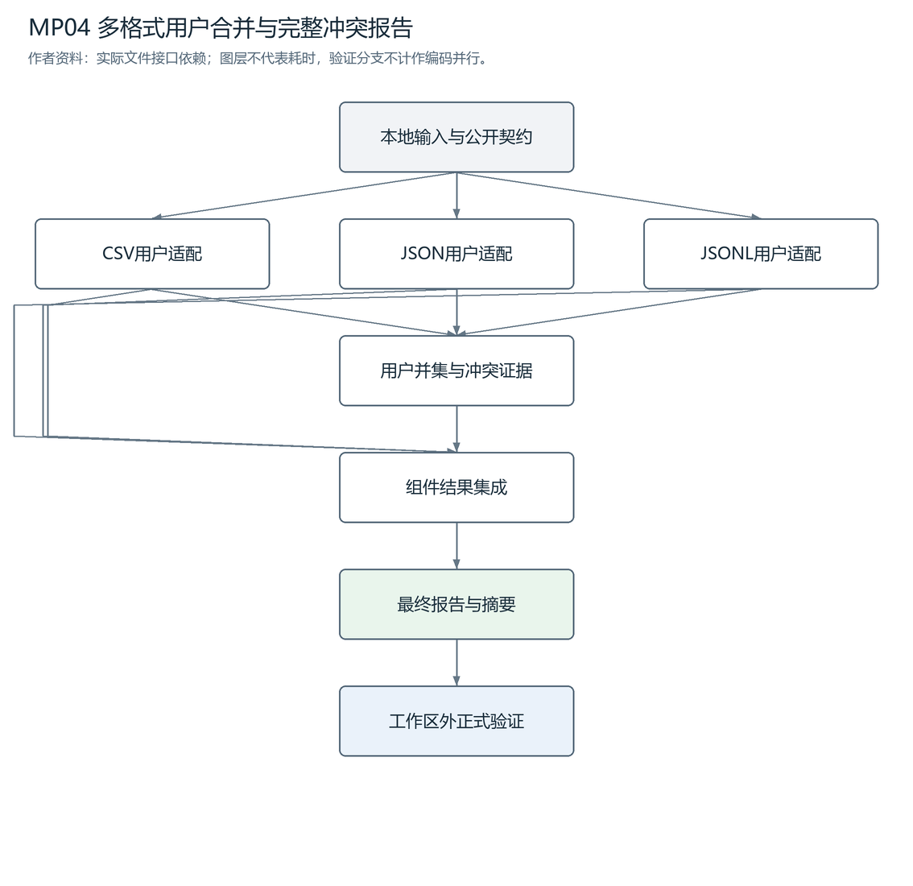
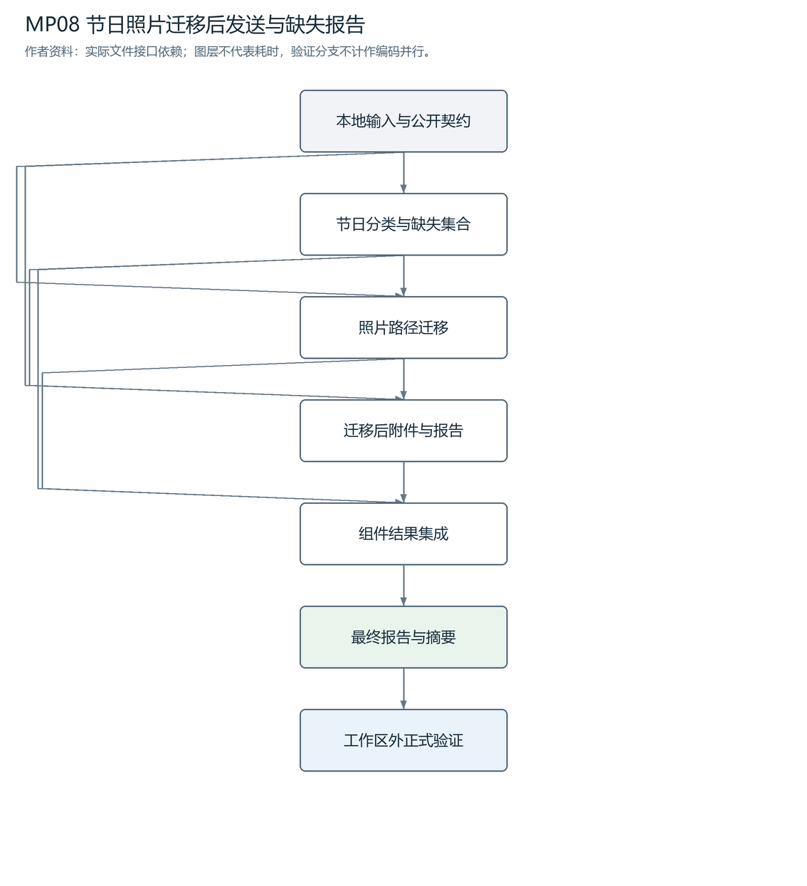
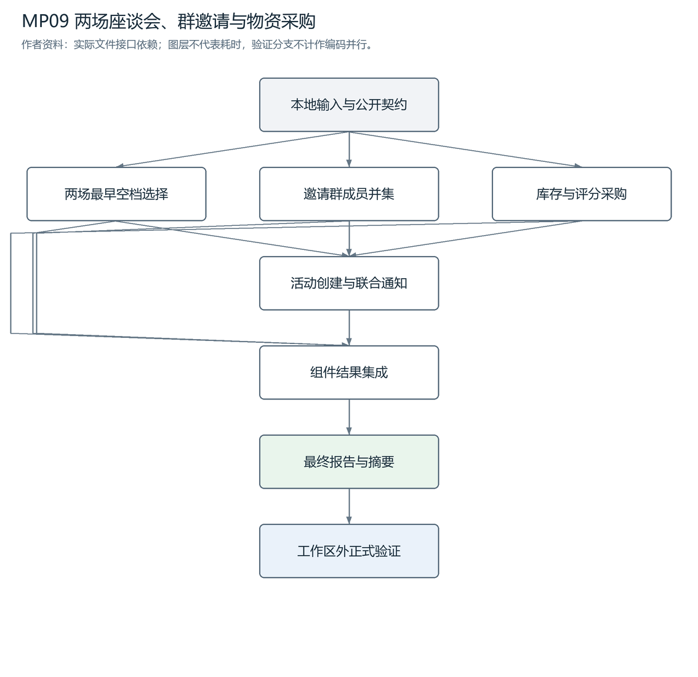
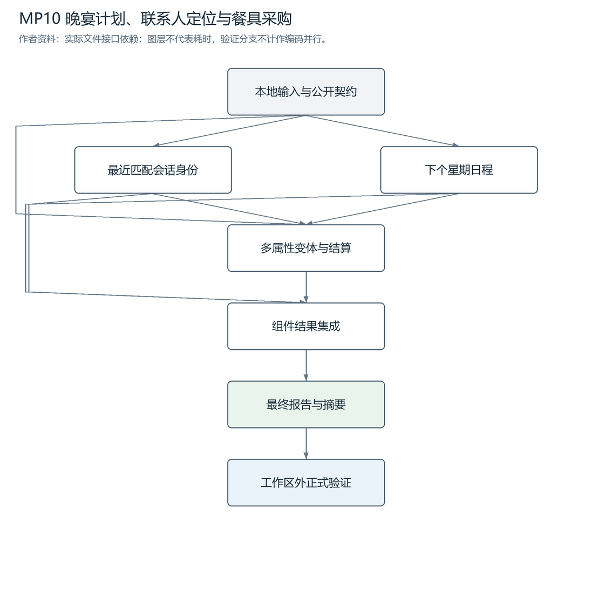
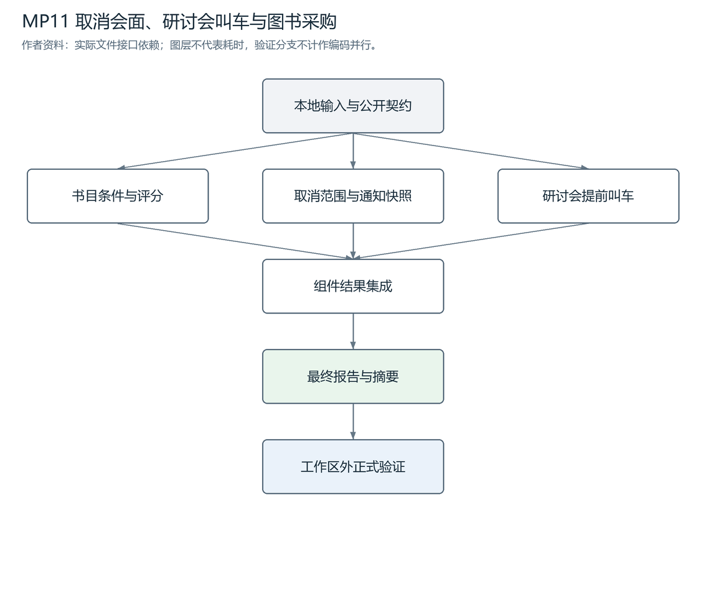
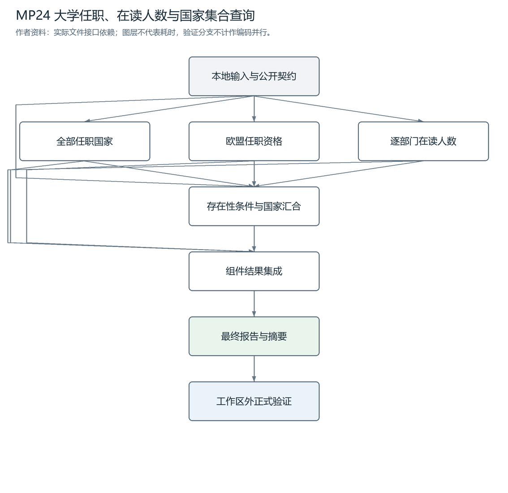

# 独立六题核心版v3：任务目录与DAG

六道核心版任务独立发布；分档使用核心完成率，稳健性独立报告。每题说明链接指向正式TASK及README，作者DAG由实际contract.inputs生成。

[当前难度分级标准](难度分级标准_v3.md) · [验收结果](../review/validation_report.json) · [来源与范围](../NOTICE.md)

## MP04 · 多格式用户合并与完整冲突报告

风格：`multistage4`；实现单元：4；[TASK](../tasks/multistage4/multiformat_user_merge/TASK.md) · [完整接口规格](../tasks/multistage4/multiformat_user_merge/workspace/README.md)。
三格式的缺失值、类型、优先级与完整冲突证据需要一致，标准解析与集合规则即可解决。

## MP08 · 节日照片迁移后发送与缺失报告

风格：`linux2`；实现单元：3；[TASK](../tasks/linux2/holiday_photo_migration/TASK.md) · [完整接口规格](../tasks/linux2/holiday_photo_migration/workspace/README.md)。
照片分类、部分成功、缺失证据及先移后发的路径约束相结合，不等待用户回答。

## MP09 · 两场座谈会、群邀请与物资采购

风格：`reasoning4`；实现单元：4；[TASK](../tasks/reasoning4/panel_events_procurement/TASK.md) · [完整接口规格](../tasks/reasoning4/panel_events_procurement/workspace/README.md)。
有限日历空档/日期计算、群集合和商品 argmax 三路合并，各算法标准且范围受控。

## MP10 · 晚宴计划、联系人定位与餐具采购

风格：`context8`；实现单元：3；[TASK](../tasks/context8/dinner_contact_checkout/TASK.md) · [完整接口规格](../tasks/context8/dinner_contact_checkout/workspace/README.md)。
晚宴计划、最近会话身份和多属性变体选择形成稳定三接口，无预算最优化或取消补偿。

## MP11 · 取消会面、研讨会叫车与图书采购

风格：`reasoning4`；实现单元：3；[TASK](../tasks/reasoning4/meeting_ride_book_plan/TASK.md) · [完整接口规格](../tasks/reasoning4/meeting_ride_book_plan/workspace/README.md)。
日历范围筛选、提前量与书目条件独立求解，只在取消后通知处有真实局部顺序。

## MP24 · 大学任职、在读人数与国家集合查询

风格：`reasoning4`；实现单元：4；[TASK](../tasks/reasoning4/university_relation_query/TASK.md) · [完整接口规格](../tasks/reasoning4/university_relation_query/workspace/README.md)。
A1/S0/C1/I1：受限关系关联、日期筛选与 distinct 计数。来源歧义属于质量修订而非 H。

