# 六套Harness：GLM low与V4 Pro普通模式完整对比

> GitHub发布版：图表与数据使用相对路径；本机绝对路径已转换为`local-artifacts://`来源定位符，数值、布尔、null与异常标签保持不变。未包含原始提示、工具输出、凭据或正式隐藏测试。
> [下载完整报告包](report-bundle.zip) · [162份逐题CSV](data/cells-162.csv) · [汇总数据](data/summary.json) · [导出验收](EXPORT_AUDIT.json)

**更新日期：2026年11月10日｜已补入V4普通Medium5的30份既有结果｜同一新版Reward口径**

本报告在前版基础上增加 Nanobot、OpenCode、Codex、DSH、LangGraph、LATTE planning-adapted 在 **Medium5：MP01/02/03/05/06** 上的 V4 Pro 普通模式结果。六套Harness现在均有两种模型配置下的Core6六题与Medium5五题：**主矩阵132题位＝6×2×11**；另保留原30个high/explicit补充条件，合计 **162份选定提交**。

**新增结果全部复用已完成试次，没有重新调用模型。** 30份保留代码按前版已冻结、已验收的同一评分器离线重评，原题目、verifier、attempt和旧分数不覆盖；前版132份结果的每个原字段及18组汇总逐项保持不变。

## 1. 新增结果与可比性核对

- 新增V4 Medium5 **30/30** 份均有保存提交和原始评分；与GLM Medium5的题面/README、保护输入、契约及冻结用例摘要一致，5题版本匹配。
- 使用同一 `delivery-bonus-50-v1-local-migration-r2` 代码、清单与容器镜像离线验收；**新增严格通过2/30，均为Codex（MP02、MP05）**。其余保留部分得分，LATTE5题保留非零Agent退出标签，其中2题有zero-graph记录。
- 新增30份实际模型请求 **1628/1628** 有usage结算，unknown0；原估算费用 **USD7.626251776**。这些是历史调用与成本，**不是此次更新新增的调用或费用**。
- 加入后主矩阵Strict为 **56/132**；补充条件为 **23/30**；合计 **79/162**。不同任务/模型/提示条件分别分析，不用这个合计给单一Harness排名。
- **跨批次限制**：V4 Medium5来自2026-11-05/06；GLM主要来自11月9/10日。任务和评分一致，Harness版本、适配配置、输出预算、并发与服务延迟可能不同。因此可作当前已有结果的对照，不能当成只替换模型的严格控制变量实验。

V4 Chat请求的实际设置为`thinking=disabled`；历史Codex Responses协议为`reasoning.effort=none`（日志thinking_type为none）。两种协议均核查为当时的普通模式，不把未填写的未知值冒充普通模式。工具字段客户端省略与观测未知分开保留。

## 2. 六Harness × 四组条件的总体矩阵

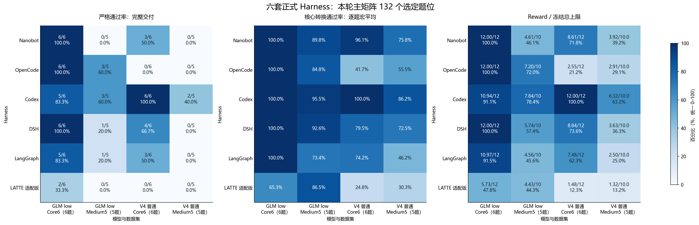

*图：严格通过、核心转换宏平均与标准化Reward；纵轴Harness，横轴模型与数据集。来源：截至2026-11-10的选定提交；V4 Medium5来自11月5/6日历史批次，其余主表沿用先前报告。*

| Harness | GLM Core6：Strict；Reward | GLM Medium5：Strict；Reward | V4普通 Core6：Strict；Reward | V4普通 Medium5：Strict；Reward |
| --- | --- | --- | --- | --- |
| Nanobot | 6/6；12.000000/12 | 0/5；4.610932/10 | 3/6；8.611862/12 | 0/5；3.919176/10.0 |
| OpenCode | 6/6；12.000000/12 | 3/5；7.200000/10 | 0/6；2.549215/12 | 0/5；2.905734/10.0 |
| Codex | 5/6；10.935484/12 | 3/5；7.838710/10 | 6/6；12.000000/12 | 2/5；6.321057/10.0 |
| DSH | 6/6；12.000000/12 | 1/5；5.735932/10 | 4/6；8.837838/12 | 0/5；3.627061/10.0 |
| LangGraph | 5/6；10.974359/12 | 1/5；4.560932/10 | 3/6；7.480695/12 | 0/5；2.503226/10.0 |
| LATTE 适配版 | 2/6；5.730158/12 | 0/5；4.431900/10 | 0/6；1.476025/12 | 0/5；1.323477/10.0 |

### 评分与指标定义

`Reward = I × W × (0.5 × K/N + 0.5 × S)`，本轮W始终按任务发布冻结为2。`N=|A|+|B|+|D|+1`；分母不因缺实现、异常、超时或无效提交而删除。精确K/N计算，单题最终六位ROUND_HALF_UP后求和。

- **I：完整性**。保护文件不合格时无效提交，Reward0，保留标签。
- **A：核心转换用例**。直接transform的业务/契约验收；原“API准确率”现称“核心转换用例通过率”，不是HTTP成功率。主报逐题宏平均，另列通过总数/固定总数的微平均。
- **B：独立接口bundle**。每组件一个单元，加载器、全新root直接构建的两组合法输入、适用parser全部通过才计1。
- **D：产物/集成**。独立重建并对照可信组件、core_manifest和final_report结果。
- **P：公开入口**。干净副本check.py正常结束；进入核心分母与Strict门槛。
- **S：Strict Pass**。完整性有效且A、B、D、P全部通过，才获得50%完整交付奖励。
- **R：独立可选稳健性**。不扣核心Reward、不决定Strict；Full Spec=Strict且R全过。Medium5无独立R记N/A，保留其原有限JSON契约。

任务Strict与运行监控健康、多Agent触发是不同指标。原输出上限、EPIPE、非零退出、累计token cap、无效提交、unknown等标签不因离线重评分而删除。

## 3. 直接模型对照：Core6与Medium5分别比较

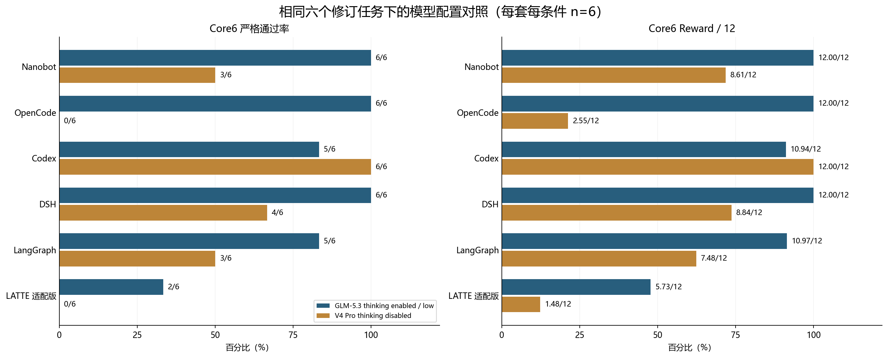

*图：相同Core6六题下的GLM low与V4普通结果，分母每组6题。来源：截至2026-11-10的选定提交；V4 Medium5来自11月5/6日历史批次，其余主表沿用先前报告。*

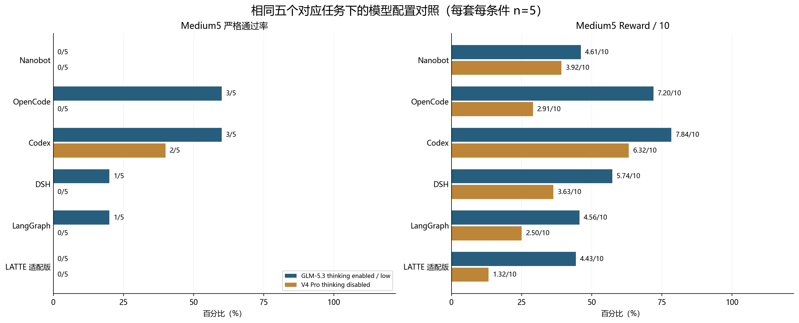

*图：相同Medium5五题下的GLM low与V4普通结果，分母每组5题；V4为历史批次。来源：截至2026-11-10的选定提交；V4 Medium5来自11月5/6日历史批次，其余主表沿用先前报告。*

GLM low在Core6六套合计30/36严格通过，V4普通16/36；Medium5分别为8/30与2/30。这个差异只描述所选小样本及当前配置，不能据此判定普遍的模型或Harness排名。修复版OpenCode GLM使用单响应65536输出预算，其余沿原冻结配置，预算并未统一。

## 4. GLM low · 修订 Core6：逐题与分组质量

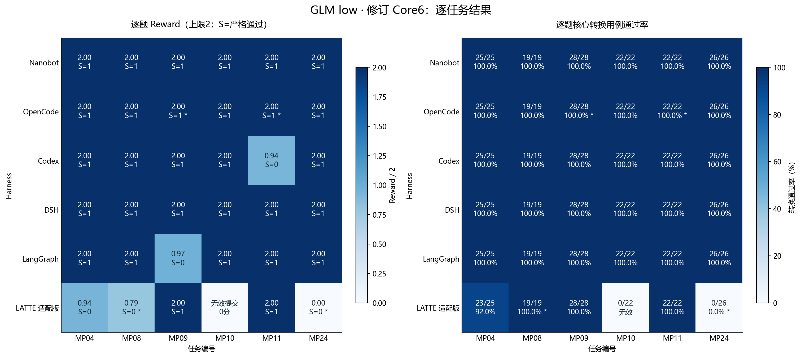

*图：GLM low · 修订 Core6逐任务Reward与核心转换用例热力图。S表示Strict；星号为原运行异常标签，无效提交不剔除。来源：截至2026-11-10的选定提交；V4 Medium5来自11月5/6日历史批次，其余主表沿用先前报告。*

| Harness | Public | Strict | 转换宏平均 | 转换通过/总数（微平均） | 接口B | 产物D | Reward |
| --- | --- | --- | --- | --- | --- | --- | --- |
| Nanobot | 6/6 | 6/6 | 100.0% | 142/142（100.0%） | 21/21 | 33/33 | 12.000000/12 |
| OpenCode | 6/6 | 6/6 | 100.0% | 142/142（100.0%） | 21/21 | 33/33 | 12.000000/12 |
| Codex | 6/6 | 5/6 | 100.0% | 142/142（100.0%） | 19/21 | 33/33 | 10.935484/12 |
| DSH | 6/6 | 6/6 | 100.0% | 142/142（100.0%） | 21/21 | 33/33 | 12.000000/12 |
| LangGraph | 6/6 | 5/6 | 100.0% | 142/142（100.0%） | 20/21 | 33/33 | 10.974359/12 |
| LATTE 适配版 | 3/6 | 2/6 | 65.3% | 92/142（64.8%） | 14/21 | 17/33 | 5.730158/12 |

## 5. GLM low · Medium5：逐题与分组质量

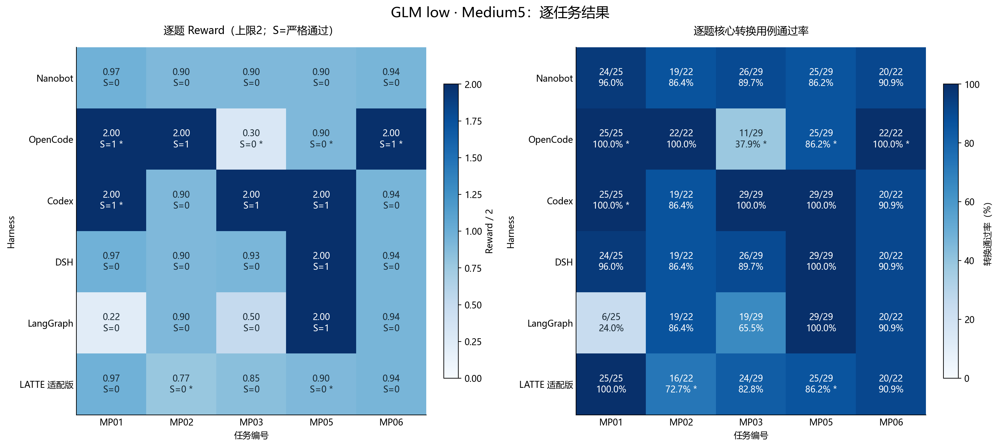

*图：GLM low · Medium5逐任务Reward与核心转换用例热力图。S表示Strict；星号为原运行异常标签，无效提交不剔除。来源：截至2026-11-10的选定提交；V4 Medium5来自11月5/6日历史批次，其余主表沿用先前报告。*

| Harness | Public | Strict | 转换宏平均 | 转换通过/总数（微平均） | 接口B | 产物D | Reward |
| --- | --- | --- | --- | --- | --- | --- | --- |
| Nanobot | 5/5 | 0/5 | 89.8% | 114/127（89.8%） | 17/18 | 28/28 | 4.610932/10 |
| OpenCode | 5/5 | 3/5 | 84.8% | 105/127（82.7%） | 14/18 | 22/28 | 7.200000/10 |
| Codex | 5/5 | 3/5 | 95.5% | 122/127（96.1%） | 18/18 | 28/28 | 7.838710/10 |
| DSH | 5/5 | 1/5 | 92.6% | 118/127（92.9%） | 18/18 | 28/28 | 5.735932/10 |
| LangGraph | 3/5 | 1/5 | 73.4% | 93/127（73.2%） | 12/18 | 17/28 | 4.560932/10 |
| LATTE 适配版 | 5/5 | 0/5 | 86.5% | 110/127（86.6%） | 16/18 | 27/28 | 4.431900/10 |

## 6. V4 普通 · 修订 Core6：逐题与分组质量

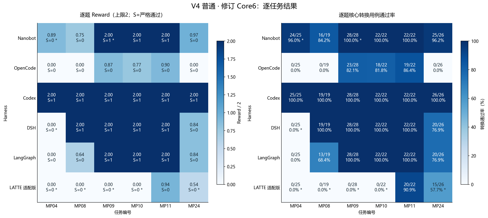

*图：V4 普通 · 修订 Core6逐任务Reward与核心转换用例热力图。S表示Strict；星号为原运行异常标签，无效提交不剔除。来源：截至2026-11-10的选定提交；V4 Medium5来自11月5/6日历史批次，其余主表沿用先前报告。*

| Harness | Public | Strict | 转换宏平均 | 转换通过/总数（微平均） | 接口B | 产物D | Reward |
| --- | --- | --- | --- | --- | --- | --- | --- |
| Nanobot | 5/6 | 3/6 | 96.1% | 137/142（96.5%） | 20/21 | 28/33 | 8.611862/12 |
| OpenCode | 3/6 | 0/6 | 41.7% | 60/142（42.3%） | 7/21 | 16/33 | 2.549215/12 |
| Codex | 6/6 | 6/6 | 100.0% | 142/142（100.0%） | 21/21 | 33/33 | 12.000000/12 |
| DSH | 5/6 | 4/6 | 79.5% | 111/142（78.2%） | 17/21 | 27/33 | 8.837838/12 |
| LangGraph | 5/6 | 3/6 | 74.2% | 105/142（73.9%） | 16/21 | 24/33 | 7.480695/12 |
| LATTE 适配版 | 2/6 | 0/6 | 24.8% | 35/142（24.6%） | 5/21 | 7/33 | 1.476025/12 |

## 7. V4 普通 · Medium5：逐题与分组质量

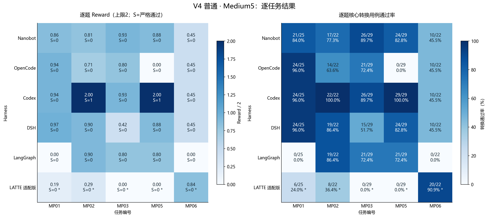

*图：V4 普通 · Medium5逐任务Reward与核心转换用例热力图。S表示Strict；星号为原运行异常标签，无效提交不剔除。来源：截至2026-11-10的选定提交；V4 Medium5来自11月5/6日历史批次，其余主表沿用先前报告。*

| Harness | Public | Strict | 转换宏平均 | 转换通过/总数（微平均） | 接口B | 产物D | Reward |
| --- | --- | --- | --- | --- | --- | --- | --- |
| Nanobot | 5/5 | 0/5 | 75.8% | 98/127（77.2%） | 15/18 | 24/28 | 3.919176/10.0 |
| OpenCode | 4/5 | 0/5 | 55.5% | 69/127（54.3%） | 11/18 | 18/28 | 2.905734/10.0 |
| Codex | 5/5 | 2/5 | 86.2% | 111/127（87.4%） | 16/18 | 24/28 | 6.321057/10.0 |
| DSH | 5/5 | 0/5 | 72.5% | 92/127（72.4%） | 13/18 | 19/28 | 3.627061/10.0 |
| LangGraph | 3/5 | 0/5 | 46.2% | 61/127（48.0%） | 11/18 | 17/28 | 2.503226/10.0 |
| LATTE 适配版 | 0/5 | 0/5 | 30.3% | 34/127（26.8%） | 5/18 | 3/28 | 1.323477/10.0 |

新增V4 Medium5中，Codex的MP02与MP05完整交付，其他题仍存在转换、接口或产物失败。LATTE五题均保留NonZeroAgentExitCodeError；MP03和MP05另有zero-graph无LATTE summary记录。这类结果不能笼统描述成模型正常作答后的纯能力负例。

### 可选稳健性单列（不改变核心Strict及Reward）

| Harness | GLM Core6：R | GLM Core6：Full Spec | V4 Core6：R | V4 Core6：Full Spec | 两模型Medium5 |
| --- | --- | --- | --- | --- | --- |
| Nanobot | 46/168 | 0/6 | 40/168 | 0/6 | R / Full Spec均N/A |
| OpenCode | 42/168 | 0/6 | 20/168 | 0/6 | R / Full Spec均N/A |
| Codex | 46/168 | 0/6 | 42/168 | 0/6 | R / Full Spec均N/A |
| DSH | 42/168 | 0/6 | 34/168 | 0/6 | R / Full Spec均N/A |
| LangGraph | 46/168 | 0/6 | 32/168 | 0/6 | R / Full Spec均N/A |
| LATTE 适配版 | 28/168 | 0/6 | 16/168 | 0/6 | R / Full Spec均N/A |

## 8. Public与完整交付：不要只看API率

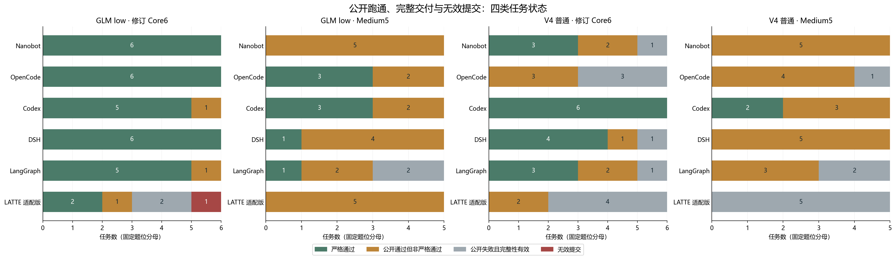

*图：Strict通过、公开通过但非Strict、公开失败且完整性有效、无效提交四种状态；不是Agent正常退出率。来源：截至2026-11-10的选定提交；V4 Medium5来自11月5/6日历史批次，其余主表沿用先前报告。*

| 模型 / Harness | 任务 | 转换用例 | Public | Strict | 失败的核心组 |
| --- | --- | --- | --- | --- | --- |
| GLM low / LATTE 适配版 | Core6/MP08 | 19/19 | 0 | 0 | D,P |
| GLM low / LangGraph | Core6/MP09 | 28/28 | 1 | 0 | B |
| GLM low / Codex | Core6/MP11 | 22/22 | 1 | 0 | B |
| GLM low / LATTE 适配版 | Medium5/MP01 | 25/25 | 1 | 0 | D |

例如GLM Codex MP11转换22/22，但ride/books加载器接受契约禁止的标量顶层，B仅1/3，因此Strict0、Reward0.935484/2。补齐V4 Medium5后仍按相同接口门槛判断，不为新旧批次放宽要求。

## 9. 原始E2E、tokens与输入缓存

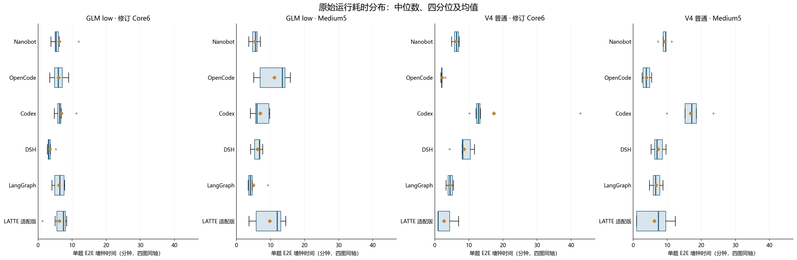

*图：单题E2E分布，单位分钟；箱体Q1–Q3，箱内线中位数，金色菱形均值，圆点为离群值；四图同轴。来源：截至2026-11-10的选定提交；V4 Medium5来自11月5/6日历史批次，其余主表沿用先前报告。*

E2E保留模型运行的controller起止墙钟区间，含环境/Agent/当次verifier开销，不含本次离线评分。新增V4 Medium5由trial-consumption启动记录至outcome.finished_at复原，逐题保存计量依据。不同日期的服务延迟、版本与并发会影响时长；每组5/6题只是描述分布。

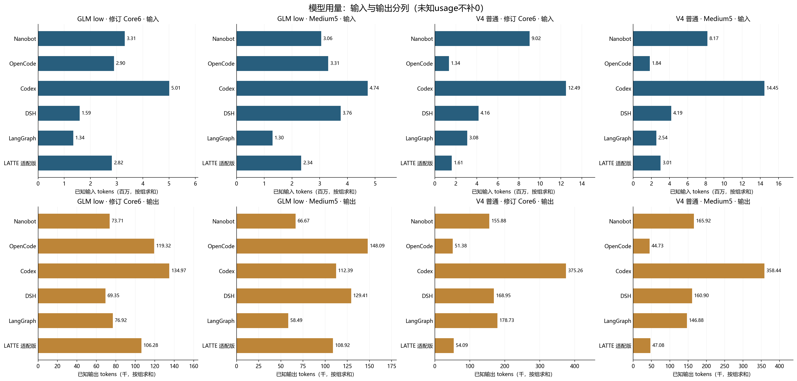

*图：按组汇总的已知输入/输出tokens；上排百万输入、下排千输出，子图按标注刻度读值。来源：截至2026-11-10的选定提交；V4 Medium5来自11月5/6日历史批次，其余主表沿用先前报告。*

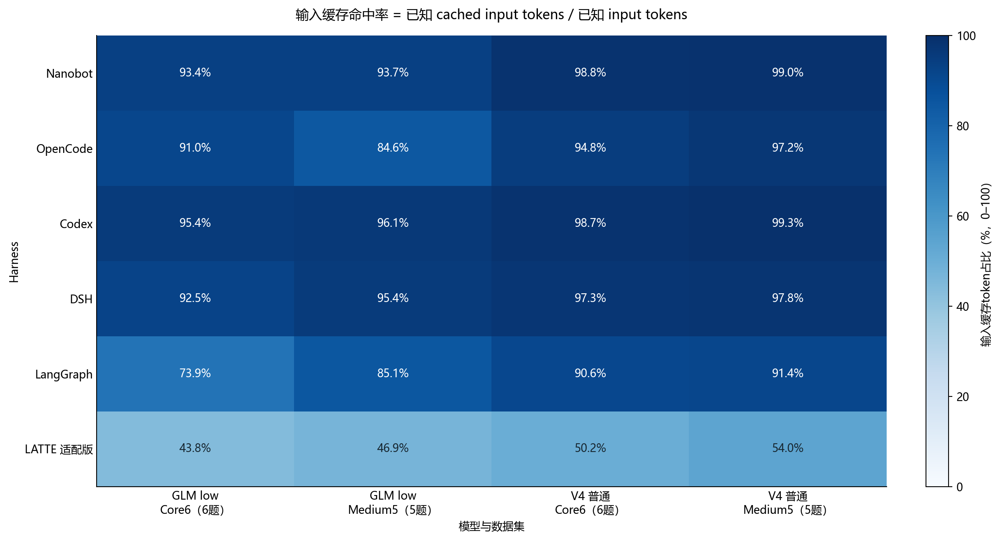

*图：API usage返回的已知缓存输入tokens / 已知输入tokens，非请求命中比例或GPU内部KV物理命中率。来源：截至2026-11-10的选定提交；V4 Medium5来自11月5/6日历史批次，其余主表沿用先前报告。*

### GLM low · 修订 Core6：原始运行指标

| Harness | 平均/中位E2E（分） | 输入tokens | 输出tokens | 输入缓存tokens | 缓存比例 | 结算/发出 | unknown | 原异常题 |
| --- | --- | --- | --- | --- | --- | --- | --- | --- |
| Nanobot | 6.22 / 5.28 | 3,308,207 | 73,710 | 3,088,832 | 93.4% | 174/174 | 0 | 0 |
| OpenCode | 6.01 / 5.89 | 2,897,042 | 119,323 | 2,637,120 | 91.0% | 130/130 | 0 | 2 |
| Codex | 6.82 / 6.29 | 5,008,705 | 134,966 | 4,777,280 | 95.4% | 162/162 | 0 | 0 |
| DSH | 3.46 / 3.12 | 1,588,270 | 69,349 | 1,469,184 | 92.5% | 102/102 | 0 | 0 |
| LangGraph | 6.16 / 6.38 | 1,344,036 | 76,921 | 993,600 | 73.9% | 237/237 | 0 | 0 |
| LATTE 适配版 | 6.26 / 7.42 | 2,819,473 | 106,285 | 1,233,728 | 43.8% | 609/609 | 0 | 3 |

### GLM low · Medium5：原始运行指标

| Harness | 平均/中位E2E（分） | 输入tokens | 输出tokens | 输入缓存tokens | 缓存比例 | 结算/发出 | unknown | 原异常题 |
| --- | --- | --- | --- | --- | --- | --- | --- | --- |
| Nanobot | 5.39 / 5.59 | 3,055,676 | 66,674 | 2,863,680 | 93.7% | 144/144 | 0 | 0 |
| OpenCode | 11.10 / 13.48 | 3,310,180 | 148,090 | 2,800,128 | 84.6% | 108/108 | 0 | 4 |
| Codex | 6.99 / 6.00 | 4,735,257 | 112,393 | 4,550,528 | 96.1% | 152/152 | 0 | 1 |
| DSH | 6.15 / 6.78 | 3,757,846 | 129,411 | 3,586,624 | 95.4% | 142/142 | 0 | 0 |
| LangGraph | 4.97 / 4.05 | 1,297,788 | 58,494 | 1,104,832 | 85.1% | 165/165 | 0 | 0 |
| LATTE 适配版 | 9.76 / 11.94 | 2,336,168 | 108,919 | 1,096,320 | 46.9% | 544/545 | 1 | 2 |

### V4 普通 · 修订 Core6：原始运行指标

| Harness | 平均/中位E2E（分） | 输入tokens | 输出tokens | 输入缓存tokens | 缓存比例 | 结算/发出 | unknown | 原异常题 |
| --- | --- | --- | --- | --- | --- | --- | --- | --- |
| Nanobot | 6.24 / 6.38 | 9,024,222 | 155,877 | 8,912,000 | 98.8% | 305/305 | 0 | 2 |
| OpenCode | 2.16 / 2.02 | 1,344,880 | 51,380 | 1,275,520 | 94.8% | 90/90 | 0 | 0 |
| Codex | 17.30 / 12.76 | 12,492,787 | 375,260 | 12,329,088 | 98.7% | 271/271 | 0 | 0 |
| DSH | 8.57 / 8.19 | 4,158,332 | 168,954 | 4,047,104 | 97.3% | 153/153 | 0 | 1 |
| LangGraph | 4.44 / 4.42 | 3,079,397 | 178,728 | 2,791,424 | 90.6% | 358/358 | 0 | 0 |
| LATTE 适配版 | 2.69 / 0.95 | 1,610,788 | 54,090 | 808,832 | 50.2% | 337/337 | 0 | 5 |

### V4 普通 · Medium5：原始运行指标

| Harness | 平均/中位E2E（分） | 输入tokens | 输出tokens | 输入缓存tokens | 缓存比例 | 结算/发出 | unknown | 原异常题 |
| --- | --- | --- | --- | --- | --- | --- | --- | --- |
| Nanobot | 9.31 / 9.55 | 8,166,140 | 165,921 | 8,084,736 | 99.0% | 248/248 | 0 | 0 |
| OpenCode | 3.92 / 3.85 | 1,841,004 | 44,731 | 1,789,696 | 97.2% | 122/122 | 0 | 0 |
| Codex | 16.87 / 17.21 | 14,453,133 | 358,435 | 14,353,024 | 99.3% | 249/249 | 0 | 0 |
| DSH | 7.34 / 7.00 | 4,194,156 | 160,898 | 4,101,504 | 97.8% | 139/139 | 0 | 0 |
| LangGraph | 6.73 / 6.55 | 2,542,384 | 146,882 | 2,323,584 | 91.4% | 295/295 | 0 | 0 |
| LATTE 适配版 | 6.25 / 7.40 | 3,013,492 | 47,078 | 1,628,160 | 54.0% | 575/575 | 0 | 5 |

GLM LATTE Medium MP05的一条usage仍未知；不将它当0或cache miss。高缓存占比不能单独证明更低总token、更高速度或更便宜。

## 10. 费用估算与结算范围

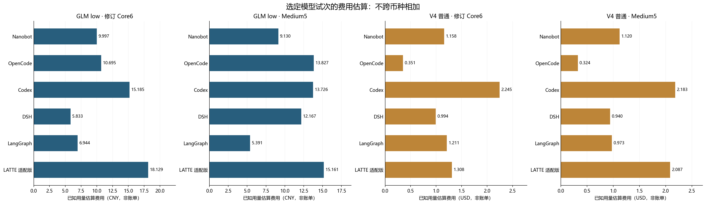

*图：当前四组主对比的已知用量估算，GLM为CNY、V4为USD，非供应商账单；不跨币种相加。来源：截至2026-11-10的选定提交；V4 Medium5来自11月5/6日历史批次，其余主表沿用先前报告。*

| 范围 | 已知费用估算 | 结算/发出 | unknown | 说明 |
| --- | --- | --- | --- | --- |
| GLM 当前选定66题 | CNY 136.185028 | 2669/2670 | 1 | 已换入修复OpenCode11题 |
| GLM 含被替换旧11题 | CNY 141.825960 | 2766/2767 | 1 | 两版模型运行均确实发生，不把旧成本抹去 |
| 新增纳入的V4 Medium5历史30题 | USD 7.626251776 | 1628/1628 | 0 | 旧模型请求，此次仅离线重评 |
| 报告所选V4合计96题 | USD 26.922941408 | 4738/4738 | 0 | V4主对比66题＋原补充30题 |
| 本次更新新调用模型 | 0 | 0/0 | 0 | 没有重跑模型，没有新API费用 |

估算来自各原批次冻结价格与已知usage；不包括unknown请求成本，也没有核对供应商最终账单。V4合计只包含本报告选择的96题，不代表整个历史Medium26或全部旧实验支出。

## 11. 同一份选定提交的新旧评分与敏感性

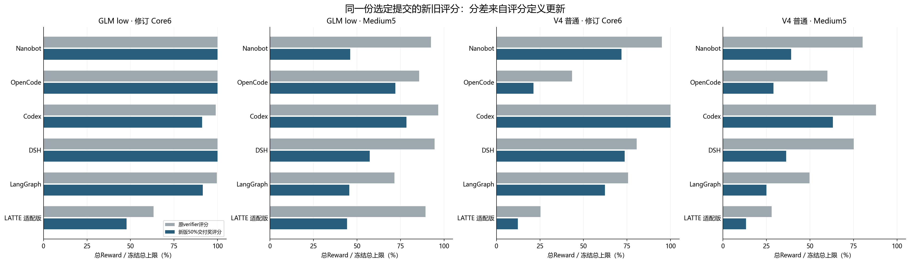

*图：同一份当前选定提交，原verifier与新版Reward的总分比例；差值是评分定义变化，不是再次运行模型的退步。来源：截至2026-11-10的选定提交；V4 Medium5来自11月5/6日历史批次，其余主表沿用先前报告。*

下面在相同I、W、K/N、Strict上仅改变交付奖权重；50%列为正式结果。新版统一A/B/D/P与独立接口门槛，分数不能和未经迁移的旧Reward混合。

| 模型 / 数据集 | Harness | 20%交付奖 | 30%交付奖 | 50%交付奖（正式） |
| --- | --- | --- | --- | --- |
| GLM low / Core6 | Nanobot | 12.000000 | 12.000000 | 12.000000 |
| GLM low / Core6 | OpenCode | 12.000000 | 12.000000 | 12.000000 |
| GLM low / Core6 | Codex | 11.496774 | 11.309677 | 10.935484 |
| GLM low / Core6 | DSH | 12.000000 | 12.000000 | 12.000000 |
| GLM low / Core6 | LangGraph | 11.558974 | 11.364103 | 10.974359 |
| GLM low / Core6 | LATTE 适配版 | 6.768254 | 6.422222 | 5.730158 |
| GLM low / Medium5 | Nanobot | 7.377491 | 6.455304 | 4.610932 |
| GLM low / Medium5 | OpenCode | 7.920000 | 7.680000 | 7.200000 |
| GLM low / Medium5 | Codex | 8.941935 | 8.574193 | 7.838710 |
| GLM low / Medium5 | DSH | 7.977491 | 7.230304 | 5.735932 |
| GLM low / Medium5 | LangGraph | 6.097491 | 5.585304 | 4.560932 |
| GLM low / Medium5 | LATTE 适配版 | 7.091040 | 6.204659 | 4.431900 |
| V4 normal / Core6 | Nanobot | 10.178979 | 9.656606 | 8.611862 |
| V4 normal / Core6 | OpenCode | 4.078743 | 3.568900 | 2.549215 |
| V4 normal / Core6 | Codex | 12.000000 | 12.000000 | 12.000000 |
| V4 normal / Core6 | DSH | 9.340541 | 9.172973 | 8.837838 |
| V4 normal / Core6 | LangGraph | 8.369112 | 8.072973 | 7.480695 |
| V4 normal / Core6 | LATTE 适配版 | 2.361639 | 2.066434 | 1.476025 |
| V4 normal / Medium5 | Nanobot | 6.270682 | 5.486846 | 3.919176 |
| V4 normal / Medium5 | OpenCode | 4.649176 | 4.068028 | 2.905734 |
| V4 normal / Medium5 | Codex | 7.713692 | 7.249480 | 6.321057 |
| V4 normal / Medium5 | DSH | 5.803298 | 5.077885 | 3.627061 |
| V4 normal / Medium5 | LangGraph | 4.005161 | 3.504516 | 2.503226 |
| V4 normal / Medium5 | LATTE 适配版 | 2.117562 | 1.852868 | 1.323477 |

## 12. 保留的30个high / explicit补充条件

任务子集不完全平衡（每条件3/4/5/6题），与132主矩阵分列，不把组间比例差直接解释为推理或提示的因果效果。

| 模式 | 条件 | Harness | 题数 | Public | Strict | 转换宏平均 | 转换通过/总数 | Reward |
| --- | --- | --- | --- | --- | --- | --- | --- | --- |
| V4 high | explicit | Codex | 4 | 4/4 | 4/4 | 100.0% | 95/95 | 8.000000/8 |
| V4 high | explicit | DSH | 3 | 3/3 | 3/3 | 100.0% | 72/72 | 6.000000/6 |
| V4 high | native | Codex | 6 | 5/6 | 5/6 | 83.3% | 114/142 | 10.000000/12 |
| V4 high | native | DSH | 6 | 3/6 | 3/6 | 50.0% | 72/142 | 6.000000/12 |
| V4 normal | explicit | Codex | 6 | 6/6 | 6/6 | 100.0% | 142/142 | 12.000000/12 |
| V4 normal | explicit | DSH | 5 | 5/5 | 2/5 | 92.6% | 109/117 | 6.742029/10 |

## 13. 异常、能力结论与适用边界

1. 新纳入V4 Medium5是**历史配置的既有结果**，不冒称本轮新运行。任务与新评分相同，版本/预算/服务日期/并发仍可能不同。
2. GLM OpenCode修复11题中6题仍有server EPIPE，运行监控严格passed仅5/11；任务Strict与原运行异常并存，未擦除失败门禁。
3. GLM LATTE Core6 MP10仍是invalid_submission，Reward0、转换0/22；固定分母保留。新增V4 Medium5的LATTE5题非零退出，另2题zero-graph，不能都解释成正常模型负例。
4. GLM历史unknown1保留，新增30题unknown0不覆盖它。费用是估算、不是账单；unknown不补0。
5. 工具可用、跨trial并发、任务得分与tokens使用量均不自动证明实际多Agent委派。多Agent是否触发仍须原生trace另审。
6. 每套每条件只有5/6题，适合描述本轮选定样本，不作普遍能力排名或显著性结论。

## 14. 数据来源、验收与逐任务附录

- 评分依据：xi474/benchmark `648732fb2b4215f6cb2479830e374139d70f643a`，独立迁移`delivery-bonus-50-v1-local-migration-r2`。
- 前版11参考解、9负例/控制、8官方算术例与冻结代码未改；本次仅用该同版评分器对新增30个保留提交离线验收。新增30个原提交/score哈希复核不变。
- 本报告162份选定提交共 **5568个固定核心验收单元**；旧132行、旧18组汇总逐字段不变，新30行与24组汇总验收通过。
- [全部162份逐题CSV](data/cells-162.csv)、[逐题JSON](data/cells-162.json)、[汇总JSON](data/summary.json)、[任务兼容性](data/task-compatibility.json)、[新增模型模式与usage审计](data/historical-mode-usage-audit.json)、[最终验收](data/final-validation.json)。
- 本地来源目录：`local-artifacts://project/outputs/results-overview-20261110-medium5-v4-r3`。原132图文报告和旧矩阵保留为前版，当前文件覆盖的是加入V4 Medium5后的新选定范围。

展开全部162份选定提交（包含补充条件）

| 模型/条件 | Harness | 任务 | Reward | Public/Strict | 转换用例 | E2E/分 | 输入/输出tokens | 缓存比例 | 估算费用 | 原运行标签 |
| --- | --- | --- | --- | --- | --- | --- | --- | --- | --- | --- |
| GLM low/native | Nanobot | Core6/MP04 | 2.000000/2 | 1/1 | 25/25 | 11.92 | 671,090 / 20,552 | 91.7% | CNY 2.251248 | scored |
| GLM low/native | OpenCode | Core6/MP04 | 2.000000/2 | 1/1 | 25/25 | 8.95 | 711,515 / 33,523 | 93.2% | CNY 2.653676 | scored |
| GLM low/native | DSH | Core6/MP04 | 2.000000/2 | 1/1 | 25/25 | 5.23 | 290,556 / 19,330 | 88.6% | CNY 1.321240 | scored |
| GLM low/native | LangGraph | Core6/MP04 | 2.000000/2 | 1/1 | 25/25 | 7.76 | 379,566 / 20,217 | 81.0% | CNY 1.758636 | scored |
| GLM low/native | LATTE 适配版 | Core6/MP04 | 0.944444/2 | 1/0 | 23/25 | 7.66 | 410,720 / 23,032 | 39.8% | CNY 2.948768 | scored |
| GLM low/native | OpenCode | Core6/MP08 | 2.000000/2 | 1/1 | 19/19 | 7.46 | 598,587 / 24,965 | 92.0% | CNY 2.182244 | scored |
| GLM low/native | Codex | Core6/MP04 | 2.000000/2 | 1/1 | 25/25 | 11.21 | 1,672,309 / 36,073 | 96.2% | CNY 4.737828 | scored |
| GLM low/native | Nanobot | Core6/MP08 | 2.000000/2 | 1/1 | 19/19 | 6.18 | 512,877 / 11,180 | 93.4% | CNY 1.541048 | scored |
| GLM low/native | DSH | Core6/MP08 | 2.000000/2 | 1/1 | 19/19 | 2.73 | 242,872 / 9,124 | 93.2% | CNY 0.839856 | scored |
| GLM low/native | LangGraph | Core6/MP08 | 2.000000/2 | 1/1 | 19/19 | 5.25 | 177,408 / 9,465 | 72.7% | CNY 0.910140 | scored |
| GLM low/native | Codex | Core6/MP08 | 2.000000/2 | 1/1 | 19/19 | 6.43 | 750,359 / 23,057 | 95.1% | CNY 2.368020 | scored |
| GLM low/native | Nanobot | Core6/MP09 | 2.000000/2 | 1/1 | 28/28 | 5.20 | 931,989 / 11,600 | 96.0% | CNY 2.410856 | scored |
| GLM low/native | OpenCode | Core6/MP09 | 2.000000/2 | 1/1 | 28/28 | 4.50 | 478,752 / 12,110 | 96.0% | CNY 1.412360 | scored__OpenCodeTerminalStateError__scored_with_server_epipe |
| GLM low/native | LATTE 适配版 | Core6/MP08 | 0.785714/2 | 0/0 | 19/19 | 8.11 | 556,936 / 19,436 | 51.7% | CNY 3.270928 | scored__NonZeroAgentExitCodeError |
| GLM low/native | DSH | Core6/MP09 | 2.000000/2 | 1/1 | 28/28 | 3.65 | 237,325 / 11,633 | 91.7% | CNY 0.918340 | scored |
| GLM low/native | Codex | Core6/MP09 | 2.000000/2 | 1/1 | 28/28 | 5.59 | 622,806 / 16,280 | 94.6% | CNY 1.903184 | scored |
| GLM low/native | OpenCode | Core6/MP10 | 2.000000/2 | 1/1 | 22/22 | 6.01 | 524,237 / 19,635 | 94.9% | CNY 1.758076 | scored |
| GLM low/native | LangGraph | Core6/MP09 | 0.974359/2 | 1/0 | 28/28 | 7.64 | 204,720 / 13,181 | 66.4% | CNY 1.191212 | scored |
| GLM low/native | Nanobot | Core6/MP10 | 2.000000/2 | 1/1 | 22/22 | 5.36 | 672,445 / 9,047 | 95.4% | CNY 1.782892 | scored |
| GLM low/native | LATTE 适配版 | Core6/MP09 | 2.000000/2 | 1/1 | 28/28 | 8.34 | 652,465 / 24,353 | 41.5% | CNY 4.277668 | scored |
| GLM low/native | DSH | Core6/MP10 | 2.000000/2 | 1/1 | 22/22 | 3.27 | 196,301 / 11,366 | 90.8% | CNY 0.819216 | scored |
| GLM low/native | Codex | Core6/MP10 | 2.000000/2 | 1/1 | 22/22 | 4.73 | 609,072 / 14,329 | 95.9% | CNY 1.770556 | scored |
| GLM low/native | Nanobot | Core6/MP11 | 2.000000/2 | 1/1 | 22/22 | 3.74 | 177,380 / 8,069 | 84.8% | CNY 0.742188 | scored |
| GLM low/native | LangGraph | Core6/MP10 | 2.000000/2 | 1/1 | 22/22 | 7.51 | 261,494 / 12,340 | 73.6% | CNY 1.282016 | scored |
| GLM low/native | OpenCode | Core6/MP11 | 2.000000/2 | 1/1 | 22/22 | 3.40 | 255,650 / 9,332 | 80.7% | CNY 1.069248 | scored__OpenCodeTerminalStateError__scored_with_server_epipe |
| GLM low/native | LATTE 适配版 | Core6/MP10 | 0.000000/2 | 0/0 | 0/22 | 7.17 | 734,039 / 19,103 | 38.4% | CNY 4.714524 | invalid_submission |
| GLM low/native | DSH | Core6/MP11 | 2.000000/2 | 1/1 | 22/22 | 2.96 | 363,999 / 8,316 | 95.7% | CNY 1.054728 | scored |
| GLM low/native | Codex | Core6/MP11 | 0.935484/2 | 1/0 | 22/22 | 6.15 | 648,534 / 21,828 | 95.0% | CNY 2.102304 | scored |
| GLM low/native | LangGraph | Core6/MP11 | 2.000000/2 | 1/1 | 22/22 | 4.73 | 138,042 / 8,923 | 64.5% | CNY 0.819652 | scored |
| GLM low/native | LATTE 适配版 | Core6/MP11 | 2.000000/2 | 1/1 | 22/22 | 4.97 | 412,604 / 18,963 | 46.8% | CNY 2.672884 | scored |
| GLM low/native | OpenCode | Core6/MP24 | 2.000000/2 | 1/1 | 26/26 | 5.77 | 328,301 / 19,758 | 79.2% | CNY 1.619056 | scored |
| GLM low/native | Nanobot | Core6/MP24 | 2.000000/2 | 1/1 | 26/26 | 4.89 | 342,426 / 13,262 | 89.7% | CNY 1.268312 | scored |
| GLM low/native | DSH | Core6/MP24 | 2.000000/2 | 1/1 | 26/26 | 2.90 | 257,217 / 9,580 | 93.7% | CNY 0.879448 | scored |
| GLM low/native | LATTE 适配版 | Core6/MP24 | 0.000000/2 | 0/0 | 0/26 | 1.33 | 52,709 / 1,398 | 68.4% | CNY 0.244624 | scored__NonZeroAgentExitCodeError |
| GLM low/native | Codex | Core6/MP24 | 2.000000/2 | 1/1 | 26/26 | 6.79 | 705,625 / 23,399 | 94.4% | CNY 2.303116 | scored |
| GLM low/native | LangGraph | Core6/MP24 | 2.000000/2 | 1/1 | 26/26 | 4.06 | 182,806 / 12,795 | 76.4% | CNY 0.982820 | scored |
| GLM low/native | OpenCode | Medium5/MP01 | 2.000000/2 | 1/1 | 25/25 | 13.48 | 730,604 / 34,256 | 80.5% | CNY 3.276192 | scored__OpenCodeTerminalStateError__scored_with_server_epipe |
| GLM low/native | Nanobot | Medium5/MP01 | 0.972222/2 | 1/0 | 24/25 | 6.05 | 328,299 / 14,069 | 88.1% | CNY 1.285028 | scored |
| GLM low/native | DSH | Medium5/MP01 | 0.972222/2 | 1/0 | 24/25 | 5.29 | 439,264 / 23,324 | 93.0% | CNY 1.714960 | scored |
| GLM low/native | LATTE 适配版 | Medium5/MP01 | 0.972222/2 | 1/0 | 25/25 | 5.78 | 365,751 / 16,480 | 46.8% | CNY 2.360632 | scored |
| GLM low/native | Codex | Medium5/MP01 | 2.000000/2 | 1/1 | 25/25 | 9.51 | 1,987,963 / 37,897 | 97.2% | CNY 5.375700 | scored__NonZeroAgentExitCodeError |
| GLM low/native | LangGraph | Medium5/MP01 | 0.222222/2 | 0/0 | 6/25 | 9.26 | 841,674 / 24,556 | 91.2% | CNY 2.813344 | scored |
| GLM low/native | Nanobot | Medium5/MP02 | 0.903226/2 | 1/0 | 19/22 | 4.70 | 686,190 / 15,587 | 94.0% | CNY 2.054468 | scored |
| GLM low/native | OpenCode | Medium5/MP02 | 2.000000/2 | 1/1 | 22/22 | 14.24 | 350,684 / 32,922 | 74.1% | CNY 2.167864 | scored |
| GLM low/native | LangGraph | Medium5/MP02 | 0.903226/2 | 1/0 | 19/22 | 3.55 | 95,249 / 5,698 | 78.9% | CNY 0.470720 | scored |
| GLM low/native | OpenCode | Medium5/MP03 | 0.300000/2 | 1/0 | 11/29 | 15.80 | 1,618,215 / 37,905 | 92.5% | CNY 5.026068 | scored__OpenCodeTerminalStateError__scored_with_server_epipe |
| GLM low/native | DSH | Medium5/MP02 | 0.903226/2 | 1/0 | 19/22 | 6.86 | 586,777 / 30,732 | 93.5% | CNY 2.263064 | scored |
| GLM low/native | Nanobot | Medium5/MP03 | 0.900000/2 | 1/0 | 26/29 | 7.00 | 797,569 / 17,378 | 94.5% | CNY 2.347072 | scored |
| GLM low/native | LangGraph | Medium5/MP03 | 0.500000/2 | 0/0 | 19/29 | 4.05 | 122,776 / 11,021 | 68.3% | CNY 0.787756 | scored |
| GLM low/native | LATTE 适配版 | Medium5/MP03 | 0.850000/2 | 1/0 | 24/29 | 3.65 | 228,452 / 11,325 | 71.9% | CNY 1.158988 | scored |
| GLM low/native | DSH | Medium5/MP03 | 0.925000/2 | 1/0 | 26/29 | 6.78 | 1,046,947 / 26,155 | 96.4% | CNY 3.049932 | scored |
| GLM low/native | Nanobot | Medium5/MP05 | 0.900000/2 | 1/0 | 25/29 | 3.62 | 413,210 / 7,121 | 93.3% | CNY 1.193004 | scored |
| GLM low/native | LATTE 适配版 | Medium5/MP02 | 0.774194/2 | 1/0 | 16/22 | 14.44 | 689,043 / 29,308 | 46.6% | CNY 4.407592 | scored__NonZeroAgentExitCodeError |
| GLM low/native | OpenCode | Medium5/MP05 | 0.900000/2 | 1/0 | 25/29 | 5.09 | 318,024 / 16,942 | 79.1% | CNY 1.508680 | scored__OpenCodeTerminalStateError__scored_with_server_epipe |
| GLM low/native | LangGraph | Medium5/MP05 | 2.000000/2 | 1/1 | 29/29 | 3.42 | 127,137 / 9,146 | 84.1% | CNY 0.631904 | scored |
| GLM low/native | OpenCode | Medium5/MP06 | 2.000000/2 | 1/1 | 22/22 | 6.91 | 292,653 / 26,065 | 69.6% | CNY 1.848388 | scored__OpenCodeTerminalStateError__scored_with_server_epipe |
| GLM low/native | Nanobot | Medium5/MP06 | 0.935484/2 | 1/0 | 20/22 | 5.59 | 830,408 / 12,519 | 95.2% | CNY 2.250628 | scored |
| GLM low/native | DSH | Medium5/MP05 | 2.000000/2 | 1/1 | 29/29 | 7.69 | 1,316,036 / 32,954 | 96.8% | CNY 3.806328 | scored |
| GLM low/native | DSH | Medium5/MP06 | 0.935484/2 | 1/0 | 20/22 | 4.15 | 368,822 / 16,246 | 93.7% | CNY 1.332248 | scored |
| GLM low/native | LangGraph | Medium5/MP06 | 0.935484/2 | 1/0 | 20/22 | 4.58 | 110,952 / 8,073 | 64.0% | CNY 0.687420 | scored |
| GLM low/native | LATTE 适配版 | Medium5/MP05 | 0.900000/2 | 1/0 | 25/29 | 11.94 | 566,832 / 23,244 | 40.6% | CNY 3.805776 | scored__NonZeroAgentExitCodeError |
| GLM low/native | LATTE 适配版 | Medium5/MP06 | 0.935484/2 | 1/0 | 20/22 | 13.01 | 486,090 / 28,562 | 43.2% | CNY 3.428168 | scored |
| GLM low/native | Codex | Medium5/MP02 | 0.903226/2 | 1/0 | 19/22 | 5.60 | 548,770 / 14,973 | 94.2% | CNY 1.708988 | scored |
| GLM low/native | Codex | Medium5/MP05 | 2.000000/2 | 1/1 | 29/29 | 4.09 | 481,840 / 11,198 | 95.6% | CNY 1.405384 | scored |
| GLM low/native | Codex | Medium5/MP06 | 0.935484/2 | 1/0 | 20/22 | 6.00 | 626,166 / 18,442 | 95.7% | CNY 1.929544 | scored |
| GLM low/native | Codex | Medium5/MP03 | 2.000000/2 | 1/1 | 29/29 | 9.73 | 1,090,518 / 29,883 | 95.6% | CNY 3.306276 | scored |
| V4 normal/native | Nanobot | Core6/MP04 | 0.888889/2 | 0/0 | 24/25 | 6.03 | 1,991,928 / 37,813 | 98.7% | USD 0.270366 | scored__NonZeroAgentExitCodeError |
| V4 normal/native | LATTE 适配版 | Core6/MP04 | 0.000000/2 | 0/0 | 0/25 | 0.95 | 33,977 / 207 | 79.1% | USD 0.011370 | scored__NonZeroAgentExitCodeError |
| V4 normal/native | LATTE 适配版 | Core6/MP08 | 0.000000/2 | 0/0 | 0/19 | 0.87 | 34,936 / 242 | 79.1% | USD 0.011795 | scored__NonZeroAgentExitCodeError |
| V4 normal/native | OpenCode | Core6/MP04 | 0.000000/2 | 0/0 | 0/25 | 1.93 | 93,441 / 8,871 | 86.6% | USD 0.055248 | scored |
| V4 normal/native | LATTE 适配版 | Core6/MP09 | 0.000000/2 | 0/0 | 0/28 | 0.95 | 34,521 / 364 | 79.0% | USD 0.012220 | scored__NonZeroAgentExitCodeError |
| V4 normal/native | LATTE 适配版 | Core6/MP10 | 0.000000/2 | 0/0 | 0/22 | 0.94 | 32,793 / 255 | 63.6% | USD 0.017674 | scored__NonZeroAgentExitCodeError |
| V4 normal/native | OpenCode | Core6/MP08 | 0.000000/2 | 0/0 | 0/19 | 2.11 | 96,035 / 9,208 | 85.8% | USD 0.058047 | scored |
| V4 normal/native | OpenCode | Core6/MP10 | 0.774194/2 | 1/0 | 18/22 | 1.97 | 335,390 / 5,241 | 97.3% | USD 0.047146 | scored |
| V4 normal/native | OpenCode | Core6/MP09 | 0.871795/2 | 1/0 | 23/28 | 3.09 | 522,083 / 13,568 | 96.6% | USD 0.099203 | scored |
| V4 normal/native | LangGraph | Core6/MP04 | 0.000000/2 | 0/0 | 0/25 | 5.44 | 195,034 / 36,856 | 74.2% | USD 0.218671 | scored |
| V4 normal/native | OpenCode | Core6/MP11 | 0.903226/2 | 1/0 | 19/22 | 1.79 | 225,720 / 5,732 | 96.2% | USD 0.043645 | scored |
| V4 normal/native | OpenCode | Core6/MP24 | 0.000000/2 | 0/0 | 0/26 | 2.07 | 72,211 / 8,760 | 89.2% | USD 0.047854 | scored |
| V4 normal/native | LangGraph | Core6/MP08 | 0.642857/2 | 1/0 | 13/19 | 4.14 | 611,428 / 25,856 | 90.4% | USD 0.204551 | scored |
| V4 normal/native | LangGraph | Core6/MP09 | 2.000000/2 | 1/1 | 28/28 | 5.28 | 648,899 / 28,325 | 92.7% | USD 0.201235 | scored |
| V4 normal/native | LATTE 适配版 | Core6/MP11 | 0.935484/2 | 1/0 | 20/22 | 6.98 | 716,862 / 29,067 | 51.9% | USD 0.586242 | scored |
| V4 normal/native | LangGraph | Core6/MP10 | 2.000000/2 | 1/1 | 22/22 | 4.70 | 619,333 / 28,978 | 92.9% | USD 0.198113 | scored |
| V4 normal/native | LangGraph | Core6/MP11 | 2.000000/2 | 1/1 | 22/22 | 3.27 | 536,744 / 29,020 | 91.4% | USD 0.197222 | scored |
| V4 normal/native | LangGraph | Core6/MP24 | 0.837838/2 | 1/0 | 20/26 | 3.80 | 467,959 / 29,693 | 91.2% | USD 0.190918 | scored |
| V4 normal/native | LATTE 适配版 | Core6/MP24 | 0.540541/2 | 1/0 | 15/26 | 5.43 | 757,699 / 23,955 | 44.1% | USD 0.669065 | scored__NonZeroAgentExitCodeError |
| V4 normal/native | Nanobot | Core6/MP08 | 0.750000/2 | 1/0 | 16/19 | 5.61 | 1,004,063 / 18,193 | 97.6% | USD 0.146642 | scored |
| V4 normal/native | Nanobot | Core6/MP11 | 2.000000/2 | 1/1 | 22/22 | 4.91 | 1,046,835 / 20,218 | 98.8% | USD 0.142032 | scored |
| V4 normal/native | Nanobot | Core6/MP24 | 0.972973/2 | 1/0 | 25/26 | 6.73 | 1,154,401 / 22,198 | 98.8% | USD 0.155644 | scored |
| V4 normal/native | Nanobot | Core6/MP10 | 2.000000/2 | 1/1 | 22/22 | 7.05 | 1,850,929 / 29,022 | 98.9% | USD 0.221583 | scored |
| V4 normal/native | Nanobot | Core6/MP09 | 2.000000/2 | 1/1 | 28/28 | 7.10 | 1,976,066 / 28,433 | 99.1% | USD 0.221267 | scored__NonZeroAgentExitCodeError__observed_token_cap |
| V4 normal/explicit | Codex | Core6/MP04 | 2.000000/2 | 1/1 | 25/25 | 20.94 | 4,245,539 / 111,736 | 98.8% | USD 0.695471 | normal |
| V4 normal/explicit | Codex | Core6/MP08 | 2.000000/2 | 1/1 | 19/19 | 20.91 | 4,108,869 / 81,616 | 98.1% | USD 0.603381 | normal |
| V4 normal/explicit | Codex | Core6/MP09 | 2.000000/2 | 1/1 | 28/28 | 14.27 | 4,151,687 / 65,488 | 98.2% | USD 0.536909 | normal |
| V4 normal/explicit | Codex | Core6/MP10 | 2.000000/2 | 1/1 | 22/22 | 20.81 | 6,426,402 / 125,539 | 98.6% | USD 0.891819 | normal |
| V4 normal/explicit | Codex | Core6/MP11 | 2.000000/2 | 1/1 | 22/22 | 11.50 | 1,606,175 / 45,024 | 96.2% | USD 0.326914 | normal |
| V4 normal/explicit | Codex | Core6/MP24 | 2.000000/2 | 1/1 | 26/26 | 16.80 | 3,326,561 / 81,539 | 97.6% | USD 0.572447 | normal |
| V4 normal/native | Codex | Core6/MP04 | 2.000000/2 | 1/1 | 25/25 | 42.70 | 3,248,491 / 136,001 | 97.7% | USD 0.777834 | normal |
| V4 normal/native | Codex | Core6/MP08 | 2.000000/2 | 1/1 | 19/19 | 10.17 | 1,468,198 / 45,393 | 98.7% | USD 0.269068 | normal |
| V4 normal/native | Codex | Core6/MP09 | 2.000000/2 | 1/1 | 28/28 | 12.07 | 1,529,476 / 49,044 | 98.9% | USD 0.282586 | normal |
| V4 normal/native | Codex | Core6/MP10 | 2.000000/2 | 1/1 | 22/22 | 12.54 | 1,835,006 / 51,108 | 99.1% | USD 0.304848 | normal |
| V4 normal/native | Codex | Core6/MP11 | 2.000000/2 | 1/1 | 22/22 | 12.97 | 1,949,058 / 47,240 | 99.1% | USD 0.295044 | normal |
| V4 normal/native | Codex | Core6/MP24 | 2.000000/2 | 1/1 | 26/26 | 13.37 | 2,462,558 / 46,474 | 99.3% | USD 0.315212 | normal |
| V4 high/explicit | Codex | Core6/MP04 | 2.000000/2 | 1/1 | 25/25 | 21.07 | 4,565,649 / 77,172 | 97.9% | USD 0.630967 | normal |
| V4 high/explicit | Codex | Core6/MP10 | 2.000000/2 | 1/1 | 22/22 | 8.94 | 2,265,763 / 58,723 | 97.0% | USD 0.419498 | normal |
| V4 high/explicit | Codex | Core6/MP11 | 2.000000/2 | 1/1 | 22/22 | 6.74 | 1,733,149 / 44,435 | 96.2% | USD 0.336045 | normal |
| V4 high/explicit | Codex | Core6/MP24 | 2.000000/2 | 1/1 | 26/26 | 13.17 | 3,340,238 / 86,992 | 97.9% | USD 0.580899 | normal |
| V4 high/native | Codex | Core6/MP04 | 2.000000/2 | 1/1 | 25/25 | 25.34 | 3,923,498 / 83,012 | 99.3% | USD 0.536694 | normal |
| V4 high/native | Codex | Core6/MP08 | 2.000000/2 | 1/1 | 19/19 | 20.44 | 3,161,947 / 107,942 | 99.4% | USD 0.590211 | scored_with_agent_terminal_output_cap |
| V4 high/native | Codex | Core6/MP09 | 0.000000/2 | 0/0 | 0/28 | 6.34 | 66,015 / 33,400 | 90.4% | USD 0.143293 | scored_with_agent_terminal_output_cap |
| V4 high/native | Codex | Core6/MP10 | 2.000000/2 | 1/1 | 22/22 | 17.67 | 3,373,238 / 93,277 | 98.3% | USD 0.592183 | normal |
| V4 high/native | Codex | Core6/MP11 | 2.000000/2 | 1/1 | 22/22 | 19.20 | 3,553,632 / 104,518 | 98.3% | USD 0.647954 | normal |
| V4 high/native | Codex | Core6/MP24 | 2.000000/2 | 1/1 | 26/26 | 10.30 | 1,901,170 / 48,559 | 99.0% | USD 0.299283 | normal |
| V4 normal/explicit | DSH | Core6/MP08 | 0.892857/2 | 1/0 | 16/19 | 7.78 | 933,301 / 18,801 | 96.3% | USD 0.159683 | normal |
| V4 normal/explicit | DSH | Core6/MP09 | 2.000000/2 | 1/1 | 28/28 | 4.57 | 1,238,116 / 28,080 | 97.0% | USD 0.213820 | normal |
| V4 normal/explicit | DSH | Core6/MP10 | 2.000000/2 | 1/1 | 22/22 | 7.64 | 1,103,275 / 23,365 | 96.3% | USD 0.193716 | normal |
| V4 normal/explicit | DSH | Core6/MP11 | 0.903226/2 | 1/0 | 19/22 | 7.54 | 985,750 / 20,738 | 96.4% | USD 0.170275 | normal |
| V4 normal/explicit | DSH | Core6/MP24 | 0.945946/2 | 1/0 | 24/26 | 7.77 | 1,222,332 / 38,727 | 95.2% | USD 0.282022 | normal |
| V4 normal/native | DSH | Core6/MP04 | 0.000000/2 | 0/0 | 0/25 | 11.10 | 77,937 / 34,023 | 89.5% | USD 0.148594 | scored_with_agent_terminal_output_cap |
| V4 normal/native | DSH | Core6/MP08 | 2.000000/2 | 1/1 | 19/19 | 8.00 | 818,220 / 30,220 | 97.4% | USD 0.183005 | normal |
| V4 normal/native | DSH | Core6/MP09 | 2.000000/2 | 1/1 | 28/28 | 8.00 | 808,081 / 30,523 | 97.4% | USD 0.183724 | normal |
| V4 normal/native | DSH | Core6/MP10 | 2.000000/2 | 1/1 | 22/22 | 11.60 | 751,264 / 27,083 | 96.7% | USD 0.172194 | normal |
| V4 normal/native | DSH | Core6/MP11 | 2.000000/2 | 1/1 | 22/22 | 8.37 | 1,073,337 / 33,271 | 98.1% | USD 0.204532 | normal |
| V4 normal/native | DSH | Core6/MP24 | 0.837838/2 | 1/0 | 20/26 | 4.33 | 629,493 / 13,834 | 97.6% | USD 0.101902 | normal |
| V4 high/explicit | DSH | Core6/MP09 | 2.000000/2 | 1/1 | 28/28 | 13.00 | 1,862,008 / 74,698 | 96.5% | USD 0.461673 | normal |
| V4 high/explicit | DSH | Core6/MP10 | 2.000000/2 | 1/1 | 22/22 | 11.04 | 1,679,058 / 68,239 | 96.9% | USD 0.410847 | normal |
| V4 high/explicit | DSH | Core6/MP11 | 2.000000/2 | 1/1 | 22/22 | 11.24 | 2,010,697 / 83,277 | 97.8% | USD 0.474036 | normal |
| V4 high/native | DSH | Core6/MP04 | 0.000000/2 | 0/0 | 0/25 | 9.07 | 93,374 / 34,501 | 83.9% | USD 0.159921 | scored_with_agent_terminal_output_cap |
| V4 high/native | DSH | Core6/MP08 | 0.000000/2 | 0/0 | 0/19 | 7.60 | 110,359 / 34,093 | 85.9% | USD 0.159656 | scored_with_agent_terminal_output_cap |
| V4 high/native | DSH | Core6/MP09 | 2.000000/2 | 1/1 | 28/28 | 11.34 | 1,224,245 / 50,613 | 98.8% | USD 0.272981 | normal |
| V4 high/native | DSH | Core6/MP10 | 2.000000/2 | 1/1 | 22/22 | 10.77 | 1,072,339 / 52,178 | 96.7% | USD 0.298339 | normal |
| V4 high/native | DSH | Core6/MP11 | 2.000000/2 | 1/1 | 22/22 | 8.90 | 938,354 / 40,834 | 98.5% | USD 0.221102 | normal |
| V4 high/native | DSH | Core6/MP24 | 0.000000/2 | 0/0 | 0/26 | 7.20 | 57,020 / 34,005 | 84.6% | USD 0.148352 | scored_with_agent_terminal_output_cap |
| V4 normal/native | Codex | Medium5/MP01 | 0.944444/2 | 1/0 | 24/25 | 15.21 | 1,935,040 / 54,148 | 99.2% | USD 0.318432 | scored |
| V4 normal/native | Codex | Medium5/MP02 | 2.000000/2 | 1/1 | 22/22 | 23.51 | 4,747,433 / 106,132 | 99.5% | USD 0.660744 | scored |
| V4 normal/native | Codex | Medium5/MP03 | 0.925000/2 | 1/0 | 26/29 | 18.51 | 3,225,091 / 81,588 | 99.2% | USD 0.497499 | scored |
| V4 normal/native | Codex | Medium5/MP05 | 2.000000/2 | 1/1 | 29/29 | 17.21 | 3,230,326 / 74,600 | 99.3% | USD 0.466283 | scored |
| V4 normal/native | Codex | Medium5/MP06 | 0.451613/2 | 1/0 | 10/22 | 9.90 | 1,315,243 / 41,967 | 99.0% | USD 0.240121 | scored |
| V4 normal/native | DSH | Medium5/MP01 | 0.972222/2 | 1/0 | 24/25 | 8.55 | 558,190 / 38,143 | 96.8% | USD 0.198123 | scored |
| V4 normal/native | DSH | Medium5/MP02 | 0.903226/2 | 1/0 | 19/22 | 6.30 | 649,984 / 27,716 | 97.3% | USD 0.160731 | scored |
| V4 normal/native | DSH | Medium5/MP03 | 0.425000/2 | 1/0 | 15/29 | 9.60 | 1,258,872 / 44,091 | 98.4% | USD 0.255460 | scored |
| V4 normal/native | DSH | Medium5/MP05 | 0.875000/2 | 1/0 | 24/29 | 7.00 | 1,065,664 / 32,333 | 98.1% | USD 0.201142 | scored |
| V4 normal/native | DSH | Medium5/MP06 | 0.451613/2 | 1/0 | 10/22 | 5.25 | 661,446 / 18,615 | 97.4% | USD 0.124468 | scored |
| V4 normal/native | LangGraph | Medium5/MP01 | 0.000000/2 | 0/0 | 0/25 | 7.80 | 365,404 / 34,883 | 85.4% | USD 0.222440 | scored |
| V4 normal/native | LangGraph | Medium5/MP02 | 0.903226/2 | 1/0 | 19/22 | 5.85 | 838,687 / 36,240 | 93.8% | USD 0.246437 | scored |
| V4 normal/native | LangGraph | Medium5/MP03 | 0.800000/2 | 1/0 | 21/29 | 6.55 | 490,595 / 21,152 | 93.7% | USD 0.144510 | scored |
| V4 normal/native | LangGraph | Medium5/MP05 | 0.800000/2 | 1/0 | 21/29 | 8.70 | 597,204 / 32,518 | 92.7% | USD 0.210524 | scored |
| V4 normal/native | LangGraph | Medium5/MP06 | 0.000000/2 | 0/0 | 0/22 | 4.75 | 250,494 / 22,089 | 84.3% | USD 0.148797 | scored |
| V4 normal/native | Nanobot | Medium5/MP01 | 0.861111/2 | 1/0 | 21/25 | 9.60 | 1,459,975 / 33,293 | 98.9% | USD 0.216177 | scored |
| V4 normal/native | Nanobot | Medium5/MP02 | 0.806452/2 | 1/0 | 17/22 | 11.30 | 2,054,149 / 35,518 | 99.3% | USD 0.249660 | scored |
| V4 normal/native | Nanobot | Medium5/MP03 | 0.925000/2 | 1/0 | 26/29 | 8.80 | 1,842,577 / 34,843 | 99.0% | USD 0.242266 | scored |
| V4 normal/native | Nanobot | Medium5/MP05 | 0.875000/2 | 1/0 | 24/29 | 9.55 | 1,413,985 / 34,502 | 99.1% | USD 0.215626 | scored |
| V4 normal/native | Nanobot | Medium5/MP06 | 0.451613/2 | 1/0 | 10/22 | 7.30 | 1,395,454 / 27,765 | 98.6% | USD 0.196499 | scored |
| V4 normal/native | OpenCode | Medium5/MP01 | 0.944444/2 | 1/0 | 24/25 | 5.40 | 591,513 / 16,904 | 97.5% | USD 0.111781 | scored |
| V4 normal/native | OpenCode | Medium5/MP02 | 0.709677/2 | 1/0 | 14/22 | 4.85 | 299,868 / 4,627 | 97.5% | USD 0.041271 | scored |
| V4 normal/native | OpenCode | Medium5/MP03 | 0.800000/2 | 1/0 | 21/29 | 3.85 | 531,012 / 7,607 | 98.1% | USD 0.066315 | scored |
| V4 normal/native | OpenCode | Medium5/MP05 | 0.000000/2 | 0/0 | 0/29 | 2.90 | 99,109 / 8,887 | 93.6% | USD 0.047604 | scored |
| V4 normal/native | OpenCode | Medium5/MP06 | 0.451613/2 | 1/0 | 10/22 | 2.60 | 319,502 / 6,706 | 96.1% | USD 0.056638 | scored |
| V4 normal/native | LATTE 适配版 | Medium5/MP01 | 0.194444/2 | 0/0 | 6/25 | 7.40 | 892,739 / 6,218 | 70.5% | USD 0.399955 | scored__NonZeroAgentExitCodeError |
| V4 normal/native | LATTE 适配版 | Medium5/MP03 | 0.000000/2 | 0/0 | 0/29 | 0.95 | 32,154 / 226 | 81.2% | USD 0.010019 | scored__NonZeroAgentExitCodeError__zero_graph_no_latte_summary |
| V4 normal/native | LATTE 适配版 | Medium5/MP05 | 0.000000/2 | 0/0 | 0/29 | 1.00 | 33,191 / 180 | 79.4% | USD 0.010879 | scored__NonZeroAgentExitCodeError__zero_graph_no_latte_summary |
| V4 normal/native | LATTE 适配版 | Medium5/MP02 | 0.290323/2 | 0/0 | 8/22 | 9.55 | 1,048,637 / 14,889 | 50.2% | USD 0.771393 | scored__NonZeroAgentExitCodeError |
| V4 normal/native | LATTE 适配版 | Medium5/MP06 | 0.838710/2 | 0/0 | 20/22 | 12.35 | 1,006,771 / 25,565 | 41.7% | USD 0.894459 | scored__NonZeroAgentExitCodeError |

