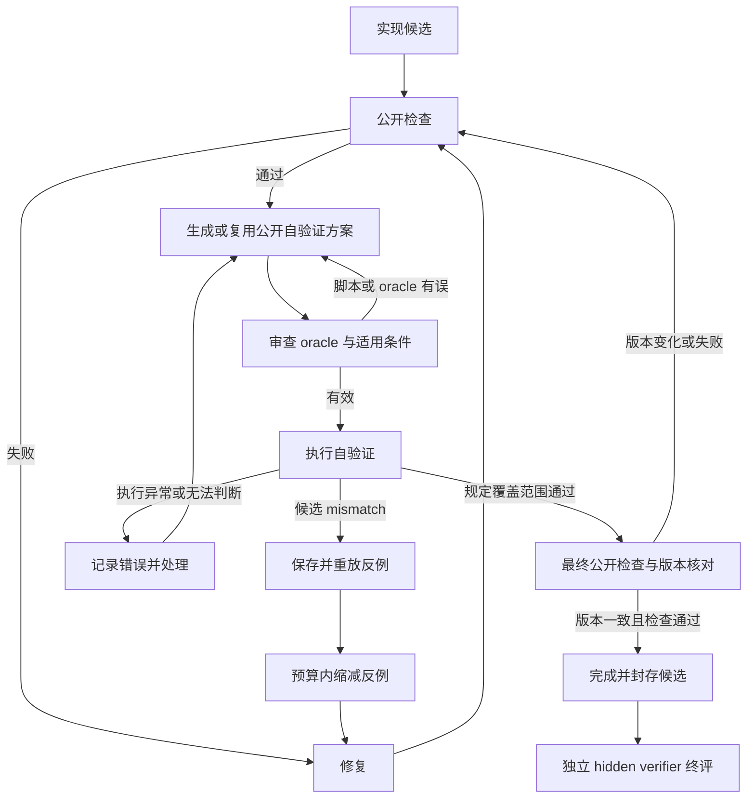

# Codex / OpenCode「找反例 → 修复 → 再验证」源码与 trace 复核

分析日期：2026-10-31（Asia/Shanghai）<br>
对象：本地 `mixed16-precise-spec-v4` 实验，调用模型为 `deepseek-v4-pro`。<br>
交付用途：解释实际机制，并为自研 Harness 改造和后续消融实验提供依据。

## 1. 结论与证据边界

**已核实：在具体 trial 中，对照程序由模型在执行任务时通过普通工具调用写出；执行结果返回模型后，模型修改业务实现或对照程序，再调用工具复测。源码提供通用的模型—工具循环，没有在所检查的路径中发现“公开检查通过就强制启动反例搜索”的专用阶段。**

**尚未核实：system prompt 是不同 Harness 行为差异的“主要原因”。** 本次是源码和历史日志的观察性审计，没有交换 prompt、统一工具协议或统一预算的对照实验，因此不能给出因素贡献排名。

更准确的解释是：

> 模型根据任务规格、编码指导、当前实现和工具反馈选择验证策略；工具负责执行；Harness 的续跑、停止、预算和上下文处理决定这种策略能否持续。要让该行为稳定发生，应在控制层增加有证据要求、受预算约束的自验证门禁，同时保留模型生成测试的能力。

新增问题的直接回答：

- **谁写脚本？** 在已核查示例中，模型输出包含完整脚本内容的工具参数，运行时据此执行。未见 adapter 提前提供这些具体脚本。
- **什么时候写？** 没有统一时点。Codex 的示例在首次 `check.py` 通过后；OpenCode 的示例在首次 `check.py` 之前；另一个 OpenCode 示例甚至先在 `/tmp` 比较候选算法，再落地业务文件。
- **怎么写？** 依据公开 README、契约、输入和已生成实现，构造小规模穷举 reference、输入生成器和结果比较器，再通过 shell heredoc 或文件写入工具运行。
- **什么触发修复？** 具体的工具输出，例如 mismatch、异常、与规格不符的输出；模型决定修改目标。修复目标可能是业务算法，也可能是测试脚本自身。
- **是否保证正确？** 不保证。完整回路和最终 reward 是两个指标。本次看到 Codex 批处理题有回路但 reward 0，OpenCode 同题有回路且 reward 1；OpenCode 租户题做了大量算法对照，最终仍 reward 0。

### 本次实际完成的核查

1. 对 Codex / OpenCode 共 **32 份原生 trace** 做结构扫描，记录事件类型和文件哈希。
2. 对其中 **3 个代表性 trial** 详细对齐生成脚本、执行、反例、文件修改与复测事件。这不是 32 个 trial 的闭环发生率统计。
3. 摘取 **16 个源码/配置/公开任务文件**，保存物理行号和 SHA-256。
4. 比较 Codex catalog 中解码后的 prompt 与本地 vendor prompt，文本完全相等，均为 **20,751 字符**。
5. 对 OpenCode 日志中的一个四窗口反例，独立枚举 **16 个子集**，确认公开规格下的正确答案。

没有调用付费模型，没有重跑 benchmark，没有修改原实验目录，没有读取 `trusted_validation` 内部题目或 oracle。最终 reward / 失败原因来自既有结果文件，仅用于事后解释。

## 2. 证据分级：哪些结论可以成立

本文区分五类证据：

- **意图**：模型的计划、reasoning、最终自述。能说明它说要做什么，不能单独证明执行，也不能证明内部因果。
- **执行**：原生工具事件包含命令、脚本内容、输出、状态或退出码。
- **闭环**：实际对照输出 → 对应业务文件修改 → 新一次对照输出的有序链路。
- **回归**：固定失败输入或固定 seed 的测试，在修改后的同一目标上重新执行；最好进一步绑定源码和测试哈希。
- **因果**：控制其他因素后的干预实验，证明更改 prompt、工具或控制策略改变了闭环发生率或最终正确率。

本次 Codex 示例有执行和闭环证据；OpenCode 批处理示例还有固定 seed、同脚本重跑的较强回归证据。**本次没有因素归因所需的因果证据，也没有完整的逐轮 workspace 哈希链。**

`MISMATCH` 出现在命令字符串里，不代表执行时真的发生不匹配。本文引用的失败来自工具的输出字段。日志里的“20,000 次通过”也要结合循环范围、提前退出条件和实际完成标记判断。

## 3. 源码位置与版本边界

本报告的引用文件已随文上传到 [GitHub 证据包](https://github.com/xi474/benchmark/tree/data/mixed16-v4-execution-2026-10-30/experiments/mixed16-v4-2026-10-30/counterexample-review-2026-10-31)。下列链接直接打开所审计的完整文件；[带行号摘录](https://github.com/xi474/benchmark/blob/data/mixed16-v4-execution-2026-10-30/experiments/mixed16-v4-2026-10-30/counterexample-review-2026-10-31/source-excerpts.md) 和 [机器可读证据](https://github.com/xi474/benchmark/blob/data/mixed16-v4-execution-2026-10-30/experiments/mixed16-v4-2026-10-30/counterexample-review-2026-10-31/evidence.json) 保留来源与哈希。

- **S01**：[harness-v3-research/harbor-agents/harbor_agents/cli_agents.py](https://github.com/xi474/benchmark/blob/data/mixed16-v4-execution-2026-10-30/experiments/mixed16-v4-2026-10-30/counterexample-review-2026-10-31/snapshots/harness-v3-research/harbor-agents/harbor_agents/cli_agents.py#L25) — Harbor CLI adapter。
- **S02**：[harness-v3-research/harbor-agents/config/codex-model-catalog.json](https://github.com/xi474/benchmark/blob/data/mixed16-v4-execution-2026-10-30/experiments/mixed16-v4-2026-10-30/counterexample-review-2026-10-31/snapshots/harness-v3-research/harbor-agents/config/codex-model-catalog.json) — 实际配置的模型 catalog。
- **S03**：[harness-v3-research/vendor/codex/codex-rs/models-manager/prompt.md](https://github.com/xi474/benchmark/blob/data/mixed16-v4-execution-2026-10-30/experiments/mixed16-v4-2026-10-30/counterexample-review-2026-10-31/snapshots/harness-v3-research/vendor/codex/codex-rs/models-manager/prompt.md#L125) — Codex 上游 prompt。
- **S04**：[harness-v3-research/vendor/codex/codex-rs/core/src/session/turn.rs](https://github.com/xi474/benchmark/blob/data/mixed16-v4-execution-2026-10-30/experiments/mixed16-v4-2026-10-30/counterexample-review-2026-10-31/snapshots/harness-v3-research/vendor/codex/codex-rs/core/src/session/turn.rs#L162) — Codex turn 循环。
- **S05**：[harness-v3-research/vendor/opencode/packages/opencode/src/session/system.ts](https://github.com/xi474/benchmark/blob/data/mixed16-v4-execution-2026-10-30/experiments/mixed16-v4-2026-10-30/counterexample-review-2026-10-31/snapshots/harness-v3-research/vendor/opencode/packages/opencode/src/session/system.ts#L31) — OpenCode 默认 prompt 路由。
- **S06**：[harness-v3-research/vendor/opencode/packages/opencode/src/session/llm/request.ts](https://github.com/xi474/benchmark/blob/data/mixed16-v4-execution-2026-10-30/experiments/mixed16-v4-2026-10-30/counterexample-review-2026-10-31/snapshots/harness-v3-research/vendor/opencode/packages/opencode/src/session/llm/request.ts#L56) — OpenCode 请求拼装。
- **S07**：[harness-v3-research/vendor/opencode/packages/opencode/src/session/prompt/default.txt](https://github.com/xi474/benchmark/blob/data/mixed16-v4-execution-2026-10-30/experiments/mixed16-v4-2026-10-30/counterexample-review-2026-10-31/snapshots/harness-v3-research/vendor/opencode/packages/opencode/src/session/prompt/default.txt#L70) — OpenCode 通用编码 prompt。
- **S08**：[harness-v3-research/vendor/opencode/packages/opencode/src/session/prompt.ts](https://github.com/xi474/benchmark/blob/data/mixed16-v4-execution-2026-10-30/experiments/mixed16-v4-2026-10-30/counterexample-review-2026-10-31/snapshots/harness-v3-research/vendor/opencode/packages/opencode/src/session/prompt.ts#L1103) — OpenCode session 循环。
- **S09**：[harness-v3-research/harbor-agents/harbor_agents/framework_runner_common.py](https://github.com/xi474/benchmark/blob/data/mixed16-v4-execution-2026-10-30/experiments/mixed16-v4-2026-10-30/counterexample-review-2026-10-31/snapshots/harness-v3-research/harbor-agents/harbor_agents/framework_runner_common.py#L116) — 框架通用 prompt。
- **S10**：[harness-v3-research/harbor-agents/harbor_agents/langgraph_runner.py](https://github.com/xi474/benchmark/blob/data/mixed16-v4-execution-2026-10-30/experiments/mixed16-v4-2026-10-30/counterexample-review-2026-10-31/snapshots/harness-v3-research/harbor-agents/harbor_agents/langgraph_runner.py#L223) — LangGraph 控制流。
- **S11**：[xi474-benchmark/mixed16-precise-spec-v4/tasks/reasoning4/batch_scheduler_transition_spec_v4/workspace/README.md](https://github.com/xi474/benchmark/blob/data/mixed16-v4-execution-2026-10-30/experiments/mixed16-v4-2026-10-30/counterexample-review-2026-10-31/snapshots/xi474-benchmark/mixed16-precise-spec-v4/tasks/reasoning4/batch_scheduler_transition_spec_v4/workspace/README.md#L24) — 公开任务业务规格。
- **S12**：[xi474-benchmark/harbor-tasks-mixed16-v4/mixed16-v4-batch_scheduler_transition_spec_v4/task.toml](https://github.com/xi474/benchmark/blob/data/mixed16-v4-execution-2026-10-30/experiments/mixed16-v4-2026-10-30/counterexample-review-2026-10-31/snapshots/xi474-benchmark/harbor-tasks-mixed16-v4/mixed16-v4-batch_scheduler_transition_spec_v4/task.toml#L1) — Harbor 任务配置。
- **S13**：[harness-v3-monitoring-workspace/mixed16-v4-workflow-dag.mmd](https://github.com/xi474/benchmark/blob/data/mixed16-v4-execution-2026-10-30/experiments/mixed16-v4-2026-10-30/counterexample-review-2026-10-31/snapshots/harness-v3-monitoring-workspace/mixed16-v4-workflow-dag.mmd#L1) — 现有工作流说明。
- **S14**：[harness-v3-research/harbor-agents/docker/xi474-harness-base.Dockerfile](https://github.com/xi474/benchmark/blob/data/mixed16-v4-execution-2026-10-30/experiments/mixed16-v4-2026-10-30/counterexample-review-2026-10-31/snapshots/harness-v3-research/harbor-agents/docker/xi474-harness-base.Dockerfile#L1) — 共享镜像 Dockerfile。
- **S15**：[xi474-benchmark/mixed16-precise-spec-v4/tasks/reasoning4/batch_scheduler_transition_spec_v4/TASK.md](https://github.com/xi474/benchmark/blob/data/mixed16-v4-execution-2026-10-30/experiments/mixed16-v4-2026-10-30/counterexample-review-2026-10-31/snapshots/xi474-benchmark/mixed16-precise-spec-v4/tasks/reasoning4/batch_scheduler_transition_spec_v4/TASK.md#L1) — 公开 TASK.md。
- **S16**：[xi474-benchmark/mixed16-precise-spec-v4/tasks/reasoning4/batch_scheduler_transition_spec_v4/workspace/check.py](https://github.com/xi474/benchmark/blob/data/mixed16-v4-execution-2026-10-30/experiments/mixed16-v4-2026-10-30/counterexample-review-2026-10-31/snapshots/xi474-benchmark/mixed16-precise-spec-v4/tasks/reasoning4/batch_scheduler_transition_spec_v4/workspace/check.py#L1) — 公开 check.py。

全部 32 份 trace 的路径和哈希见 [trace_inventory](https://github.com/xi474/benchmark/blob/data/mixed16-v4-execution-2026-10-30/experiments/mixed16-v4-2026-10-30/counterexample-review-2026-10-31/evidence.json)；具体案例结果在下文对应链接。

审计时记录的 vendor HEAD（[版本来源](https://github.com/xi474/benchmark/blob/data/mixed16-v4-execution-2026-10-30/experiments/mixed16-v4-2026-10-30/counterexample-review-2026-10-31/version-provenance.json)）：


```text
Codex:    6aaac694803004a63c6f393d153c96d22521a6b9
OpenCode: 148842ef7cb1bc34192b3fff57d0f9721ab9c801
```

OpenCode [package.json](https://github.com/xi474/benchmark/blob/data/mixed16-v4-execution-2026-10-30/experiments/mixed16-v4-2026-10-30/counterexample-review-2026-10-31/snapshots/harness-v3-research/vendor/opencode/packages/opencode/package.json) 声明版本 `1.19.4`。[WORKLOG 版本摘录](https://github.com/xi474/benchmark/blob/data/mixed16-v4-execution-2026-10-30/experiments/mixed16-v4-2026-10-30/counterexample-review-2026-10-31/version-provenance.json)记录共享镜像安装 Codex `0.164.0` 和 OpenCode `1.19.4`。这些信息**不等于已经证明 vendor 无本地修改，也不等于证明运行二进制与 checkout 逐字节一致**。S14 的默认版本参数是 `latest`，S01 的备用 OpenCode 安装也使用 `latest`；严格复现还应保存构建参数、镜像 digest、包完整性和运行版本输出。

原材料称“本地没有 OpenCode 完整源码”需要修正：本次在 `vendor/opencode` 找到了相关 TypeScript 源码。原材料对实际 CLI 启动参数的描述位于继承的 Harbor 安装 agent 边界；本文没有完整审计这些父类，不把这些参数逐项视作本次已核实的源码事实。

## 4. Codex：指导文本鼓励验证，turn 循环负责承接反馈

### 4.1 本地 adapter 实际做了什么

S01 第 86—119 行中，`CodexAgent` 继承 Harbor Codex，指定 `model_catalog_json`，上传 catalog，检查 CLI 是否已经安装，并可上传 delegation policy。第 25—55 行还配置了 provider 和多 agent 提示。

这些配置已经同时改变了不止 prompt 一个因素：协议、模型元数据、工具类型和可用能力均受影响。S01 的注释特别指出：缺少定制 catalog 时，自定义模型的元数据回退会使 patch 工具不可用。因此，“所有 Harness 都有 shell”并不代表工具接口已经等价。

在检查的 adapter 路径里，没有看到固定的 brute reference 模板、mismatch 解析器、反例缩减器，或 `check.py` 成功后强制启动的自验证节点。

### 4.2 prompt 的确切作用与不能推出的结论

S03 第 125 行要求持续解决问题，直到确信任务已解决再结束；第 149—153 行建议运行测试，并从具体测试逐渐扩大范围。

S02 的 `deepseek-v4-pro.base_instructions` 解码后与 S03 完全一致。这里的第 125 / 153 行是**解码后 prompt 或 S03 的行号**，不是 JSON 内部行号。

但这些文本没有直接要求“第一次检查通过后写穷举 reference”，也没有规定一定运行 fuzz。将其解释为鼓励进一步验证是合理机制解释；将其改写成显式“首次通过不可结束”规则则超出了原文。

`base_instructions` 也不是每个模型请求全部上下文的同义词。其他指导、AGENTS、工具描述、任务文本和工具反馈同样会进入决策；没有有效请求快照，就不能只凭 catalog 文件还原全部输入。

### 4.3 核心控制链路

S04 的 `run_turn` 注释和实现显示：工具结果会进入后续模型交互；第 580—610 行综合模型续跑需求和待处理输入；第 723—759 行在通常可结束时还会执行 stop hook，并允许 hook 追加信息、继续循环。

因此不能把 Codex 的停止机制简单概括为“只由模型决定”。更准确的链路是：

```text
任务 + 有效指导 + 工具 schema + 历史状态
→ 模型输出下一步（命令、编辑、消息）
→ 工具执行并返回结果
→ 历史更新，模型再次决策
→ 若无续跑需求，检查停止 hook 等条件
→ 继续 / 完成 / 出错 / 达到限制
```

“比较 got/ref、发现问题、选择修改哪个算法”在本次示例中体现在模型发出的普通命令与编辑行为中。**通用循环支持这种策略，源码片段没有显示专用反例流程强制它发生。** 本次 adapter 配置中也未见为这些 trial 配置专门的反例 stop gate；这不构成对所有全局 hook 或插件的穷尽排除。

## 5. OpenCode：默认 prompt、请求拼装与 session 续跑

### 5.1 DeepSeek 默认会选到哪个 prompt

S05 的 `provider(model)` 根据模型标识选择 prompt。`deepseek-v4-pro` 不命中所列 GPT、Claude、Gemini 等分支，因此在**没有 agent prompt 覆盖**时走 `PROMPT_DEFAULT`。

S07 第 70—75 行建议理解代码、实现功能，并尽可能用测试验证；对已经提供的 lint / typecheck 命令另有要求。它没有明确要求生成 brute reference 或启动反例搜索。

S06 第 58—65 行的请求拼装顺序是：

```typescript
...(input.agent.prompt ? [input.agent.prompt] : SystemPrompt.provider(input.model)),
...input.system,
...(input.user.system ? [input.user.system] : []),
```

第 69—73 行还调用 system transform 插件。因此，“DeepSeek 默认选通用 prompt”是源码可核实的默认路由；**该 trial 最终收到的全文是否另有配置或插件改写，仍需有效请求快照才能确认。**

这也解释了为什么不能拿 OpenCode 的 GPT 专用 prompt 去归因本次 DeepSeek 实验。

### 5.2 session 的停止条件并非每个 step_finish 都结束

S08 第 1103—1116 行专门检查工具调用：即使 provider 返回 `stop`，若仍有工具调用需要把结果送回模型，循环仍应继续。第 1178—1179 行读取 `agent.steps`，缺省为 `Infinity`，达到步数时有最后一步提示；第 1319—1335 行处理 stop、compact 和 continue。

所以 `step_finish` 是一次 step 的结束，不等于整个任务的成功，也不等于 session 终止。应结合 finish reason、后续事件、压缩和实际终止状态解释。

```text
公开任务 / 项目指导
→ 选择 agent 和模型默认 prompt
→ 拼装有效 system、消息、工具及 provider 参数
→ 模型输出工具调用
→ bash/read/write/edit 等执行，结果回到消息历史
→ 模型分析并继续调用工具
→ session 根据完成、工具状态、步数、压缩、错误等决定继续或停止
```

S01 的 OpenCode adapter 还处理一种日志已记录 stop、进程随后 EPIPE 的非零退出情形。这说明“进程退出码”“session 正常结束”“验证通过”也应分开记录。

## 6. 实际 trace：发生过什么

### 6.1 Codex：公开检查通过以后启动差分测试

任务：`batch_scheduler_transition_spec_v4`。原始文件：

[完整 codex 原生 trace](https://github.com/xi474/benchmark/blob/data/mixed16-v4-execution-2026-10-30/experiments/mixed16-v4-2026-10-30/counterexample-review-2026-10-31/snapshots/xi474-benchmark/experiments/mixed16-v4-2026-10-30/traces/codex/batch_scheduler_transition_spec_v4/codex.txt) · [既有 trial 结果](https://github.com/xi474/benchmark/blob/data/mixed16-v4-execution-2026-10-30/experiments/mixed16-v4-2026-10-30/counterexample-review-2026-10-31/snapshots/xi474-benchmark/experiments/mixed16-v4-2026-10-30/results/codex/batch_scheduler_transition_spec_v4/summary.json)。

以下行号是该原生日志的物理行号，包含非 JSON 前导行：

1. **第 36 行**：`python3 check.py` 返回 `LOCAL_CHECKS_PASSED`，退出码 0。
2. **第 37 行**：模型明确说要对边界和平局情况使用 brute-force reference 做 stress test。
3. **第 41 行**：实际执行 `python3 - <<'PY' ...`，内容含 `def brute`、子集穷举、随机生成和 got/expected 比较；输出真实 `MISMATCH`。
4. **第 47—49 行**：又一次 mismatch 后，`file_change` 记录更新 `/app/engines/calendar_windows/transform.py`。
5. **第 51、59、63 行**：继续出现反例，既涉及目标值，也涉及同值情况下的完整 ID 列表。第 57、61、65 行记录同一目标文件的修改。
6. **第 67 行**：扩展后的随机对照脚本输出 `all ok`。第 73—77 行又有比较、修改与复测。
7. 后续继续执行公开检查；**第 229 行**记录 `turn.completed`。

这条链路同时具有“通过以后继续测试”和“发现问题后修改再测”的执行证据。

还有一个影响门禁实现的细节：第 41 等行的脚本在 mismatch 后打印信息并 `break`，**进程退出码仍为 0**。因此“命令成功退出”不等于“对照通过”；需要可信执行器验收明确的比较结果与实际完成用例数。

限制：Codex 原生 `file_change` 事件在此只列文件路径和更新状态，没有完整历史 diff。随机脚本内容及范围也在变化，不能把它们一概称为“原封不动的同一测试集”。本次检查的几个 Codex heredoc 没有显式固定 random seed；它们打印了失败输入，可用于回归，但不足以单凭“重跑”证明失败输入已再次执行。

该 trial 最终结果文件是 **reward 0**，失败原因指向 `worker_assignment` 的 held-out API case。含义是：对 `calendar_windows` 做得更充分，不代表整个交付物已经正确。这不是闭环无效的因果证明，也不是闭环提高最终 ACC 的证明。

### 6.2 OpenCode：先修测试脚本，再用随机反例修业务算法

同一任务的原始文件：

[完整 opencode 原生 trace](https://github.com/xi474/benchmark/blob/data/mixed16-v4-execution-2026-10-30/experiments/mixed16-v4-2026-10-30/counterexample-review-2026-10-31/snapshots/xi474-benchmark/experiments/mixed16-v4-2026-10-30/traces/opencode/batch_scheduler_transition_spec_v4/opencode.txt) · [既有 trial 结果](https://github.com/xi474/benchmark/blob/data/mixed16-v4-execution-2026-10-30/experiments/mixed16-v4-2026-10-30/counterexample-review-2026-10-31/snapshots/xi474-benchmark/experiments/mixed16-v4-2026-10-30/results/opencode/batch_scheduler_transition_spec_v4/summary.json)。

1. **第 96 行**：模型决定创建 `/tmp` 中的 brute-force 验证脚本。其文字中曾在先跑公开检查还是先跑 brute 之间犹豫；实际事件才决定发生顺序。
2. **第 97 行**：`bash` 参数含 `cat > /tmp/opencode/validate.py << 'EOF'`，写出完整程序后立即执行。首先发生模块加载错误：多个不同目录的 `transform` 被当成同名模块导入，调用到了错误实现。
3. **第 100—101 行**：模型改用 `importlib.util.spec_from_file_location` 和不同模块名加载。重新运行得到 `ALL_BRUTE_FORCE_CHECKS_PASSED`。这一步修的是**验证程序**。
4. **第 104—105 行**：模型继续创建 `rand_cw.py`，其中有 `random.seed(1234)` 和 `range(20000)`。实际运行在 trial 63 打印 mismatch；随后因未导入 `sys` 又报 `NameError`。
5. **第 113—127 行**：模型分析零价值窗口与完整列表字典序的问题，检查公开 README，并宣布用“最大价值 oracle + 贪心重建”重写算法。
6. **第 130 行**：`write` 工具实际替换 `/app/engines/calendar_windows/transform.py`。这一步修的是**业务实现**。
7. **第 148 行**：真实输入上的对照再次通过。
8. **第 149 行**：给 `rand_cw.py` 补 `sys` 导入，再执行同一固定 seed 脚本，输出 `RANDOM_CW_OK`。
9. **第 153 行**：首次执行成功的 `check.py` 返回 `LOCAL_CHECKS_PASSED`。

这条链路的实际顺序是：

```text
业务文件已生成
→ 生成真实输入对照脚本
→ 脚本导入错误，修脚本
→ 真实输入对照通过
→ 生成固定 seed 随机对照脚本
→ 发现业务反例（同时暴露脚本缺少 sys）
→ 重写业务算法
→ 修脚本并复跑固定 seed 对照
→ 首次公开检查通过
```

它**不是统一的“公开通过后启动”流程**，但能清楚证明执行中的脚本生成和反馈修复。补 `sys` 导入没有改变随机种子；同一测试逻辑重新执行提供了比未固定 seed 更强的回归证据。仍建议未来记录逐用例与候选源码哈希。

该 trial 最终 **reward 1**。这与 Codex 同题的 reward 0 一起说明，应记录修复发生在哪个组件，不应把“有闭环”直接等同于整个任务答对。

### 6.3 另一个生成时机：业务实现落地以前比较候选算法

[OpenCode 租户任务原生 trace](https://github.com/xi474/benchmark/blob/data/mixed16-v4-execution-2026-10-30/experiments/mixed16-v4-2026-10-30/counterexample-review-2026-10-31/snapshots/xi474-benchmark/experiments/mixed16-v4-2026-10-30/traces/opencode/tenant_quota_rebalance_spec_v4/opencode.txt)（[trial 结果](https://github.com/xi474/benchmark/blob/data/mixed16-v4-execution-2026-10-30/experiments/mixed16-v4-2026-10-30/counterexample-review-2026-10-31/snapshots/xi474-benchmark/experiments/mixed16-v4-2026-10-30/results/opencode/tenant_quota_rebalance_spec_v4/summary.json)）中：

- **第 42、45 行**：先用小程序验证集合字典序在插入新元素后是否保序，观察到反例。
- **第 76 行**：在 `/tmp/opencode/test_rebalance.py` 比较候选 DP 与穷举，输出 `DP FAIL`。
- **第 84 行**：专门比较空集价值的 clamp 版本与未 clamp 版本，实际输出不一致。
- **第 88 行**：新的算法对照输出 `fails 0`。
- **第 104 行**：随后才写业务组件的 `transform.py`。
- **第 200 行**：公开检查通过。

这属于**实现前的算法探查/原型验证**，不能和“交付完成后的自检修复”混为同一统计类别。该题最终 reward 0，也说明通过某个算法的测试不覆盖全部接口语义。

### 6.4 独立确认一个反例确实违反公开规格

OpenCode 批处理日志第 105 行给出的输入为：

```json
{
  "cooldown": 0,
  "windows": [
    {"id": "w8",  "start": 5,  "end": 11, "value": 0},
    {"id": "w19", "start": 0,  "end": 2,  "value": 0},
    {"id": "w24", "start": 16, "end": 22, "value": 9},
    {"id": "w11", "start": 14, "end": 18, "value": 3}
  ]
}
```

日志记录候选结果 `value=9, selected=["w24"]`。按公开 README 第 26 行的目标，正确结果是 `value=9, selected=["w19","w24"]`：两者价值相同，但后者完整 ID 列表字典序更小。

本次独立枚举全部 16 个子集确认了该结果，见 [oracle-witness.json](https://github.com/xi474/benchmark/blob/data/mixed16-v4-execution-2026-10-30/experiments/mixed16-v4-2026-10-30/counterexample-review-2026-10-31/oracle-witness.json)。这不是再次运行历史候选，也没有使用 hidden oracle。

算法上的危险在于局部 tie-break 不一定能直接合成全局 tie-break：

```text
[] < ["a"]
但加入相同的 "b" 再排序后：
["b"] > ["a", "b"]
```

因此局部最小列表可能丢掉后续需要的零价值窗口。这解释了为什么当前样例目标值正确、公开检查通过，仍可能需要更强对照。

## 7. 新增需求：脚本生成的时机与方式

### 7.1 脚本生成并非独立的神秘组件

本次可观察到的机制是：

```text
模型看到公开规格、接口、代码和已有测试结果
→ 决定某个算法仍存在不确定性
→ 在下一次工具调用参数中生成验证代码
→ 工具执行代码并返回结果
→ 模型继续决定扩大测试、修脚本、修实现或结束
```

“决定存在不确定性”是对行动与可见文字的机制解释，不是对模型内部状态的直接测量。真正可审计的是工具参数中的代码和后续执行结果。

### 7.2 两种已观察到的生成载体

**Codex：直接通过 Python 标准输入执行。**

```bash
python3 - <<'PY'
# 工具参数中包含由模型给出的完整验证程序
PY
```

shell 的 heredoc 将正文传给 Python。它不一定创建任何 `/tmp/test_*.py` 文件；本例大量验证就是这种一次性执行。`command_execution` 是原生事件类型，也不应自动当作模型实际收到的工具 schema 名称。

**OpenCode：先写临时文件再运行。**

```bash
cat > /tmp/opencode/rand_cw.py <<'EOF'
# 工具参数中包含由模型给出的完整验证程序
EOF
python3 /tmp/opencode/rand_cw.py
```

以上是机制摘录，非可直接运行的完整测试。实际正文保存在 [evidence.json](https://github.com/xi474/benchmark/blob/data/mixed16-v4-execution-2026-10-30/experiments/mixed16-v4-2026-10-30/counterexample-review-2026-10-31/evidence.json) 的工具参数中，也已单独导出到 [运行时测试脚本索引](https://github.com/xi474/benchmark/blob/data/mixed16-v4-execution-2026-10-30/experiments/mixed16-v4-2026-10-30/counterexample-review-2026-10-31/generated-tests/README.md)。后续模型可以重写脚本、用 `sed` 补导入，再执行同一个文件。

### 7.3 对照程序通常由哪些部分组成

1. **目标加载器**：从待测文件加载真实 `transform`；多目录同名模块要隔离加载，防止测错目标。
2. **独立 reference**：在小输入上枚举所有可行方案，按公开规格比较完整目标，而非复制候选的 DP 转移。
3. **测试输入**：真实公开输入、随机小实例、刻意构造的边界和平局。
4. **比较器**：规范化输出后比较完整结构、目标值和 tie-break；非法输入则检查指定异常行为。
5. **失败产物**：输入、契约、expected、actual、异常、seed、case index、目标及脚本哈希。
6. **完成判据**：执行的用例数、跳过数、错误数、退出码以及明确的终结结果。

本次 OpenCode `validate.py` 对窗口使用子集穷举，对 worker assignment 使用分配组合枚举，还对 job order 的公开样例写了断言。这些测试强度不同：样例断言不等于通用 reference，随机测试未发现失败不等于算法证明。

### 7.4 “执行中生成”能证明到什么程度

原生工具调用包含完整脚本正文，且出现任务特定路径、目标函数、随后暴露的脚本错误及修订，支持“由模型在当前执行过程中提供并落盘/执行”这一判断。在检查过的 adapter 中没有发现注入这些具体脚本的固定模板。

它不能证明模型此前从未见过类似代码，也不能完全排除未保存配置的影响。论文和报告宜使用前一种可观测表述。

### 7.5 自研系统建议采用的明确生成时机

把“何时要求验证”固定在控制层，把“怎样生成有效验证”交给模型和受信执行器：

- **可选早期阶段**：遇到复杂 tie-break、组合优化、解析规则时，允许先生成小规模原型 reference。
- **必经阶段**：候选交付完整、公开检查通过、准备结束时，控制器要求针对未覆盖规格生成或补足自验证。
- **反例反馈阶段**：重放失败输入，确认原因；必要时更新 oracle，或修业务实现，再重放已有反例和新用例。
- **代码再变更后**：使受影响范围的旧验证凭证失效，重新验证最终实际交付的版本。

这是建议新增的设计，不是对 Codex / OpenCode 已有固定阶段的描述。

## 8. 工具、prompt、模型与控制层的归因

### 8.1 工具提供执行能力，也会改变行为成本

对这类实际执行的差分测试，需要某种运行/验证接口和反馈通道，但**不要求必须是 Bash，也不要求测试必须写入文件**。Python runner、容器测试 API 等同样可以支持该机制。模型还可能仅靠推理发现反例，因此“没有 shell 就无法找反例”过强。

工具描述、参数约束、输出截断、进程续接、单次超时、错误返回、文件编辑可靠性，都会影响模型是否愿意做、是否做得成。不能因为都拥有名称类似的 shell，就排除工具因素。

### 8.2 prompt 是合理解释因素，主要贡献仍待实验

Codex 的持续完成和扩大验证范围指导，OpenCode 的编码与测试指导，均为可核实的机制线索。模型在这些上下文中选择 brute-force 是合理推断。

但同一模型标识不保证同一推理配置、采样、输出上限、工具格式或上下文保留；“有工具的其他 Harness 少出现”也只能说明粗粒度工具可用性解释不充分，不能证明 system prompt 的影响最大。

要衡量模型能力，需要在同一 Harness / prompt / 工具条件下更换模型，或测量相同反例生成和修复子任务。当前一款模型的跨 Harness 比较无法分离模型能力与指导的交互效应。

### 8.3 任务文本不能排除

S15 的 TASK.md 不只是要求 `check.py`，还提醒公开检查不是正式严格评分。S11 第 26 行明确说明零价值窗口、完整 ID 列表平局和局部 DP tie-break 的陷阱；第 57 行再次说明公开检查不覆盖全部业务语义。

这些文字没有直接命令写 fuzz，但为进一步验证提供了具体线索。不能从“没有写 brute-force”推出任务提示词没有影响。

### 8.4 控制层既能支持闭环，也能提前终止

LangGraph 的 S10 显示：普通 agent 路径在无 pending tool calls 时进入 END；另有 `parallel_workers → synthesizer → END` 路径。worker 有工具循环，但 synthesizer 之后没有独立的最终执行验收节点。还存在工具迭代上限，默认值 50。

这比“LangGraph prompt 较短”更具体地指出了一个需要排查的机制：**无工具调用或综合答案完成，被当作图结束信号；结束前没有检查交付与验证证据。** 本轮并未将所有失败 trial 与该分支逐一配对，不能断言它解释了全部失败。

同理，Codex / OpenCode 的通用循环支持多轮验证，但不是每个任务都会触发。应分别检查：模型主动结束、输出截断、工具故障、步数耗尽、上下文压缩丢失任务、分工交接不完整和真正的验证完成。

### 8.5 对原摘要建议修改的措辞

- “工具是必要条件”改为“可执行验证接口及反馈通道使本次这种执行型差分测试成为可能”。
- “system prompt 是主要触发因素”改为“prompt 是有源码依据的解释因素，贡献排序需消融实验”。
- “Codex / OpenCode 都在首次通过后测试”改为“Codex 示例如此，OpenCode 的具体示例在首次公开检查前”。
- “任务提示词不是原因”改为“任务未显式要求 fuzz，但其边界与评分提醒可能影响验证选择”。
- “没有硬编码找反例功能”改为“在本次检查的默认路径中未发现专用反例阶段；存在通用 loop、hook 和插件扩展点”。
- “缺少闭环”改为“缺少统一、可审计的自验证结束门禁；已有通用模型—工具循环仍可能自发做修复”。

## 9. 自研 Harness 的落地方案

### 9.1 三层各自负责什么

**Prompt：明确验证目标和证据义务。** 要求完成交付、识别公开检查未覆盖的语义、生成独立验证，并诚实说明验证范围。

**Tool：可靠地执行并返回结构化结果。** 提供加载隔离、预算、case replay、规范化比较、错误分类和持久化失败输入。`run_self_verify()` 可以是便利 API，不必把每种测试变成专用工具。

**Control plane：掌握状态和结束权限。** 最终消息只是模型申请完成；控制器决定是否满足验证要求、是否继续、是否预算耗尽。门禁要求的是有效验证产物，而不是“调用过一次测试工具”。

这样可保证流程必经、缺证据时不会误报完成；不能保证有限测试证明所有程序正确，也不能保证弱模型总能写出可信 oracle。

### 9.2 建议状态图



所有循环都受总预算限制。预算耗尽输出明确的未验证/未解决状态，不能伪装为通过；缩减超时可以保留原反例继续修复，不应成为必须无限等待的步骤。已有可信 reference 可以直接复用，不强制重复生成。

### 9.3 结构化结果契约

建议执行器区分以下状态：

```text
PASS_BOUNDED        规定范围已执行并通过
CANDIDATE_MISMATCH  候选与可信比较基准不符
ORACLE_ERROR       reference 或规范化有问题
SCRIPT_ERROR       导入、语法、脚本基础设施错误
TIMEOUT            未完成，不能当通过
UNSUPPORTED        当前规格缺乏可用验证办法
```

每个结果至少包括 `candidate_hash`、`spec_hash`、`oracle_hash`、`test_suite_hash`、实际用例数、失败/跳过数、seed、退出码和证据文件位置。`all ok` 文本只能作为辅助证据；最好由执行器对结构化结果和实际进程结果一起验收。

### 9.4 修复循环的控制逻辑（设计伪代码）

```python
while budget.available():
    candidate = snapshot_candidate()
    public = run_public_check(candidate)
    if not public.passed:
        resume_agent(public.feedback)
        continue

    suite = obtain_self_verification(public_spec, candidate, budget)
    if not suite.is_valid_for(public_spec):
        repair_verification_plan(suite.feedback)
        continue

    result = run_self_verify(candidate, suite, regression_cases)
    if result.status == "CANDIDATE_MISMATCH":
        case = independently_confirm_and_replay(result.counterexample)
        if not case.confirmed:
            repair_oracle_or_script(case.feedback)
            continue
        regression_cases.add(minimize_if_budget_allows(case))
        resume_agent(case.feedback)  # 同一候选工作区或显式快照交接
        continue

    if result.status != "PASS_BOUNDED":
        handle_nonpass(result)
        continue

    final = run_final_check_and_seal(candidate)
    if final.passed and final.candidate_hash == candidate.hash:
        return completed_with_bounded_evidence(final, result)

return stopped_with_unresolved_evidence()
```

若 API 不支持 resume，可以在同一明确版本的 workspace 启动新的 repair session，传入公开契约、反例、expected/actual、当前代码和预算。新 session 不是状态天然相同的替代品，必须保存交接清单及快照。

### 9.5 最小 prompt 建议

下面是建议新增的指导，不是从原工具中发现的规则：

```text
完成实现后运行公开检查。公开检查通过后，识别至少一个重要但未覆盖的规格风险。
对可穷举的小规模算法，优先构造独立 reference；其他情况使用可说明适用条件的性质或变形测试。
生成并实际执行验证，比较完整结果与规定的平局规则。
发现不一致时，先确认是候选错误、reference 错误还是脚本错误。
保存失败输入；修复后重放它，并运行相关回归和最终公开检查。
仅使用公开规格与数据；遵守控制器预算。
无法执行、无法建立可信 oracle 或预算耗尽时，明确报告未验证范围，不得宣称通过。
```

不要用“必须找到反例”作为门禁：正确候选可能不存在规定范围内的反例。应要求有意义的搜索和证据，而非要求产出失败。

## 10. 公开 oracle / metamorphic test 与 hidden 隔离

### 10.1 三种不同的验证资源

1. **模型生成的自检**：来自公开规格与输入，允许在任务执行中使用和修正。
2. **benchmark 提供的开发 oracle**：若采用，应提前定义为对所有系统可用的公共实验资源，并统一查询额度。
3. **最终 hidden verifier**：候选封存后单向评分，不把失败样例、期望答案或评分反馈送回当前 trial 的 agent。

“公开”指反馈依据和可用规则公开，不要求 agent 可以篡改执行器。可将冻结的自检、回归输入和受信 runner 放在候选写权限之外。候选不能通过修改测试或结果文件满足门禁。

本地 S12 的 `environment_mode = "separate"` 和 artifacts 配置、S13 的工作流文档支持现有隔离设计。它们不是对整个调度系统不存在任何其他反馈渠道的形式化证明。

### 10.2 适合当前几类算法的公开验证

**Weighted intervals**：小规模枚举全部子集，按 cooldown 检查相容，先最大化价值，再比较完整排序 ID 列表。重点覆盖空输入、全负值、最优值 0、零值窗口改变正价值平局、相接端点和重复/空白 ID。

**Capacity assignment**：小规模枚举 worker 分配；检查技能、每个 worker 的总 duration、selected 过滤、makespan 对每个 worker 的容量裁剪，以及 score → cost → assignments 全部优先级。空 job、空 worker 和不可行输出应分别验证。

**Critical path**：独立计算依赖合法性、完整拓扑波次、earliest finish 和规定的路径平局；测试环、重复依赖、空图、零 duration 与上游分配衍生依赖。不要用候选输出本身来生成 expected。

reference 也可能有错：优先选择与候选不同的简单算法，手工构造少量可解释 witness，明确合法输入前提，并保留 oracle 版本。多个同模型生成的实现共享错误理解时，“互相一致”仍不能证明正确。

### 10.3 变形关系必须附前提

- 如果规格要求忽略输入排列，重排窗口、节点或 worker 输入后，应得到相同规范化结果。
- 对窗口的所有起止时间加同一个非负偏移，保持 cooldown 不变，应保持可行关系、最优价值和 selected。
- 对所有窗口 value 乘同一正整数，在无溢出约束变化时，应保持 selected，并按比例缩放最优价值。
- 在 worker 筛选和其他输入固定、原问题可行时，提高容量后应仍可行，最优 score 不应降低；不要对原来 infeasible 的零占位 score 直接套用单调关系。
- 任意重命名 ID 可能改变字典序平局答案；添加零价值窗口也可能改变 selected。它们不是无条件输出不变的关系。

变形测试提供部分性质约束，通常不能替代完整 reference。将 metamorphic pass 与 differential pass 分开报告。

## 11. 如何记录 trace，证明闭环确实发生

建议新增标准事件，而不是只抽取模型自述：

```text
candidate.snapshot
public_check.completed
self_verify.plan_created
oracle.validated
self_verify.started
counterexample.found
counterexample.replayed
counterexample.minimized
repair.applied
regression.completed
self_verify.completed
completion.requested
completion.accepted / completion.rejected
candidate.sealed
```

共同字段包括 `trial_id`、`task_id`、`harness_id`、`agent_id`、`session_id`、`event_id`、`parent_event_id`、`tool_call_id`、单调序号、时间、代码/规格/测试哈希。失败事件还应绑定 case ID、输入、expected/actual、失败类型与 oracle 依据。

一条可审计回路应满足：

```text
候选 C0 + 测试 T + 输入 X → 实际不一致
→ 修改得到 C1（有真实 diff / hash 变化）
→ C1 + 冻结的 X + 可追溯的 T → 实际通过
→ 旧回归与新测试通过
→ 交付版本仍为 C1 或已重新验证的后续版本
```

如果修复的是测试，事件应标为 `oracle/script repair`，不能算作业务缺陷修复。如果同时改 oracle 与候选，必须单独说明变化原因，并重新确认反例。

测试完成时记录 `executed / passed / failed / skipped / errored`，保留超时、截断和缺失；不可观测填 null，不填 0。原始工具内容可存为脱敏附件，不依赖模型公开完整 reasoning；行为证据本身就能证明大部分执行链路。

## 12. 五套 Harness 的公平性与对照实验

### 12.1 先区分实验要回答什么

**原生系统比较**回答“开箱配置整体表现如何”：保留各自默认 prompt 和工具，用相同任务与外层资源限制，接受系统内部设计不同。

**机制消融**回答“增加某种验证指导或门禁有什么作用”：在每套 Harness 内比较控制与干预条件，并审计干预是否真正生效。两类结果应分开报告。

“所有 trial 并发都是 5”不充分保证公平：请求大小、排队、缓存热度、并行工具和运行顺序仍可能不同。相同模型名称也不充分保证实际推理配置一致。

### 12.2 推荐先做 prompt × gate 的四条件实验

每套 Harness 都设置：

- **A：原生 baseline**。
- **B：baseline + 同一段增量验证指导**。
- **C：baseline + 同一外层自验证 gate**。
- **D：baseline + 增量指导 + gate**。

其余任务、工具权限、模型版本/端点、已确认的采样与推理设置、总输出/时间预算、CPU/内存和测试查询预算保持一致。记录最终有效 prompt，不能只记录某个配置文件。

可以在 baseline 中记录完成请求而不拦截，得到原生行为；gate 条件再对缺少验证证据的完成请求续跑。若 gate 同时新增 oracle、反馈和额外 token，测到的是整个验证干预包的效应，不能把它全称作“多了一个循环”的纯效应。

若需进一步分离工具因素，再单独比较原生工具与统一最小工具面；不能一边交换 prompt 一边改变 patch/schema、截断与权限，然后只归因 prompt。要测模型因素，再在稳定条件下重复不同模型。

### 12.3 预算与重跑方式

建议同时报告：

1. **等总预算**：自验证与修复消耗原有总预算。回答相同资源下是否更可靠。
2. **允许额外预算**：保留原有实现预算，再增加固定自验证预算。回答额外成本能买到多少可靠性。

以 task 为配对/分层单位，每个条件做多次独立运行，随机或交错执行顺序；基础设施失败、超时和重试规则提前规定。16 道题只适合探索，不能把每个随机 seed 当成独立的新任务来夸大样本量。5 次重复可作为排查波动的起点，不是统计功效保证。

先用少数公开算法题离线审计门禁语义，再做小规模试运行和功效规划，最后扩展全部任务。明确声明新增评测条件，不能把原生 baseline 与增强版不加说明地放在同一排行榜。

### 12.4 建议指标

- **行为覆盖**：有效自检执行率、结束时有验证凭证的比例。
- **闭环行为**：真实 mismatch 率、可确认业务反例率、完成修复并回归的比例。找到的反例越多不一定越好，可能说明初始实现更差。
- **修复质量**：冻结反例的消除率、旧回归新增失败率、被修复组件覆盖范围。
- **最终正确率 ACC**：按预先规定的全部发起 trial 统计，失败和超时规则统一；不要只在“成功跑完验证”的 trial 上计算。
- **E2E**：保留既有 start → finish 定义，同时拆分实现、脚本生成、oracle 审查、验证、缩减、修复、环境和最终评分时间；报告中位数、尾部与超时。
- **成本**：分开统计输入、cache hit/miss、输出、测试执行和 verifier 成本；注明缺失和估计。原实验已有 Codex usage 缺失，不能填 0 或当作精确总成本。
- **增量收益**：对照条件间的 ΔACC、ΔE2E 和 Δcost；额外成功数为正时才解释“每增加一个成功的成本”。

统计时使用任务配对差异与按 task 聚类的区间；小规模单次二元结果可用配对精确检验，多 seed 数据不能直接当成全部独立样本。只看“有闭环的 trial 更成功”会有选择偏差：较强模型、较难任务和更长预算均可能同时影响两者。

### 12.5 对 ACC、E2E 和成本的合理预期

有效独立 oracle 可能提高正确率；错误 oracle、修复引入回归、预算被验证挤占，都可能使 ACC 不变或下降。验证步骤通常增加工作量，但减少盲目重试或更早定位问题时，总 E2E 也可能下降。

增加模型调用通常增加 token 成本；缓存、请求序列和计算开销会影响实际增量。不能从现有 Codex 与 OpenCode 的总成本差异推出反例闭环本身的成本，因为既无干预对照，usage 口径也未完全统一。

## 13. 建议实施顺序

1. **先补观测**：保存有效指导、工具 schema、候选/脚本哈希、退出原因及每次真实测试结果；把“生成脚本”“修脚本”“修业务代码”分开。
2. **再加结束门禁**：在完成请求处检查公开验收、自验证证据和当前候选版本，缺证据则以结构化反馈续跑。
3. **为可穷举操作接入可信小规模 reference**：先统一窗口、分配、图算法的公开验证能力和预算。
4. **再做自适应测试**：模型根据未覆盖规格生成额外边界和变形测试；执行器保存所有可信反例作回归。
5. **最后做消融**：在相同条件下比较 A/B/C/D，分别回答 prompt 能否提高自发验证概率，以及 gate 能否减少无证据结束。

最值得借鉴的不是照抄“继续直到确信正确”，而是把**公开规格、独立比较、真实反馈、修复与回归**连起来，并让系统能辨别“没有发现问题”“没有完成测试”和“最终评分正确”。

## 14. 文件与复核方法

同目录交付（[GitHub 浏览入口](https://github.com/xi474/benchmark/tree/data/mixed16-v4-execution-2026-10-30/experiments/mixed16-v4-2026-10-30/counterexample-review-2026-10-31)）：

- [codex-opencode-counterexample-review.zh-CN.md](https://github.com/xi474/benchmark/blob/data/mixed16-v4-execution-2026-10-30/experiments/mixed16-v4-2026-10-30/counterexample-review-2026-10-31/codex-opencode-counterexample-review.zh-CN.md)：本报告，可单独转发；核心判断和证据均已写入。
- [source-excerpts.md](https://github.com/xi474/benchmark/blob/data/mixed16-v4-execution-2026-10-30/experiments/mixed16-v4-2026-10-30/counterexample-review-2026-10-31/source-excerpts.md)：16 个已上传来源的带行号摘录与哈希。
- [evidence.json](https://github.com/xi474/benchmark/blob/data/mixed16-v4-execution-2026-10-30/experiments/mixed16-v4-2026-10-30/counterexample-review-2026-10-31/evidence.json)：32 份 trace 清单、3 个详细案例的原生事件、结果及来源哈希；它是证据摘录，不是新的 benchmark 结果。
- [oracle-witness.json](https://github.com/xi474/benchmark/blob/data/mixed16-v4-execution-2026-10-30/experiments/mixed16-v4-2026-10-30/counterexample-review-2026-10-31/oracle-witness.json)：四窗口反例的独立穷举结果。
- [extract_evidence.py](https://github.com/xi474/benchmark/blob/data/mixed16-v4-execution-2026-10-30/experiments/mixed16-v4-2026-10-30/counterexample-review-2026-10-31/extract_evidence.py)：只读抽取与 witness 核算脚本；使用随包 snapshots，复核输出写入 `_recheck/`，保留已发布证据。

下载本证据包并进入其目录后可离线复核：

```powershell
python extract_evidence.py
```

当前哈希刻画的是本次审计快照，不能追溯证明历史运行时文件从未改变。后续应在 trial 启动时保存源码 commit、脏文件 diff、镜像 digest、有效请求和工具 schema，补全历史 provenance。

外部实现参考：OpenAI 官方 [Build iterative repair loops with Codex](https://developers.openai.com/cookbook/examples/codex/build_iterative_repair_loops_with_codex) 展示将 review、repair、validate 与后续反馈连接的设计。它支持本文“显式控制反馈闭环”的实现方向，**不能用来证明本次 DeepSeek trial 的具体触发原因**。
