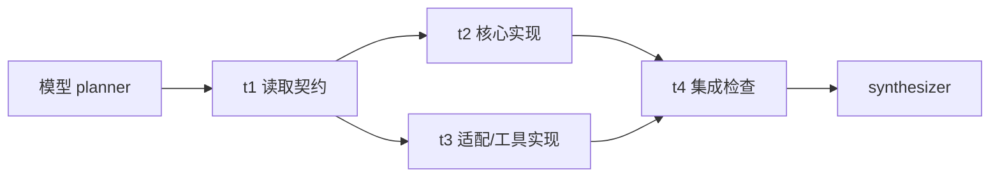
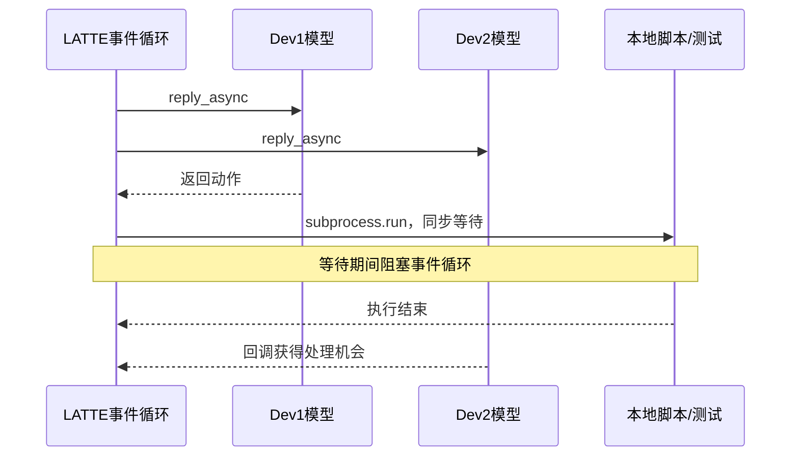

# 七套 Harness 的并行触发机制：运行 Trace 与源码审计

日期：2026-11-07。范围：DeepSeek V4 Pro 普通模式、reward-v2、7 Harness × 56 题，共 392 个基线题位。数据集为 original14、mixed16-v4、Medium26。本文只离线读取已有证据，新增供应商请求为 0。

## 结论

本批并行触发差异首先来自**控制流程和委派入口不同**。ROMA、LangGraph 和 LATTE planning-adapted 都有规划—调度流程，模型产出的依赖关系会直接影响多个执行上下文的启动。Nanobot、OpenCode、Codex、DSH 则需要模型主动选择委派工具。后四者的委派入口在各自全部 56 题的实际请求中均曾开放；其中只有 Codex 在一题调用了创建子 Agent 的工具。

进一步看，任务图存在也不能保证实际并行。LangGraph 的 29 个串行案例都生成了最大就绪波次宽度为 1 的依赖链；LATTE 的 17 个无队友案例在五轮 planning 内根本未生成任务图；LATTE 即使启动并行模型回合，执行脚本和测试时的同步阻塞调用又使工具执行串行。ROMA 则同时有递归子计划、叶执行器活动重叠和真实工具 span 重叠的证据。

对于 Nanobot、OpenCode、DSH，可以确认失败发生在“选择委派”之前：实际 trace 中没有调用对应委派工具，因而没有进入子 Agent 排队、权限拒绝或并发调度阶段。**不能进一步把未委派的心理原因认定为模型能力不足、任务不可并行、模型觉得不划算或某个参数失效。**这些解释需要单独消融实验。

## 1. 统计边界与审计方法

- 使用已发布 `results.json` 所选的 392 个 attempt，按 `(Harness, task)` 去重；失败旧 attempt、Flash、reward-v1、LATTE-frozen、纯 native LATTE 和四个独立补跑不混入分母。
- 分母包含 invalid_submission、预算跳过、特殊异常终态及一项证据失败。这是“选定 trace 中观测到的行为比例”，不是 392 次正常成功运行，也不是 benchmark 通过率。
- “开放”要求本题至少一次实际模型请求含相关工具声明，不用配置意图代替。原始网关缺少权限状态时保持未知；开放不等于已经验证每次调用都能通过权限检查。
- “创建”需要原生子 ID、父子关系或任务作用域，不能把工具数量、静态 Agent 定义数量当子 Agent 数。
- “并行”分别记录子任务生命周期、模型回合、叶模块活动、实际 HTTP 和工具执行 span。它们不是同一个指标，下面表格也不把不同宽度解释为统一性能排名。
- 对 span 使用开始/结束配对及半开区间重叠计算。LangGraph 的 start/end 原生 span_id 不相同，按唯一 `(agent_id, node_id)` 和单调时钟配对；Codex 排除 fork 继承历史，只取子线程自身最后一组 task_started/task_complete。
- Harbor 跨题五/八并发不计入题内多 Agent 并行。ROMA 单 Harbor 串行、题内 HTTP≤4；其他阶段的跨题并发不同，E2E 时间不能据此直接比较加速收益。

源结果 SHA256：`23931e7f1974d388bd6f78d25c4415ddb6885745cf69893b7ad37e17ba41d2d2`。逐题原生事件及实际请求证据的相对路径和 SHA256 见随附 JSON/CSV。

## 2. 总体结果

| Harness / 本批条件 | 实际模型可见的委派/规划入口 | 有子执行上下文的题数 | 观测到题内重叠的题数 | 主要解释 |
|---|---|---:|---|---|
| Nanobot 0.3.5＋观察器 | `spawn`，56/56 题曾开放 | 0/56 | 子 Agent：0/56 | 委派工具调用为 0，继续由根 Agent 调用读写、执行工具 |
| OpenCode 1.19.4 | `task`，56/56 题曾开放 | 0/56 | 子 Agent：0/56 | `task` 调用为 0；有单 Agent 工具重叠，不能算多 Agent |
| Codex 0.164.0＋软委派提示 | `collaboration` namespace，56/56 题曾开放 | 1/56 | 子线程生命周期：1/56，峰值 3 | 一题调用三次 `spawn_agent`；工具执行重叠未知 |
| DSH agent-team / neutral | `spawn_teammate`，56/56 题曾开放 | 0/56 | 子 Agent：0/56 | 看得到团队工具，并调用过 `list_agents`，但没有创建队友 |
| LangGraph / parallel-plan 适配 | 显式 planner→依赖图→worker | 56/56 | worker 生命周期：27/56，峰值 3 | 27 个宽就绪波次；29 个依赖链 |
| LATTE planning-adapted-v1 | 文本动作协议→动态任务图→固定队友 | 39/56 | 队友模型回合：36/56，峰值 3 | 17 个 planning 零图；已计时脚本/测试跨队友工具重叠为 0/56 |
| ROMA native-recursive-local / C0 | Atomizer→Planner→递归 Solve | 56/56 | 叶模块活动：52/56，峰值 8；工具：39/56，峰值 3 | 模型分解后按依赖调度；实际 HTTP 重叠 53/56，峰值 4 |

上表“子执行上下文”包括预定义队友的实际模型响应、按任务实例化的 worker、递归 Solve 实例或 Codex 子线程，并不表示动态发明新的 Agent 角色。LATTE 的 3 名队友预先存在；ROMA 复用固定的 5 类 Agent 定义，运行时新增定义数为 0。

### 按数据集查看并行触发

| Harness | original14 | mixed16-v4 | Medium26 | 合计 |
|---|---:|---:|---:|---:|
| Nanobot：子 Agent 重叠 | 0/14 | 0/16 | 0/26 | 0/56 |
| OpenCode：子 Agent 重叠 | 0/14 | 0/16 | 0/26 | 0/56 |
| Codex：子线程生命周期重叠 | 1/14 | 0/16 | 0/26 | 1/56 |
| DSH：子 Agent 重叠 | 0/14 | 0/16 | 0/26 | 0/56 |
| LangGraph：worker 生命周期重叠 | 7/14 | 4/16 | 16/26 | 27/56 |
| LATTE adapted：队友模型回合重叠 | 12/14 | 13/16 | 11/26 | 36/56 |
| ROMA：叶 Executor 活动重叠 | 13/14 | 15/16 | 24/26 | 52/56 |

这些列共享任务集合，但不同 Harness 行的并行观测层不同；不能据此计算统一“并行能力得分”。

## 3. Nanobot：工具确实开放，但模型没有调用

56 个选定试次共有 2930 条网关实际请求观察记录，每题都曾向模型开放 `spawn`。原生遥测记录的 `spawn` 调用为 0，子 Agent 数也为 0。大量实际调用落在 `exec`、`read_file`、`write_file`、`edit_file` 等根 Agent 工具上。

源码层面的调用链是：模型调用 `SpawnTool.execute` 后，默认 `wait=false` 进入 `SubagentManager.spawn`，由 `asyncio.create_task` 创建后台任务，再经容量 semaphore 准入；`wait=true` 是等待结果的 inline consultation。本批未走到这个入口，因此没有证据支持“子 Agent 创建了但被并发槽堵住”这种解释。

版本不能凭“新版”标签猜测：本批 capability 的 distribution metadata 是 **nanobot-ai 0.3.5**。已安装 `nanobot.agent.subagent` 的 SHA256 与 trace 记录完全一致：`032650e8bf71d77a0fcd366719f08b84fe3fcb793b7067c07cafb1ca06ac22d6`。观察器有 spawn 返回 ID、排队/开始/完成及子身份挂钩；本批负结果是“未观察到委派”，不是只因没有一个 summary 字段。

可以合理推测，根 Agent 已有直接完成工作的工具路径，而委派需要额外选择、划分范围和集成结果。但现有普通模式 trace 不能证明这就是模型不委派的主观理由；也不能证明换成强制团队提示后一定提高质量。

## 4. OpenCode：有 `task`，但走了直接编辑路线

实际请求中每题都曾出现 `task` 工具；1053 条请求观察记录带有工具声明，另 56 条未携带工具声明的请求不据此认定为“整题禁用工具”。原生工具调用中 `task=0`，未发现相应子 session。

反例尤其重要：`linux_supply_chain_recovery` 的单 Agent 工具峰值为 3，`security_boundary_hardening` 和 `storage_tiering_migration_spec_v4` 为 2。因此说“OpenCode 完全没有并行”是不准确的；本批没有触发的是**子 Agent 委派**，根 Agent 的工具可以重叠。

当前证据支持“模型没有选择 `task`”，不支持“任务权限拒绝了 `task`”或“Harbor 不支持创建子 Agent”。由于没有实际调用，本批也无法验证某一未走过的子 session 权限/结果回传路径是否会成功。

## 5. Codex：一次明确的跨目录委派，罕见但真实

Codex 的 `multi_agent_v2.enabled=true`；软提示要求只在有独立分支、能带来收益时考虑委派，对小任务或严格线性任务不委派。这个提示不是“必须创建三个子 Agent”。该提示文本在全部 56 个试次的原生 rollout 中都能找到。

每题实际请求均出现 `collaboration` namespace，且 schema SHA256 相同：`bffe904307047eca677bf621e10d41e59a3acdecfcf810eedaee4398876125e9`。因此唯一正例与其他 55 题在这一 namespace 声明层面没有“正例才开放”的差别。

唯一正例是 `original/linux_release_analysis`。根线程实际调用三次 `spawn_agent`，将 `dependency_impact`、`policy_precedence`、`event_windows` 三个产品目录分别交给子线程，并限定各自 normalize/engine/report 的写入范围、保留 contract/check 等文件。这里是**实现工作委派**，不是仅创建三个空线程或让它们复述计划。

| 子任务 | 自身开始（UTC） | 自身结束（UTC） | 生命周期 |
|---|---|---|---:|
| dependency_impact | 15:12:26.980 | 15:15:05.502 | 158.522 秒 |
| policy_precedence | 15:12:35.557 | 15:13:37.326 | 61.769 秒 |
| event_windows | 15:12:43.193 | 15:13:55.848 | 72.655 秒 |

三条子生命周期共同重叠 **54.133 秒**，峰值 3。三个子线程均 completed；父收到三份结果，三份结果进入后续模型请求。显式“发送”事件覆盖不可用，不能把该计数 0 解释为未发送。

子 rollout 含继承的父对话；直接累计里面的 `spawn_agent` 文本会重复计数。本报告只计根线程的三次调用，并用每个子线程自己的生命周期计算重叠。工具执行边界仍不足以证明三个子线程的工具同时执行，故该项为未知。

为什么只在这题触发？可观察的特点是模型给出了三个明确、互不交叉的产品写入范围，与软提示的独立分支条件一致。这是有证据支持的机制解释；但没有同题多次采样/去提示对照，不能认定该任务结构或提示单独导致了委派。该题 Harbor reward 为 0/1，也说明并行启动和结果回传都成功不保证任务解答正确。

## 6. DSH：查询过团队状态，却没有创建队友

本批使用 agent-team profile，neutral/C0 提示只约束在 `/app` 完成任务并运行检查，没有 forced-team 要求。56 题实际请求均曾提供 `spawn_teammate`、`list_agents`、`wait_agent` 和团队任务板工具。

原生调用累计 `list_agents=52`，`spawn_teammate=0`。这是比“完全没注意到团队入口”更具体的行为：运行中查询过 Agent 状态，但没有随后建立队友。后续实际工作仍由 lead 的 bash/read/write/edit 等工具完成。

因此本批没有进入队友调度、等待或结果回传阶段。工具开放和 native capability 支持反驳“团队 profile 根本没加载”的说法；但没有创建调用，也不能用本批证明创建后调度一定成功。过往 forced-team/其他模型结果只能作为独立机制验收材料，不能并入这 56 题的自主委派统计。

## 7. LangGraph：图里有没有独立波次，完整解释了串行/并行差异

这里的实验对象是我们在 LangGraph 上注册的 **parallel-plan planner/worker 适配流程**，不是宣称 LangGraph 框架默认会自主创建 Agent。planner 先返回模型生成的任务、依赖与写范围，程序将各任务实例化为 worker，再按 `topological_waves` 执行同一波次的 `asyncio.gather`。

逐题重放得到：

- 29/56 题最大就绪波次宽度为 1，实际 worker 生命周期峰值也为 1。
- 18/56 题最大波次宽度为 2，实际峰值也为 2。
- 9/56 题最大波次宽度为 3，实际峰值也为 3。
- **56/56 的计划波次最大宽度与实际 worker 峰值完全一致。**所有试次都有 worker 模型响应，52 题有 4 名 worker，4 题有 3 名 worker。

以 `adaptive_access_review` 为例，模型生成“读取契约 → 两条实现分支 → 集成检查”的依赖结构，t2/t3 的实际 worker 生命周期确实重叠：

29 个串行案例不是“没有创建 worker”，而是模型把任务排成了依赖链，使调度器每次只能取一个 ready 节点。这里能给出很强的近端原因：**本批串行由计划依赖结构决定，而不是调度器把已有的宽波次强行串行化。**

这仍不同于 worker 在运行中调用 spawn 自主创建下一名 Agent。本实现的主计划在执行前生成；当前证据不能把这 27 题称为运行中动态扩图。worker 生命周期重叠也不能无条件替代跨 worker 的真实工具执行重叠，工具归属/时间边界需另审。

源码定位：langgraph_runner.py（源码定位：`source-repositories/harness-v3-research/harbor-agents/harbor_agents/langgraph_runner.py:270`） 的 planner 与第 302–319 行的波次调度；langgraph_planner.py（源码定位：`source-repositories/harness-v3-research/harbor-agents/harbor_agents/langgraph_planner.py:203`） 的就绪波次计算。这些文件的当前哈希另存；行为结论同时由原生模型计划与执行事件独立核验。

## 8. LATTE adapted：有动态扩图，但受到规划出口与同步工具执行两处约束

### 8.1 为什么 17 题没有启动队友

本批是 **LATTE-native-planning-adapted-v1**，不是纯 native baseline，也不是 frozen。镜像标记及适配器要求：`max_planning_turns=5`、`freeze_graph=false`、`disable_verify_tasks=false`、`auto_complete_checks=false`。保留原生 `<discover_task>` 动作、依赖任务图和执行期间发现任务的路径，没有由 compiler 预编译答案图。

39 题 planning 成功形成初始图，随后至少一名队友实际响应。另 17 题均在五轮上限内得到 `tasks_discovered=0`，没有队友响应。进一步检查这 17 题的 **85 条 planning_reply**：全部已保存文本小于 4000 字符，没有触及该字段的截断边界；其中 `<discover_task>` 开始标签出现次数为 **0**。

例如 `incident_federation_rebuild` 的五轮都在 read_file/run_tests 探索，最后一轮仍在读 check.py、final_report.py、run_all.py；Medium MP03 也是持续读契约/实现文件，没有输出 discover_task。对于这些已保存回复，证据指向**没有发出任务图动作**，而不是“发出了正确图却全部被 parser 吃掉”。本次适配仍把探索与图提交共用五轮预算，模型没有在预算内切换到图提交，调度器没有任务可分发。

这既包含模型遵循规划协议的行为问题，也与提示和严格轮数预算的交互有关。现有证据不能把它单独归因于 LATTE 算法错误或 DeepSeek 模型本身；更不能用修改数据集来修复它。

### 8.2 为什么 39 个有队友案例中只有 36 个回合重叠

调度器依据 active 队友、是否收到新上下文以及 ready 任务数量选择本轮队友，用 `asyncio.gather` 调用 `step_agent_async`。39 题中 36 题出现不同队友模型回合重叠。其余 Medium MP01、MP15、MP20 的最大 `n_dispatched=1`；前两题虽然先后有两名队友响应，任何一轮都只派出一名，MP20 只有一名队友响应。

因此“有多名队友参与过”也不能直接算并行。任务依赖、可用 frontier 和调度策略会降低并行宽度，固定有三名 Dev 不意味着每轮都调用三名。

### 8.3 为什么模型回合并行了，工具却没并行

源码在 `step_agent_async` 中先等待 `agent.reply_async`，记录 `agent_turn_finished`，然后同步调用 `_process_actions` 执行模型返回的动作。`run_script` 与 `run_tests` 内部使用同步 `subprocess.run`，在同一个 asyncio 事件循环线程阻塞等待子进程结束。

这意味着：多个队友可以同时等待模型回复；某个队友进入脚本/测试后，事件循环不能继续推进其他队友的回调和工具启动。56 题中，已配对计时的跨队友 run_script/run_tests 工具 span 重叠为 **0**，最大宽度为 1。这个观测与源码阻塞点一致。

该结论限定在已计时的脚本/测试工具；不声称覆盖所有文件操作、底层进程内部线程或远程模型服务器的计算。

### 8.4 动态能力是否保留并被触发

有。排除 `agent=System` 注入的修复任务，只计模型动作被接受后写入任务图的 `discover_task`：**12/56 题在执行 round>0 产生 28 个新任务**。例如 `incident_pipeline_repair` 初始图有三条互不依赖的 metrics/traces/logs 分支，执行期又接受一个模型发现的新任务；另有一个 System 修复节点单独排除。`supply_chain_assurance` 有 5 个执行期模型新任务，来自 Lead、Dev1、Dev2。

这证明运行中扩图发生过；不表示新增的每个节点都被成功执行，更不表示 28 个节点都构成并行分支。`dynamic_agents` 在这里控制队友派发，不代表创建全新 Agent 定义。

源码：orchestrator.py（源码定位：`source-repositories/latte-native-planning-adapted-v1/orchestrator/orchestrator.py:750`） 的 planning；第 698–724 行模型回合和动作处理；第 145–185 行同步工具；第 1041–1080 行派发；第 612–655 行接受新任务。文件 SHA256 `6c681329302f167231e850610b985f299e0f41031aa30d8cc3b93f75d4408616` 与 planning-adapted manifest 完全匹配。

## 9. ROMA：递归分解与依赖调度让并行更常出现

ROMA 本批使用固定上游 commit `a6e3bb4f9e0694375fa627fa4b8bf8cae50592a6`、native recursive Solve、C0、max_depth=2。Atomizer 决定任务能否直接执行；需要分解时 Planner 返回子任务及依赖，每个子任务再次进入 Solve；达到深度上限则强制进入叶执行路径，子结果最终交由 Aggregator 汇合。

原生 `Runtime.solve_subgraph_async` 每轮找出依赖已完成的节点，`_execute_tasks_parallel` 用 `asyncio.gather` 调用这些节点的 Solve。故模型一旦返回多个 ready 分支，程序会直接调度这些分支，不需要再额外选择一个 spawn 工具。不同分支后续还能再次规划，形成运行中的递归展开。

56/56 题实际有子 Solve 实例，56/56 有递归子计划，单题最多 38 个子 Solve。52/56 有叶 Executor 模块活动重叠，实际工具执行重叠为 39/56。HTTP 峰值受本地真实总闸门约束为 4；叶模块峰值 8 包括等待与解析，不能写成“8 个上游模型请求同时运行”。

为什么还有 4 题没有叶执行器重叠？

- MP09、`search_index_rebuild_spec_v4` 实际只有一个叶 Executor，多个计划节点不等于多个实际叶执行器。
- `linux_release_analysis` 虽有 11 个叶 Executor，但根计划和三个递归子计划都是依赖链；实际叶/HTTP/工具峰值均为 1。
- MP15 虽有 4 个叶模块调用，但仅一项有 native output，叶活动峰值为 1；同时 HTTP 峰值为 3，说明其他模块（例如规划）的请求重叠不等于叶执行器并行成功。不能只看计划宽度就称执行分支全部展开。

一个很有说明力的同题对照：`linux_release_analysis` 在 Codex 中拆成三个独立产品目录并发，在 ROMA 中被规划为层层依赖链而串行。**相同 benchmark 允许不同依赖图；并行程度由 Harness 给模型的角色、上下文和规划协议共同决定，不是任务名称预先固定的属性。**

ROMA 没有通过原生 API function-tools 声明执行这些工具；DSPy ReAct 使用提示中的工具协议，实际 HTTP 请求 `tools` 为空不代表没有工具。LATTE 的文本标签协议同理。不能拿它们的 API `tool_count=0` 与 OpenCode/Nanobot 的工具数量直接比较。

原生源码定位：已安装 `roma_dspy/core/engine/solve.py:944` 的状态机；`runtime.py:732` 的子图入口、`:744` 的波次循环及 `:1020` 附近的就绪检测/并行执行。runtime.py SHA256 `77b3b35234f6ade1cf34e3d5a131d8f0f4c30159bc0a5e8942c68a878c562119`。本文只保留源码路径、行号、哈希和机制概述，不重新分发上游源码。

本地 JSON 指令传输修复、预算跳过和异常终态保持原标签；旧 HTTP400/中断 attempt 不作为模型质量负例，也不重复进入这 56 个题位计数。

## 10. 对研究结论与后续工作的建议

### 可用于汇报的表述

> 本批结果表明，提供多 Agent 工具并不足以稳定触发委派。结构化规划与依赖调度能较稳定地产生多个执行上下文，但实际并行仍受任务图的就绪宽度、规划协议遵循和工具实现方式限制。ROMA 观测到了递归扩图与真实工具重叠；LATTE 观测到了执行期扩图和模型回合重叠，但同步脚本/测试限制了工具并行；LangGraph 的串行/并行差异与模型生成的依赖波次逐题一致。

上述“近端机制”有源码与 trace 支持。“某模型天生不擅长委派”“并行一定提升准确率/降低费用”“某个 Harness 整体优于另一套”不由本次审计推出。同一模型并不意味着相同的提示、工具、上下文、每请求输出上限和总预算。

### 优先级

1. **先保留当前基线。**将“委派入口是否开放→是否调用→是否创建→是否启动→是否重叠→结果是否回传→质量是否有效”分层报告，不将零触发与监控缺失混为一谈。
2. **LATTE 单独开工具异步适配条件。**若研究真实工具并行，可将脚本/测试改为不阻塞事件循环的子进程路径；须另外解决共享文件写入、取消、超时和事件配对，再用断网 fixture 验证。这个变更会改变运行机制，应新建条件，不能覆盖本批或称纯 native。
3. **LATTE planning 做协议/预算消融。**只改通用规划提示或明确的规划轮数，比较零图率及有效计划质量；不要改题目或 verifier，不把自动补造任务图混称模型自主规划。
4. **Nanobot/OpenCode/Codex/DSH 做软提示消融。**同题同模型同预算，对照当前条件与统一的“有独立写范围时考虑委派”提示，保留不强制 spawn。强制团队只作机制验收，不并入自主委派 baseline。
5. **LangGraph/ROMA 分别审计依赖合理性。**模型可能添加过多依赖，也可能低估共享文件冲突。图更宽不是自动更好；应同时看写范围冲突、失败修复、API准确率及资源代价。

原分析轮没有修改任何 Harness 运行代码、题目或 verifier，没有新付费请求，也没有重跑实验。后续建议尚未实施。

## 11. 附件与复核

- `parallel-trigger-cells-392.csv`：逐任务×Harness 的入口、调用、计划/实际宽度、证据路径及哈希。
- `request-tool-evidence.json`：392 题实际请求声明；传统 function-tools 与文本/DSPy 工具协议明确分开。
- `native-trigger-evidence.json`：392 题原生事件、LangGraph 依赖波次、LATTE planning 元数据及 ROMA 结构指标。无原始提示、模型回复正文或工具输出。
- `codex-positive-timeline.json`：唯一 Codex 正例的根调用及三个去除继承历史后的子生命周期。
- `source-evidence.json`：分析所查本地源码/注册文件的 SHA256；区分实际注册匹配与分析时本地快照。
- `checks.json`：392 唯一题位、56/56 LangGraph 波次匹配、17/85 LATTE 零图核查及新增 API 请求 0。
- `parallel_analysis_audit.py`：只读离线重放脚本，参数为 `--outputs-root`、`--release-root`、`--output-dir`。

审计复核全部通过。原始证据保持原位；未提交原始提示、工具输出、凭据、私有 私有数据 或 LATTE/ROMA 上游源码。
