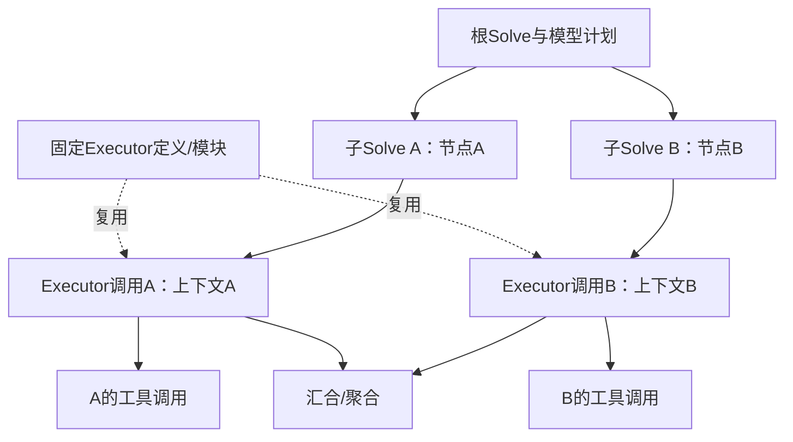

# Nanobot / OpenCode / DSH 显式委派对照实验方案

状态：**仅方案，尚未运行；新增付费调用未获本方案专项授权。**日期2026-11-08。本文不改变原56题基线、题目、verifier、模型或任何历史attempt。

## 要回答的问题

1. 在本次固定版本、Harbor适配和DeepSeek V4 Pro普通模式下，三套Harness能否由模型实际调用原生委派入口，让子Agent执行、返回结果并进入父Agent后续模型请求？
2. 中性提示、软委派提示和显式委派指令，是否影响委派触发、实际并行、任务质量、时间、tokens、缓存和费用？

原56题提供了“实际工具可见但未调用”的行为证据：Nanobot的spawn、OpenCode的task、DSH的spawn_teammate均56/56题曾向模型开放，创建调用均0。它尚未验证每一个未走过的创建/权限/返回路径。

**显式条件成功能够证明能力在该配置和任务上确实可执行；不能回溯证明原56题每次都是模型经过成本收益权衡而主动拒绝。**不要把“未调用”写成“自主判断不值得”，也不能把某一题显式成功推广成所有56题都一定可成功委派。

## 推荐先跑27个新attempt，不先重跑全部56题

三Harness × 三公开任务 × 三提示条件 × 一次采样 = **27个新attempt**。这是一组机制与探索性对照，不用于宣称稳定成功率或统计显著因果效应。

公开任务覆盖每个数据集一题：

- original/linux_release_analysis：公开工作区有可分配的产品实现范围，历史Codex正例可作任务可分解性的旁证；不给模型该历史分解方案。
- hard/search_index_rebuild_spec_v4：覆盖Mixed16复杂任务。新模型必须从公开材料自己划分任务，不注入作者DAG或过去LATTE的分解结果。
- medium/MP01：覆盖Medium26。只依据公开README、接口和初始文件讨论可分配工作，不使用隐藏verifier或参考答案。

任务选择是诊断抽样，不能声称代表56题总体。所有任务都使用冻结原始字节，提供给Agent的材料范围不扩大。

### 三个条件

| 条件 | 给模型的额外指令 | 定位 |
|---|---|---|
| MAV1-G0-neutral | 沿用本Harness原基线的提示和配置，不增加委派要求 | 同期新attempt控制，不替换原56题 |
| MAV1-G1-soft | 有独立、明确交付范围且有帮助时考虑委派；允许不委派 | 提示敏感性与自发触发 |
| MAV1-G2-explicit | 要求实际创建至少两名子Agent，各完成有用的独立工作，结果回传后集成 | 指令驱动的能力正对照；不称自主委派 |

G0/G1/G2除这一条通用协作指令外，任务、模型、权限、工具、版本、输出/轮数/超时限额和观察器均保持相同。不同Harness之间原有限额可能不同，应带条件比较，不冒充等预算性能排名。

原56题是历史中性结果，新G0是同期控制；两者各有身份，不能混成新的56题单次分母。三条件的一次采样仍受随机性影响；若后续要估计稳定效应，另注册重复次数、样本量与分析方法。

### 提示文本草案

G1：

> 请完成原任务。如果公开工作区中存在可以独立处理、交付范围清楚的部分，可以使用本Harness原生子Agent工具委派。只有在委派有帮助时才使用；主Agent负责集成、检查和最终提交。不要改动受保护文件。

G2：

> 请使用本Harness原生多Agent功能完成原任务。先阅读公开工作区，自行确定至少两项有用且可独立开展的工作，实际创建至少两名子Agent分别执行，为它们明确互不冲突的写范围或只读范围及交付物。在原生接口允许时，先启动独立分支再统一等待，主Agent继续开展独立工作。必须接收子结果并将其纳入后续集成和检查，再最终提交。不要用主Agent内的多角色文字、普通并行进程或伪造的子Agent日志替代实际委派。不能创建或返回时如实记录失败，不要修改题目、受保护文件或verifier来绕过。

跨Harness的语义相同，但入口名不同：Nanobot spawn、OpenCode V1 task、DSH spawn_teammate。原生返回/等待机制不同，操作示例只使用该固定版本的真实语法，不新增替代调度器，不在适配器中自动造子Agent。

不要给出具体题目的模块划分或答案；模型自主划分与“是否被要求委派”分别观测。G2强制了协作要求，即使子任务内容由模型生成，也不能改称无提示自主委派。

## 运行顺序、门禁和授权

1. 先离线检查三个冻结运行时的工具声明、权限、版本、提示哈希和观察器。已有fixture只说明机制，不计真实模型委派；需要覆盖创建返回ID、取消、缺失span与重复usage。
2. 在27题位内，先依次执行三Harness的linux_release_analysis/G2单trial pilot，共3题，不另加重复试次。只有收到新明确付费授权并冻结注册后才启动。
3. pilot分别检查真实请求、原生身份、评分、usage、资源和结果回传覆盖。评分0不自动判为机制失败；能力未触发也保留为G2负结果。未调用不能直接判Harness没有该能力，应先离线查提示/协议/权限/适配。
4. pilot准入后再运行余24题，采用分块随机或平衡条件顺序并保存调度清单。预期上限为全局5 Harbor trial、HTTP≤4；这不是每题保证可同时获得4个HTTP槽，必须记录排队与实际发送时序。
5. 每attempt新身份、原件保留、不自动重试。任何修复改变提示或运行路径时建立新版本与新attempt，不能在原条件下偷偷补跑到阳性。余额不足等共享依赖不可用时不发请求；单题负结果与共享安全故障分别处理。

预算上限、每Harness精确限额及本轮付费授权均待注册，不沿用旧批次的50美元授权或“跑完即止”授权。本方案没有发送模型请求、查询余额或读取API key。

## 必须分层的验收与指标

**委派可执行性**至少要有：模型实际请求创建工具；不同原生子ID及父子关系；子Agent实际模型请求和有意义的工具/工作；真实终态。创建调用返回文字或静态Agent注册不是充分证据。

**结果闭环**分别报告：子结果已发、父已收到、已进入父后续模型请求。某边界未被原生日志覆盖则记unknown；不能由“父收到”伪造“显式发送事件已观测”，也不把进入上下文当作已经正确理解/采用。

**题内并行**另行验收：不同子生命周期、模型HTTP、工具执行span分别配对；两个子Agent先后完成是multi-agent串行协作，不是并行。普通多工具/多进程不替代子Agent证据；跨题并发不计题内并行。

**任务质量**仍用原Harbor reward-v2、API/focused检查与完整性，不因为协作成功加分。能力触发成功可以同时reward0；高分也可能完全单Agent。

逐题应记录：condition、版本与源SHA、模型/普通模式、工具与提示哈希、创建/开始/完成/失败/取消、子模型与工具事件、三段返回证据、分层并行宽度与重叠时间、reward/API、E2E、输入/输出/cache-hit tokens及缓存比例、已结算/未知请求、峰价估算与按时段费用口径、容器资源。

缓存暖态、供应商时段和其他请求影响计费与时延；平衡顺序只减少偏差，不保证消除。若无法固定后端revision/缓存隔离，明确记作限制。没有推理引擎GPU/KV block/能耗数据时保持null。

## 结论模板与停止扩批的条件

- G2有完整子执行和返回闭环：该配置在该任务上具备可执行委派能力。
- G0无调用、G2有调用：提示条件与实际触发有差异；单次试验不足以断言原56题的模型心理原因或总体成功率。
- G2有创建但结果未进入父请求：能力链条只验证到创建/执行，返回闭环仍不完整。
- 多子Agent均完成但无重叠：协作能力已触发，题内并行未触发。
- G2仍无调用：指令驱动触发失败；先定位问题，不以工具“配置为true”替代实际证据。

若目的仅是证明原生功能可运行，先以27题位机制对照收口，不需要立即重跑56题。若还要测显式委派对全数据集质量的影响，可另注册三Harness各56题的G2，共168题；已完成且配置完全相同的9个G2诊断题可携带，余159题新跑。与历史56题相比只能作带时间条件的描述；要更强因果结论，需另设同期G0与预先确定的重复次数、预算和统计方法。

## ROMA“复用Agent定义”的准确解释

Agent定义类似固定角色模板：Atomizer、Planner、Executor、Aggregator、Verifier。复用定义不要求每个任务都new一个不同Python Agent对象，也不等于动态发明新角色。

ROMA模型返回子任务及依赖后，每个节点进入自己的递归Solve作用域，带任务节点ID、调用身份及局部上下文；多个ready节点可以同时调用同一种Executor模块。任务级Solve实例与模块调用是实际运行实体，固定定义数与运行实例数分别统计。

因此不能把它概括成“只有一个Agent在并行调用工具”。需要分别看子Solve/局部上下文是否存在，以及这些执行器或工具是否真的重叠。本批ROMA56/56有子Solve与递归子计划，52/56有叶Executor活动重叠、39/56有工具重叠；固定定义运行时新增0。并行HTTP峰4、叶模块活动峰8、工具峰3属于不同观测层，不表示8个模型请求同时运行。

也不应把它与Codex/Nanobot原生spawn语义完全等同。可用的表述是“模型生成递归任务图，复用固定Agent定义的任务级执行实例按依赖并行”，而非“动态合成了新Agent定义”。来源见[已有七臂trace与源码分析](../parallel-analysis/REPORT.md)。
