# Medium26：26题中文目录

26题全部纳入实现版；这里的难度与并行优势仍是待实验校准的设计标签。每题说明链接指向正式TASK及README，作者DAG由实际contract.inputs生成。

[当前难度分级标准](难度分级标准_v1.1.md) · [验收结果](../review/validation_report.json) · [来源与范围](../NOTICE.md)

## MP01 · 可关闭成员的硬/软加权投票

风格：`multistage4`；实现单元：4；[TASK](../tasks/multistage4/weighted_voting/TASK.md) · [完整接口规格](../tasks/multistage4/weighted_voting/workspace/README.md)。
标准拟合适配与硬/软投票，难点在关闭成员后的标签/权重/调用一致性，不涉及学习或搜索。

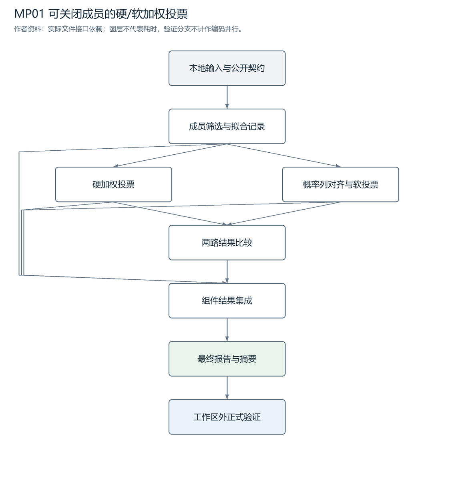

## MP02 · 单变化轴的数据分片拼接

风格：`multistage4`；实现单元：3；[TASK](../tasks/multistage4/single_axis_concat/TASK.md) · [完整接口规格](../tasks/multistage4/single_axis_concat/workspace/README.md)。
单轴排序、数据装配与属性规则的交互，范围明确删除多轴/重叠难点，运行并行仍有限。

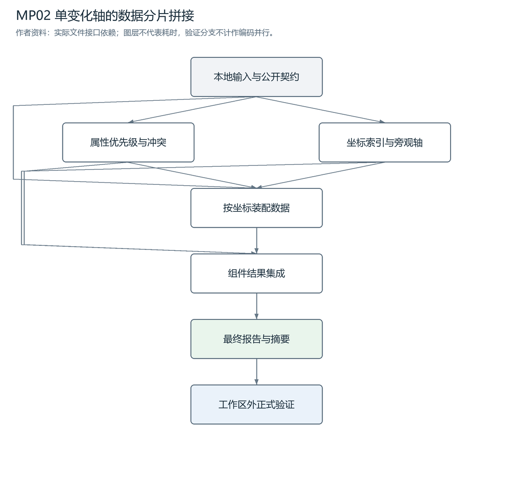

## MP03 · 三种挂载格式的离线事实归并

风格：`multistage4`；实现单元：4；[TASK](../tasks/multistage4/offline_mount_facts/TASK.md) · [完整接口规格](../tasks/multistage4/offline_mount_facts/workspace/README.md)。
三种真实文本语法与首来源优先归并，保留边界但删除真实 OS 状态和 UUID/超时回退。

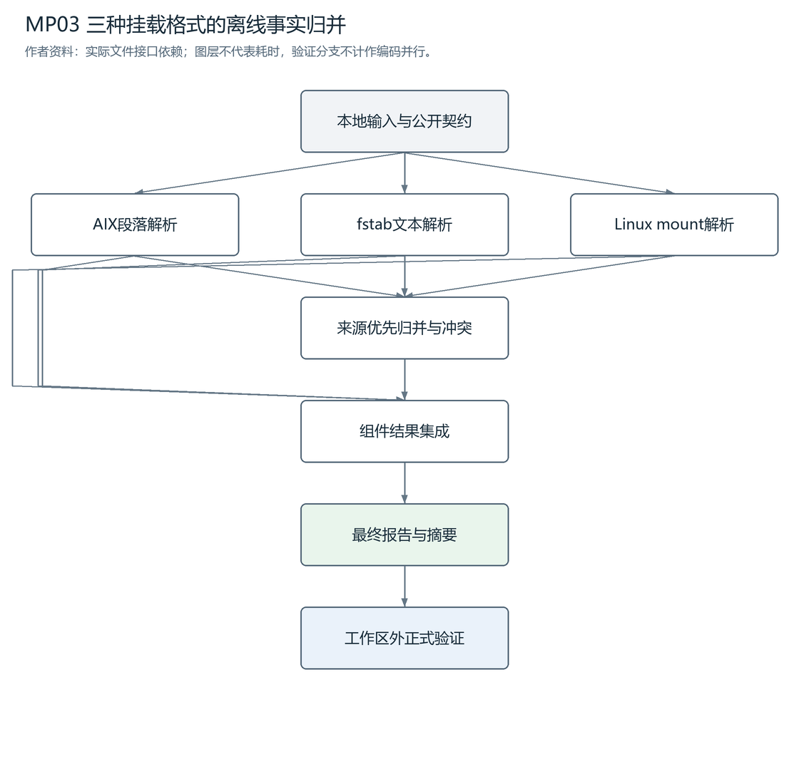

## MP04 · 多格式用户合并与完整冲突报告

风格：`multistage4`；实现单元：4；[TASK](../tasks/multistage4/multiformat_user_merge/TASK.md) · [完整接口规格](../tasks/multistage4/multiformat_user_merge/workspace/README.md)。
三格式的缺失值、类型、优先级与完整冲突证据需要一致，标准解析与集合规则即可解决。

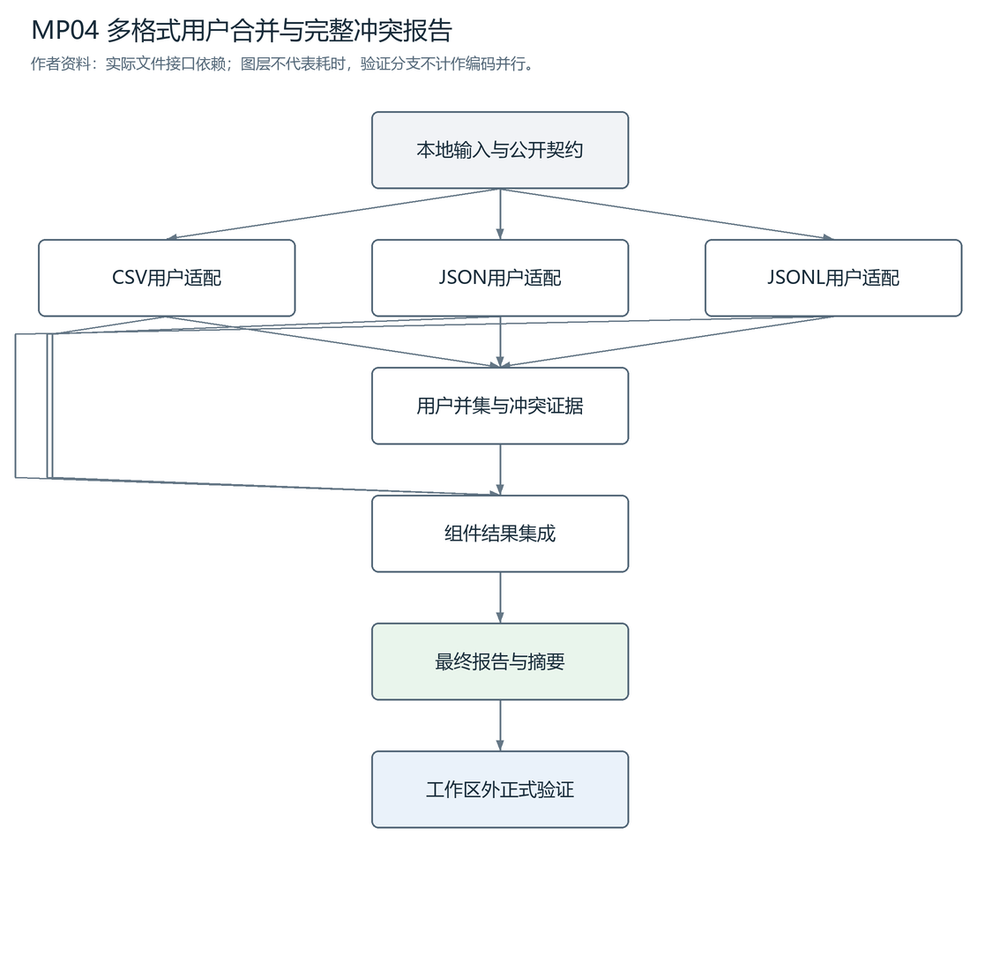

## MP05 · 跨应用候选并集与相处时长排名

风格：`multistage4`；实现单元：4；[TASK](../tasks/multistage4/cross_app_contact_ranking/TASK.md) · [完整接口规格](../tasks/multistage4/cross_app_contact_ranking/workspace/README.md)。
三个应用的候选并集、身份去重、持续时长及平局排名形成有界关联，非全局优化。

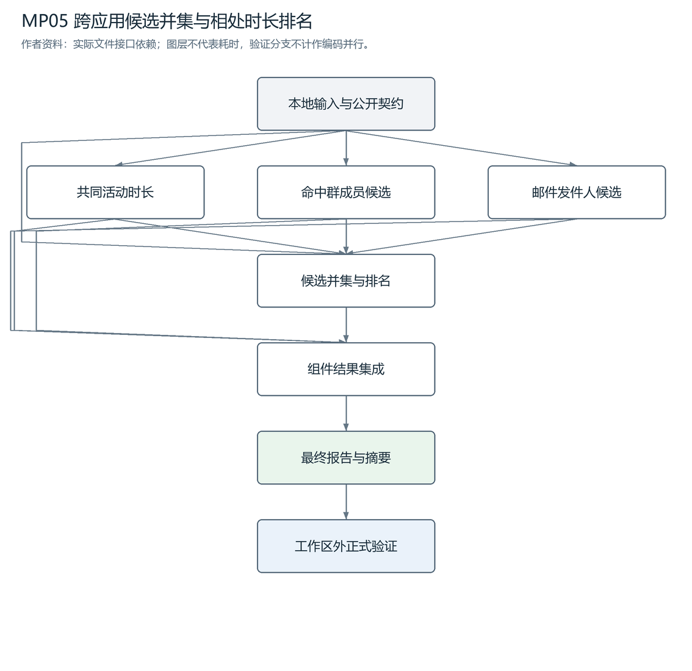

## MP06 · 取消日程后多渠道通知

风格：`multistage4`；实现单元：3；[TASK](../tasks/multistage4/calendar_cancel_notify/TASK.md) · [完整接口规格](../tasks/multistage4/calendar_cancel_notify/workspace/README.md)。
从删除前快照定位参会人，保证取消→通知及群创建→发送，只有有限批次状态。

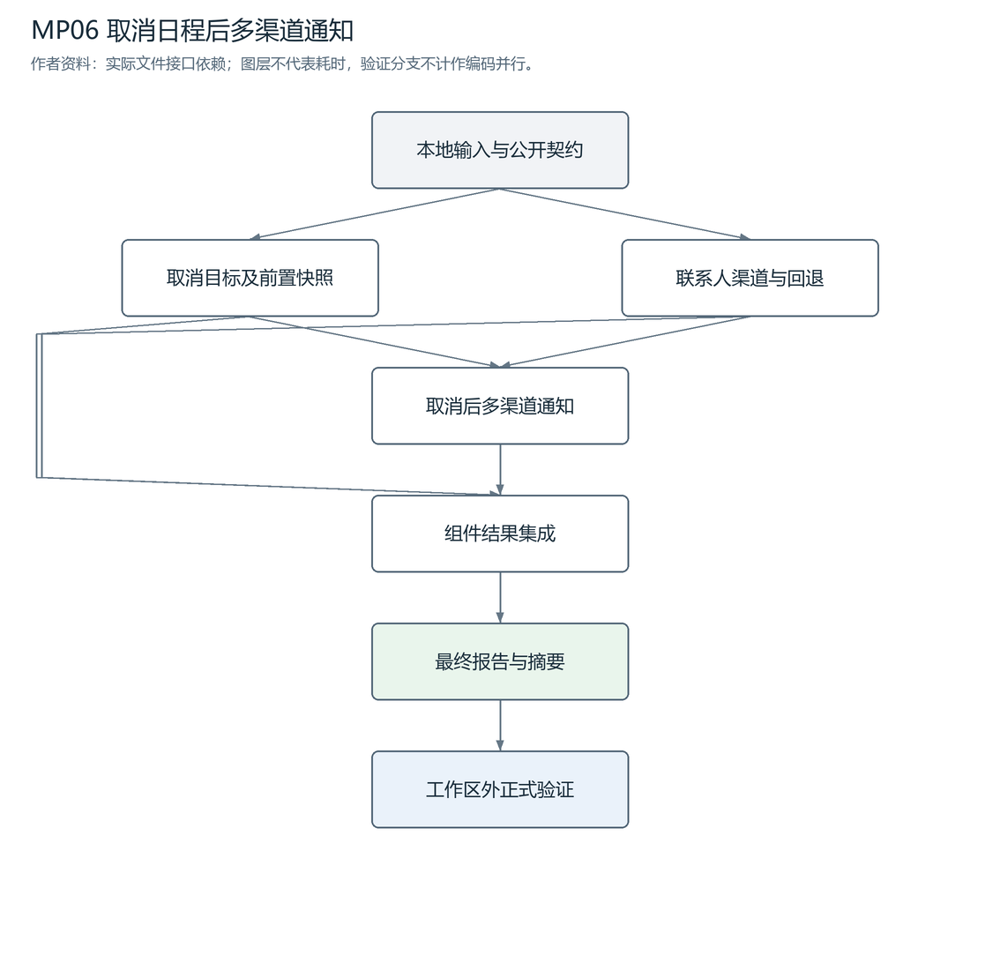

## MP07 · 附件发送后归档与独立清理

风格：`linux2`；实现单元：3；[TASK](../tasks/linux2/send_archive_cleanup/TASK.md) · [完整接口规格](../tasks/linux2/send_archive_cleanup/workspace/README.md)。
附件字节/路径、双人成功凭据与独立文件操作范围需要一致，无异步反馈状态机。

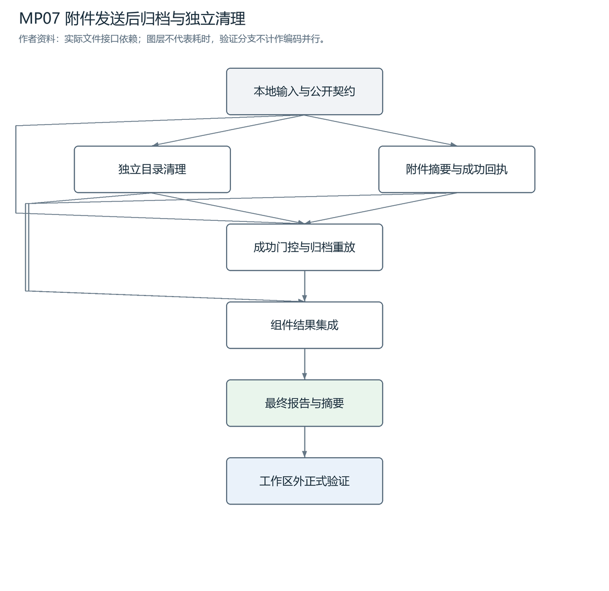

## MP08 · 节日照片迁移后发送与缺失报告

风格：`linux2`；实现单元：3；[TASK](../tasks/linux2/holiday_photo_migration/TASK.md) · [完整接口规格](../tasks/linux2/holiday_photo_migration/workspace/README.md)。
照片分类、部分成功、缺失证据及先移后发的路径约束相结合，不等待用户回答。

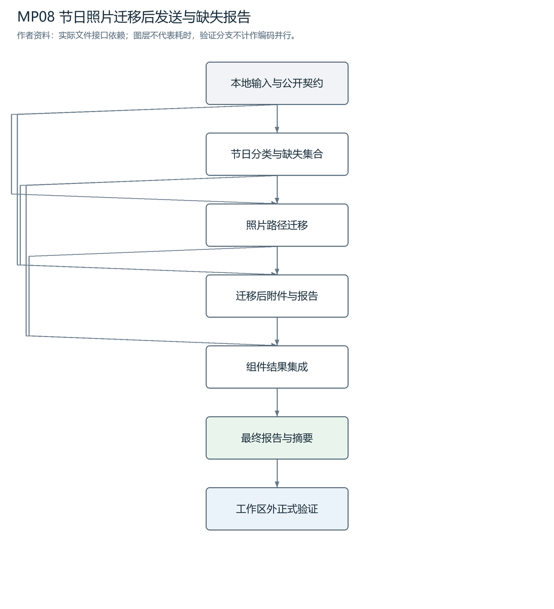

## MP09 · 两场座谈会、群邀请与物资采购

风格：`reasoning4`；实现单元：4；[TASK](../tasks/reasoning4/panel_events_procurement/TASK.md) · [完整接口规格](../tasks/reasoning4/panel_events_procurement/workspace/README.md)。
有限日历空档/日期计算、群集合和商品 argmax 三路合并，各算法标准且范围受控。

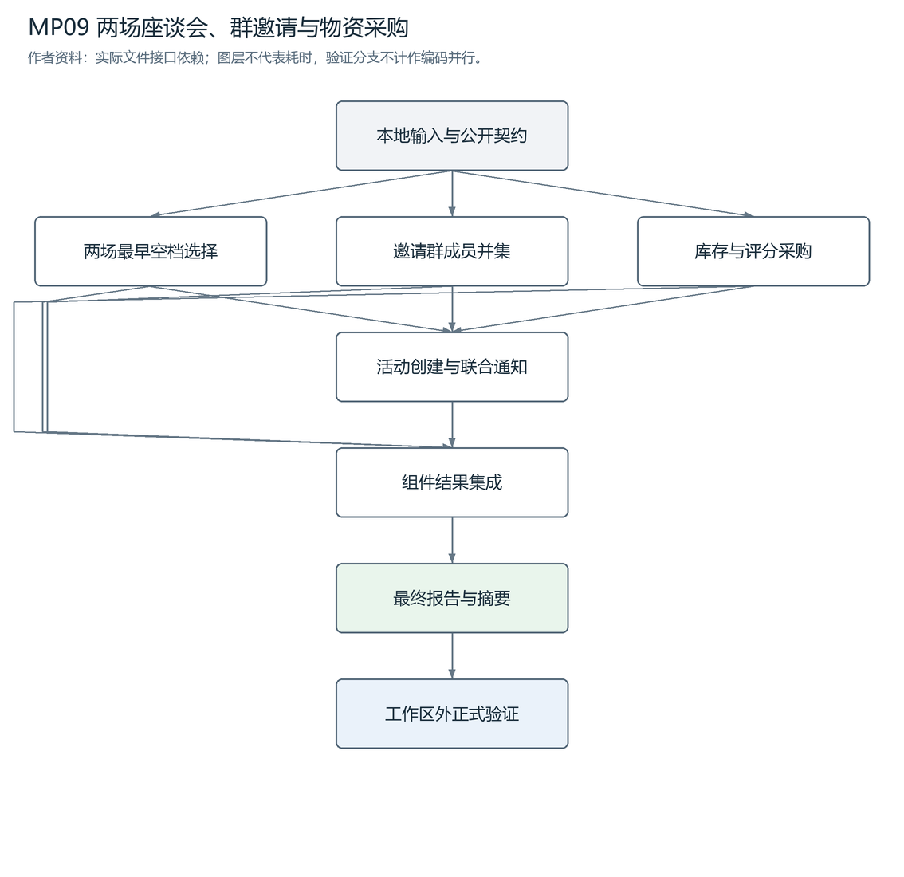

## MP10 · 晚宴计划、联系人定位与餐具采购

风格：`context8`；实现单元：3；[TASK](../tasks/context8/dinner_contact_checkout/TASK.md) · [完整接口规格](../tasks/context8/dinner_contact_checkout/workspace/README.md)。
晚宴计划、最近会话身份和多属性变体选择形成稳定三接口，无预算最优化或取消补偿。

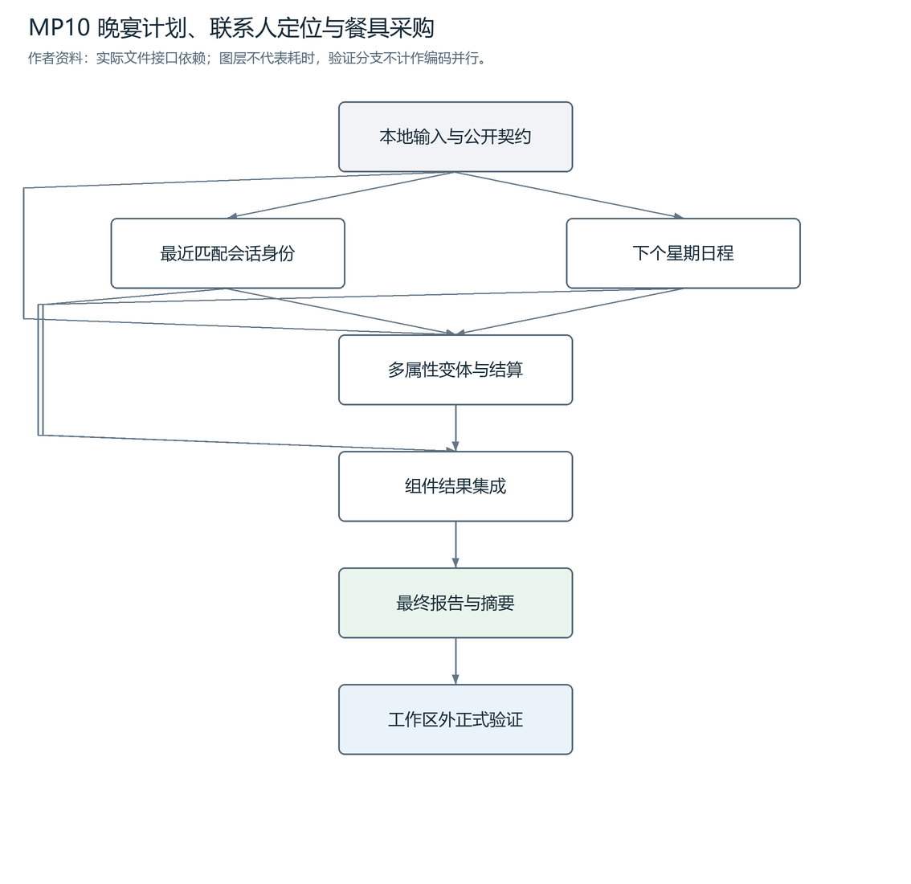

## MP11 · 取消会面、研讨会叫车与图书采购

风格：`reasoning4`；实现单元：3；[TASK](../tasks/reasoning4/meeting_ride_book_plan/TASK.md) · [完整接口规格](../tasks/reasoning4/meeting_ride_book_plan/workspace/README.md)。
日历范围筛选、提前量与书目条件独立求解，只在取消后通知处有真实局部顺序。

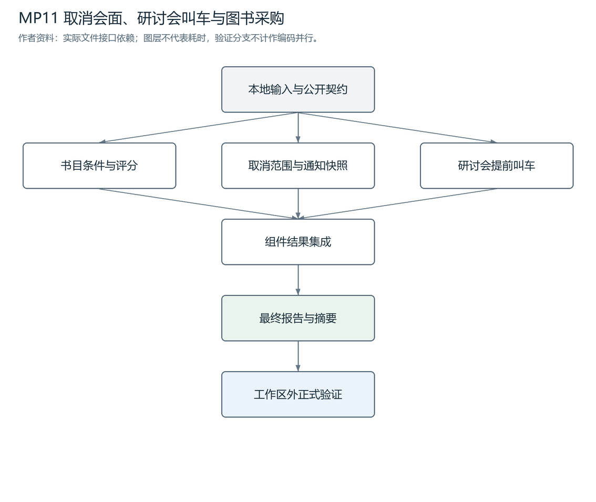

## MP12 · 下载目录归档、邮件清理与目标回复

风格：`linux2`；实现单元：4；[TASK](../tasks/linux2/files_mail_workspace/TASK.md) · [完整接口规格](../tasks/linux2/files_mail_workspace/workspace/README.md)。
三个文件/邮箱工作区的作用域与目标 ID 一致，冲突在提交前显式检查，无长期事件状态。

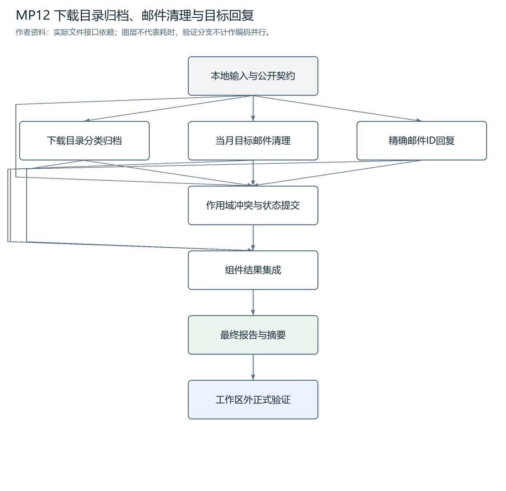

## MP13 · 聚合特征的行键保真与特征合并

风格：`reasoning4`；实现单元：4；[TASK](../tasks/reasoning4/grouped_feature_union/TASK.md) · [完整接口规格](../tasks/reasoning4/grouped_feature_union/workspace/README.md)。
A1/S0/C1/I1：三个标准提取算法及按键/列名一致性，非模型训练问题。

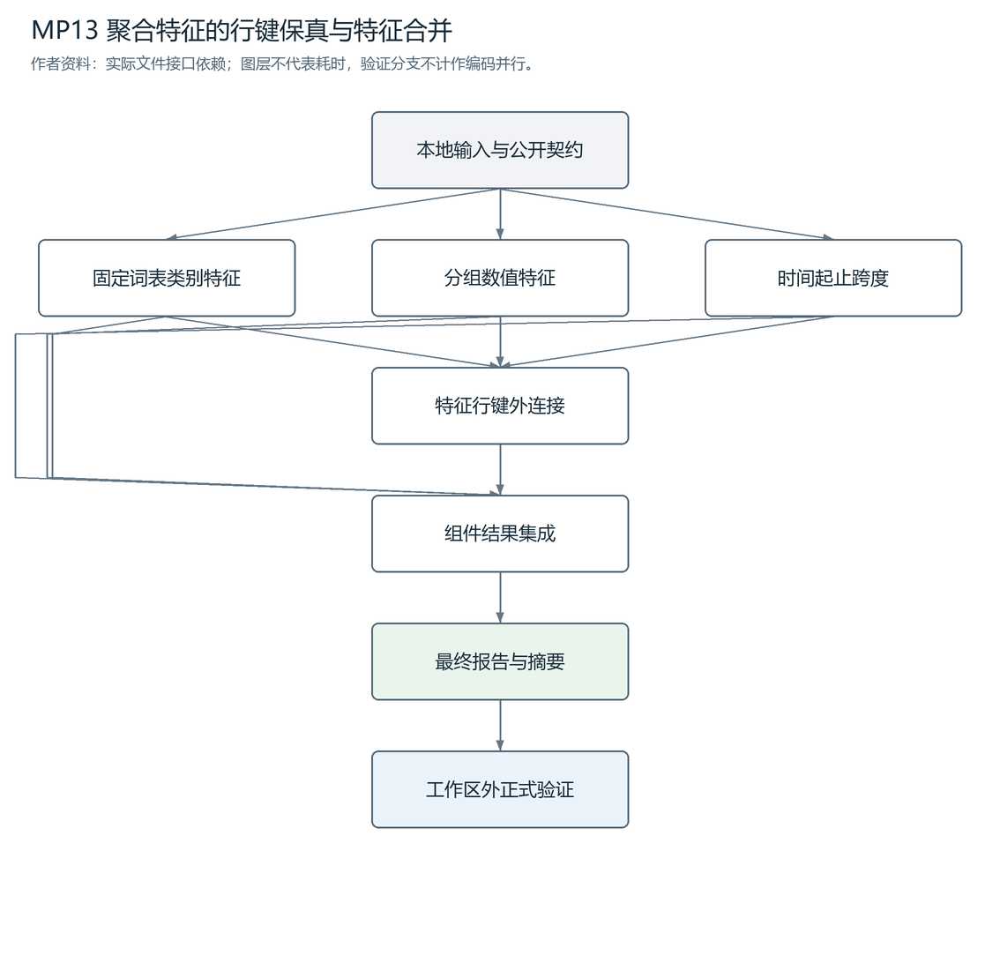

## MP14 · 异常链的可移植序列化与报告

风格：`context8`；实现单元：3；[TASK](../tasks/context8/portable_exception_report/TASK.md) · [完整接口规格](../tasks/context8/portable_exception_report/workspace/README.md)。
A1/S0/C1/I1：有限关系遍历、两类编解码及输出一致，不涉及长运行状态。

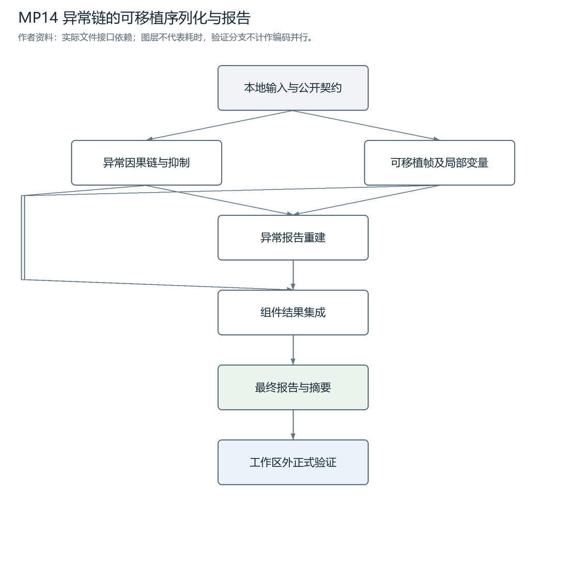

## MP15 · 普通引用、注解和类型注释的导入分析

风格：`reasoning4`；实现单元：4；[TASK](../tasks/reasoning4/python_import_usage/TASK.md) · [完整接口规格](../tasks/reasoning4/python_import_usage/workspace/README.md)。
A1/S0/C1/I1：受限静态分析加多来源一致性，无通用类型推断。

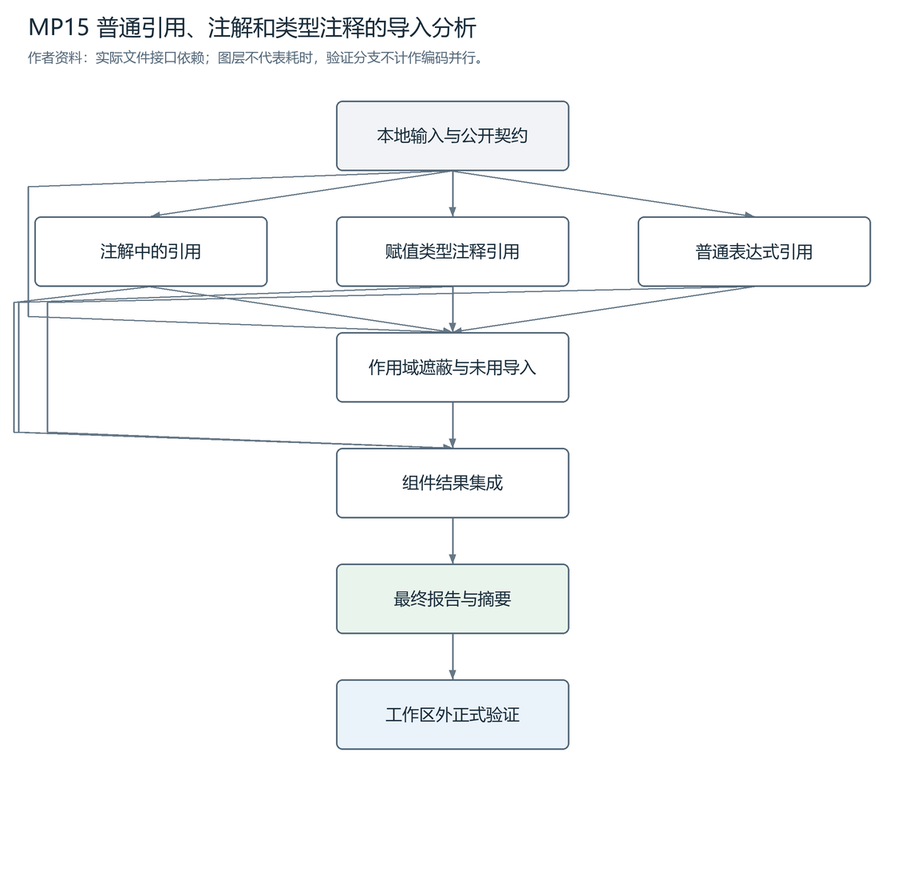

## MP16 · API 文档的签名、参数与继承信息聚合

风格：`context8`；实现单元：4；[TASK](../tasks/context8/api_documentation_merge/TASK.md) · [完整接口规格](../tasks/context8/api_documentation_merge/workspace/README.md)。
A1/S0/C1/I1：三个有限解析/查找规则和同一文档模型的集成。

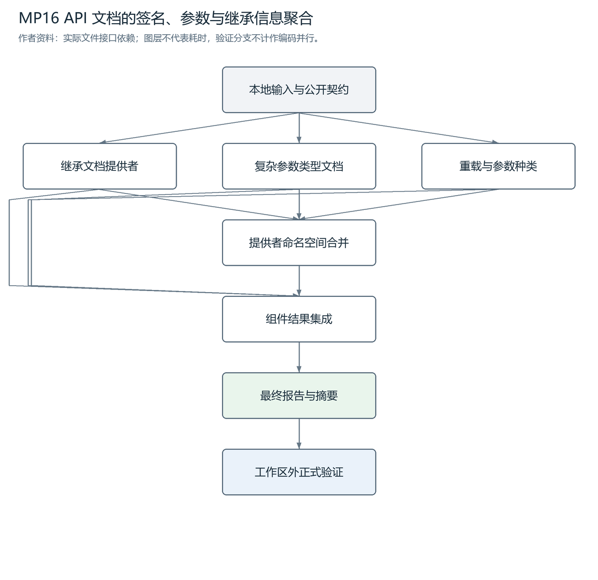

## MP17 · 文本、内联内容和文件的 multipart 组装

风格：`context8`；实现单元：3；[TASK](../tasks/context8/multipart_encoding/TASK.md) · [完整接口规格](../tasks/context8/multipart_encoding/workspace/README.md)。
A1/S0/C1/I1：边界较多的编码协议和部件一致性，无网络状态。

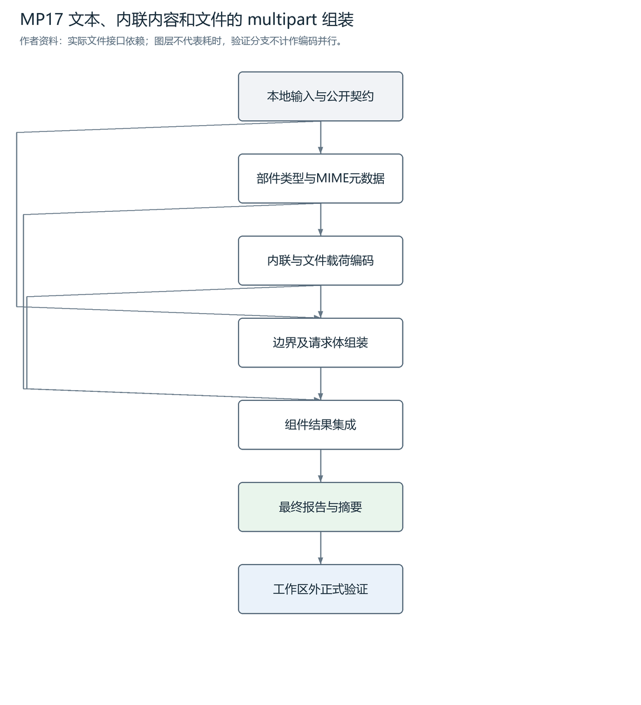

## MP18 · 集合文件清单的指令选择与归档元数据

风格：`linux2`；实现单元：3；[TASK](../tasks/linux2/collection_manifest/TASK.md) · [完整接口规格](../tasks/linux2/collection_manifest/workspace/README.md)。
A1/S0/C1/I1：有界路径规则解释、文件选择和规范清单，非依赖版本求解。

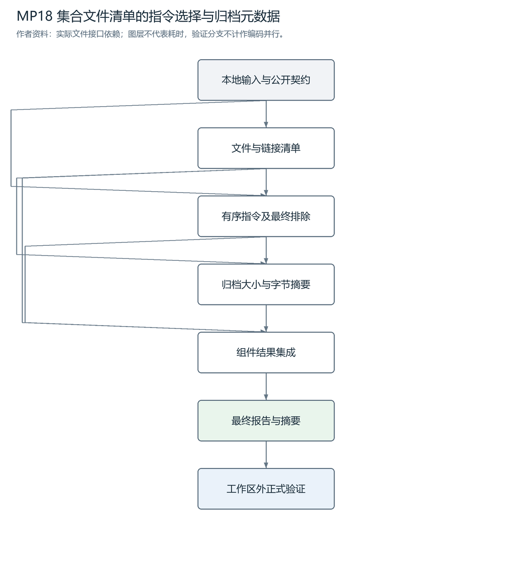

## MP19 · Python 支持模块发现与可重复 ZIP 载荷

风格：`reasoning4`；实现单元：3；[TASK](../tasks/reasoning4/module_dependency_zip/TASK.md) · [完整接口规格](../tasks/reasoning4/module_dependency_zip/workspace/README.md)。
A1/S0/C1/I1：受限静态扫描、标准闭包和打包，无动态类型推断或包安装搜索。

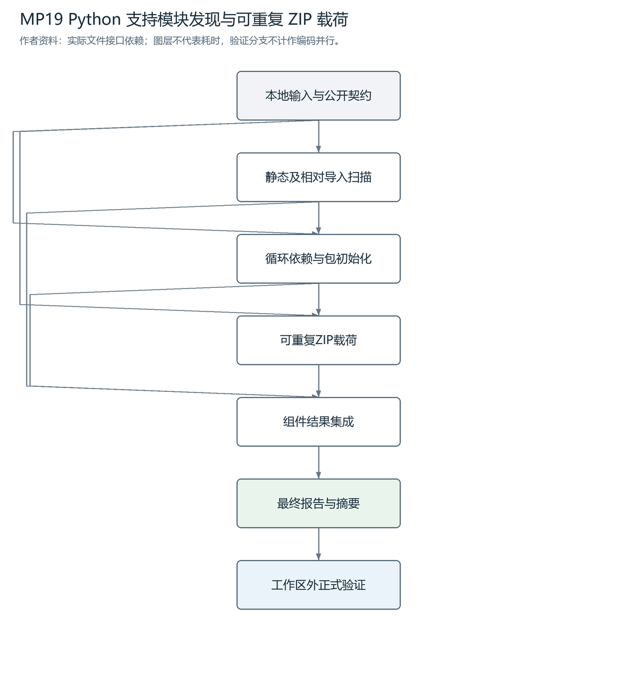

## MP20 · 特性配置的模式、附件与引用一致性

风格：`multistage4`；实现单元：4；[TASK](../tasks/multistage4/feature_config_snapshot/TASK.md) · [完整接口规格](../tasks/multistage4/feature_config_snapshot/workspace/README.md)。
A1/S1/C1/I1：有限 schema/引用图/附件转换及一次原子提交，无远程配置分发。

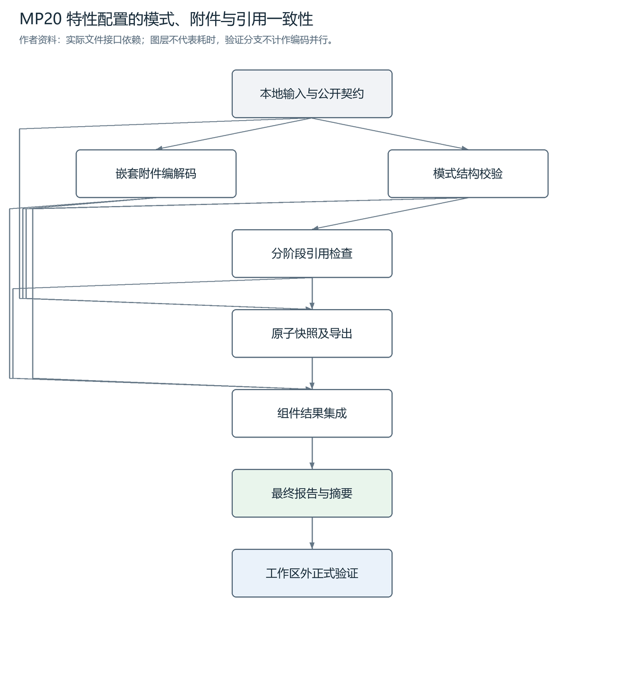

## MP21 · 播放列表重写、条件查询与 M3U 导出

风格：`context8`；实现单元：3；[TASK](../tasks/context8/playlist_query_export/TASK.md) · [完整接口规格](../tasks/context8/playlist_query_export/workspace/README.md)。
A1/S1/C1/I1：有序状态、查询表达与文本导出三接口一致。

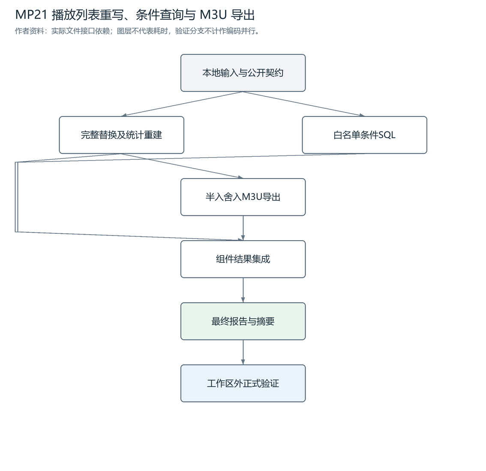

## MP22 · MARC 作者标题、语言和主题导入

风格：`multistage4`；实现单元：5；[TASK](../tasks/multistage4/marc_catalog_import/TASK.md) · [完整接口规格](../tasks/multistage4/marc_catalog_import/workspace/README.md)。
A1/S0/C1/I1：表驱动的有限格式、链接与计数，不依赖人工知识或全局实体匹配。

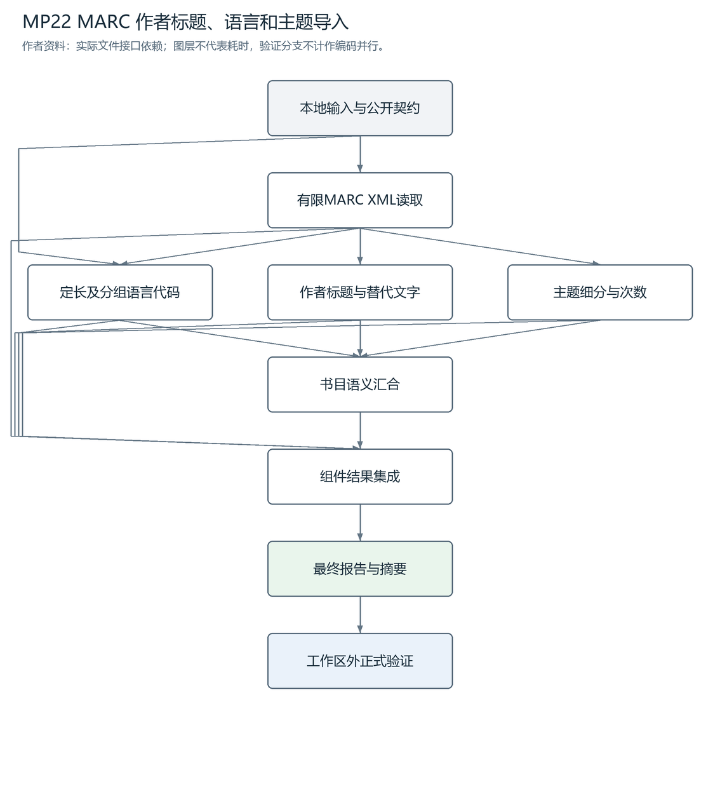

## MP23 · 受目录容量限制的可逆文件重分片

风格：`linux2`；实现单元：3；[TASK](../tasks/linux2/reversible_file_resharding/TASK.md) · [完整接口规格](../tasks/linux2/reversible_file_resharding/workspace/README.md)。
A1/S1/C1/I1：确定性分块、树布局和可逆协议，不做最优装箱或信息论压缩搜索。

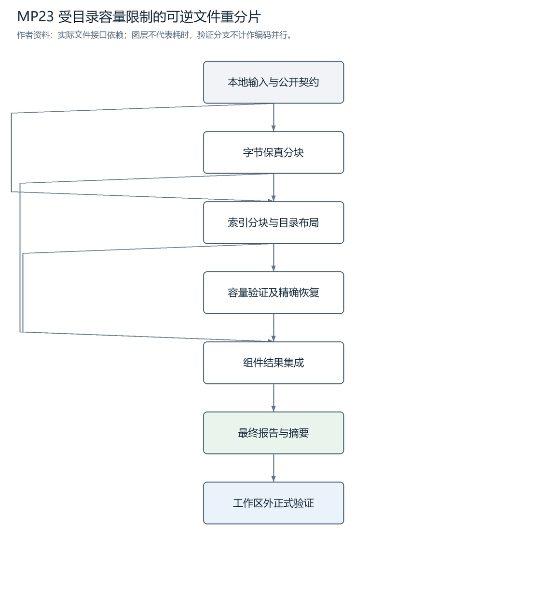

## MP24 · 大学任职、在读人数与国家集合查询

风格：`reasoning4`；实现单元：4；[TASK](../tasks/reasoning4/university_relation_query/TASK.md) · [完整接口规格](../tasks/reasoning4/university_relation_query/workspace/README.md)。
A1/S0/C1/I1：受限关系关联、日期筛选与 distinct 计数。来源歧义属于质量修订而非 H。

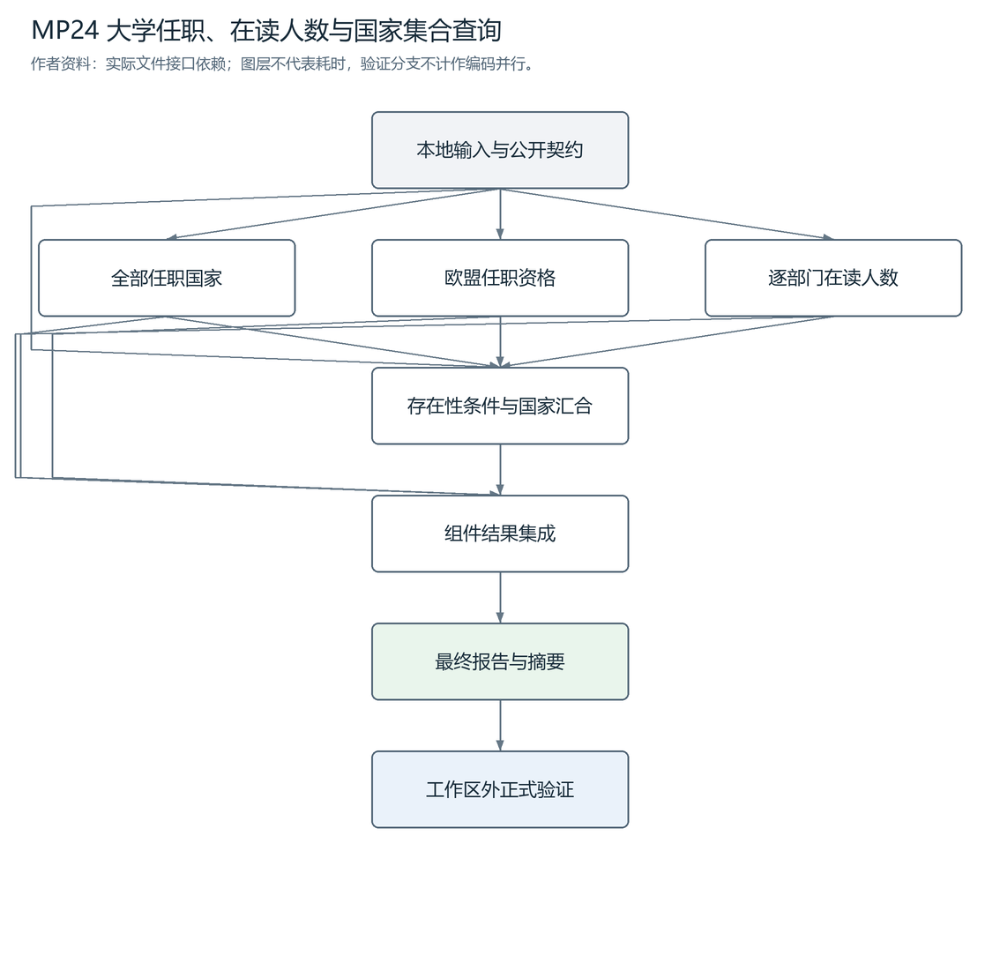

## MP25 · 文本票据分类、金额提取与归档汇总

风格：`multistage4`；实现单元：3；[TASK](../tasks/multistage4/text_invoice_archive/TASK.md) · [完整接口规格](../tasks/multistage4/text_invoice_archive/workspace/README.md)。
A1/S1/C1/I1：受控文本规则、多种金额语义和有副作用的归档一致性。

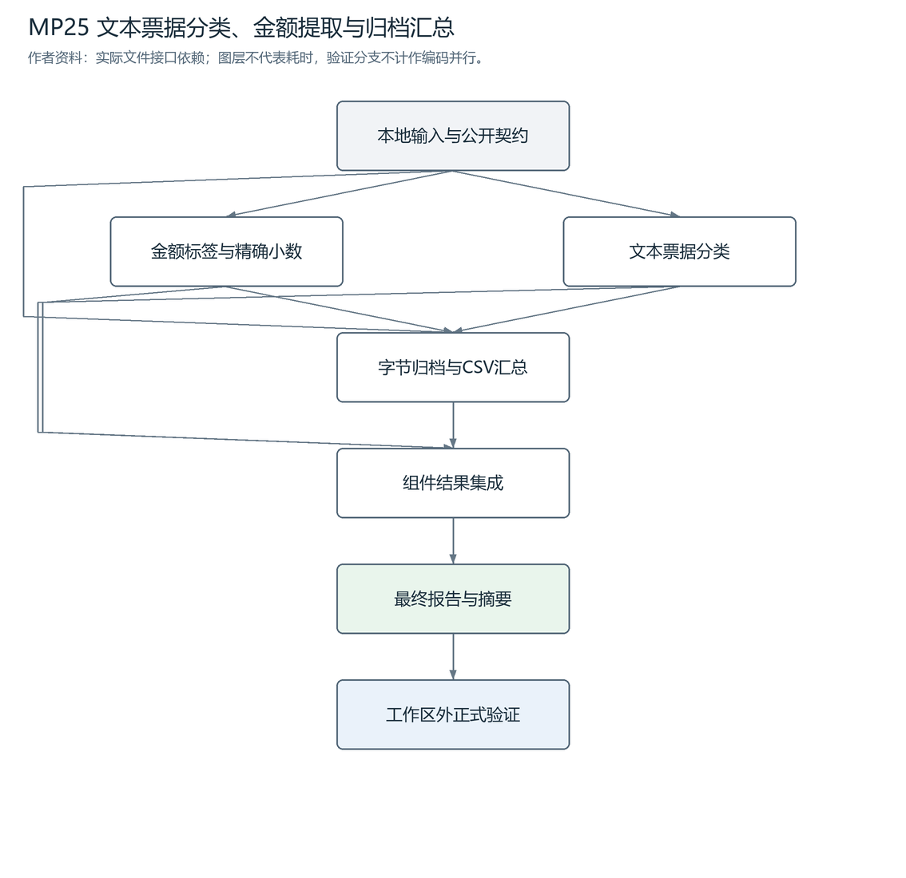

## MP26 · 每日晚餐提醒的去重、冲突取消与通知

风格：`reasoning4`；实现单元：5；[TASK](../tasks/reasoning4/recurring_dinner_calendar/TASK.md) · [完整接口规格](../tasks/reasoning4/recurring_dinner_calendar/workspace/README.md)。
A1/S1/C1/I1：标准日期/区间规划与有限的状态一致性，无资源最优排程。

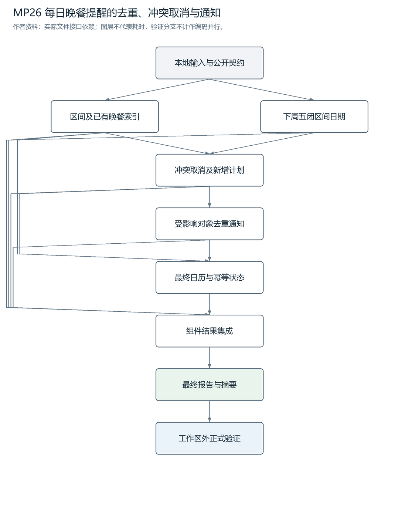
