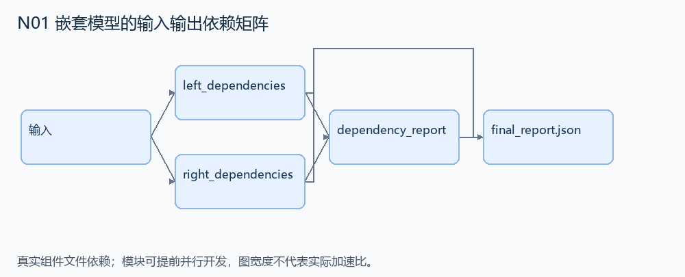
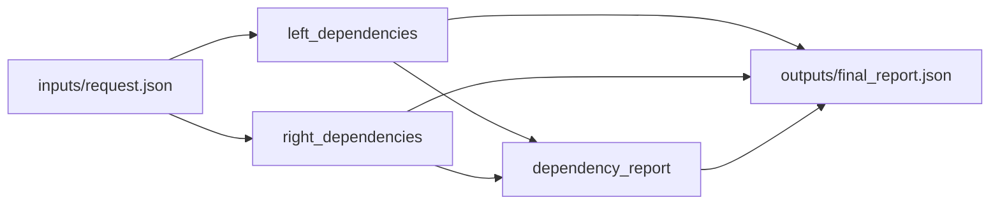

# N01 嵌套模型的输入输出依赖矩阵

设计目标 M；实测未校准。结构风格 `reasoning4`，3 个组件，组件 DAG 宽度 2。

根据小型模型表达式树，计算每个输出依赖哪些输入，保持并联嵌套前后的依赖一致。

[TASK](../../tasks/reasoning4/nested_model_dependencies/TASK.md) · [工作区规格](../../tasks/reasoning4/nested_model_dependencies/workspace/README.md)

## 核心组件

- `left_dependencies`：输入 model 是叶子 {kind:'leaf',matrix:[[0或1,...],...]}，或 {kind:'parallel'|'serial',left:模型,right:模型}。矩阵行对应输出，列对应输入。parallel 使用块对角；serial 表示先 left 后 right，结果是 right×left 的布尔乘积。返回依赖矩阵（0/1 的二维列表）。所有维度合法、矩阵非空；树深≤6，输入输出维度≤12。
  输入绑定：`{"model": "inputs/request.json#/left"}`；组件产物 `outputs/left_dependencies.json`。
- `right_dependencies`：与 left_dependencies 相同的模型依赖规则，独立计算右子树。
  输入绑定：`{"model": "inputs/request.json#/right"}`；组件产物 `outputs/right_dependencies.json`。
- `dependency_report`：按 kind=parallel/serial 组合两个矩阵。返回 {matrix:依赖矩阵,input_count:列数,output_count:行数,separable:[bool,...]}。某输出恰好依赖一个输入，且没有其他输出依赖同一输入时才 separable=true。
  输入绑定：`{"left": "outputs/left_dependencies.json#", "right": "outputs/right_dependencies.json#", "kind": "inputs/request.json#/kind"}`；组件产物 `outputs/dependency_report.json`。

## 评分与非核心范围

A/B/D/P 共 17 个冻结验收单元，接口 bundle 包含两组干净目录独立构建。上限2，Reward=2×(0.5×K/N+0.5×Strict)，完整性失败清零。

不要求安装天文库、拟合数据、坐标投影或任意模型插件。

## 来源与原始标签

- **SWE-bench Verified**：[`astropy__astropy-12907`](https://github.com/astropy/astropy/pull/12907)；原始标注：15 min - 1 hour。

原题核心：嵌套 CompoundModel 的并联组合错误地把独立输入连成全依赖。

改编范围：用声明式模型树替代 Astropy 对象；支持叶子依赖、并联与串联，以布尔矩阵完成组合，并输出可分离性报告。树和矩阵均为小规模。

[本题完整来源追溯](../原题来源与改编说明.md#n01) · [机器索引](../../review/source_provenance_v1.json)

原始标签不直接决定改编题难度；最终业务范围以当前工作区规格为准。

## 去重依据

旧题是数据轴拼接或行键聚合；本题的核心是模型组合的依赖代数，不复用拼接求解器。
