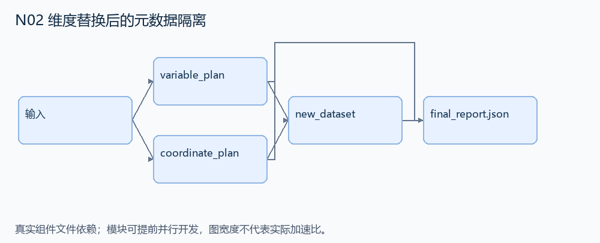
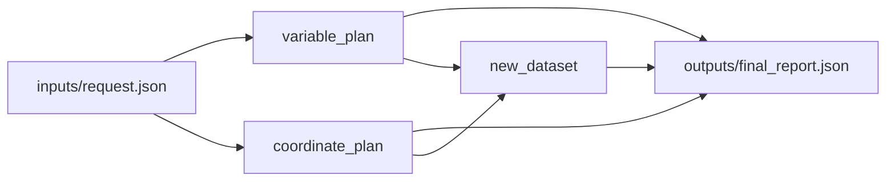

# N02 维度替换后的元数据隔离

设计目标 M；实测未校准。结构风格 `context8`，3 个组件，组件 DAG 宽度 2。

实现轻量数据集的维度替换，生成正确的新坐标和变量描述，同时保持原数据集不变。

[TASK](../../tasks/context8/isolated_dimension_swap/TASK.md) · [工作区规格](../../tasks/context8/isolated_dimension_swap/workspace/README.md)

## 核心组件

- `variable_plan`：dataset.variables 是 {name:{dims:[维度名],data:[整数],attrs:字段字典}}；swap 是单个 {旧维度:新坐标变量名}。生成变量计划 {name:{dims:替换后的维度列表,data:原数据,attrs:原attrs}}，所有结果可变元数据必须与输入隔离。输入是一维同长变量，目标坐标变量存在。
  输入绑定：`{"dataset": "inputs/request.json#/dataset", "swap": "inputs/request.json#/swap"}`；组件产物 `outputs/variable_plan.json`。
- `coordinate_plan`：返回 {coords:把 swap 的目标变量加入原 coords 后排序去重,indexes:{新坐标名:目标变量的数据}}。
  输入绑定：`{"dataset": "inputs/request.json#/dataset", "swap": "inputs/request.json#/swap"}`；组件产物 `outputs/coordinate_plan.json`。
- `new_dataset`：返回新 {variables,coords,indexes}，对象不得通过可变 dims/attrs/coords/indexes 别名修改 payload。
  输入绑定：`{"variables": "outputs/variable_plan.json#", "coordinates": "outputs/coordinate_plan.json#"}`；组件产物 `outputs/new_dataset.json`。

## 评分与非核心范围

A/B/D/P 共 17 个冻结验收单元，接口 bundle 包含两组干净目录独立构建。上限2，Reward=2×(0.5×K/N+0.5×Strict)，完整性失败清零。

不要求所有深层数据无限递归复制、分布式数组、Zarr 或任意历史 xarray API。

## 来源与原始标签

- **SWE-bench Verified**：[`pydata__xarray-6938`](https://github.com/pydata/xarray/pull/6938)；原始标注：15 min - 1 hour。

原题核心：swap_dims 的对象别名导致新索引变量修改原变量的 dims。

改编范围：保留变量→索引变量转换与复制隔离；以小型 Python 对象代替完整 xarray，只覆盖公开的替换操作和必要元数据。

[本题完整来源追溯](../原题来源与改编说明.md#n02) · [机器索引](../../review/source_provenance_v1.json)

原始标签不直接决定改编题难度；最终业务范围以当前工作区规格为准。

## 去重依据

MP02 检查拼接轴和数据排列；本题检查对象所有权与派生后隔离。
