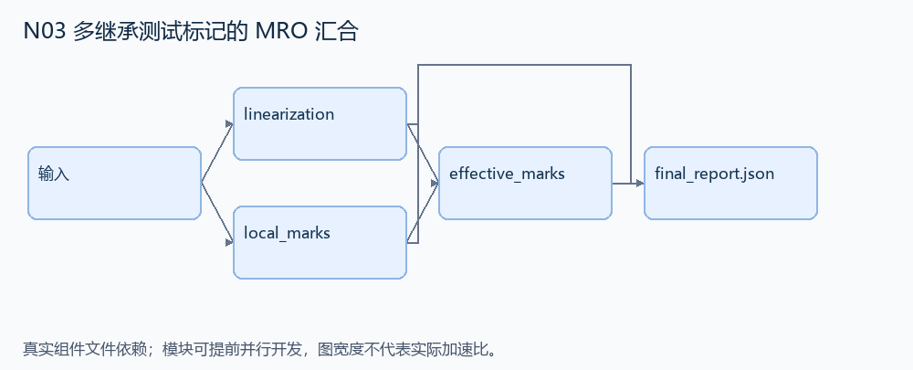
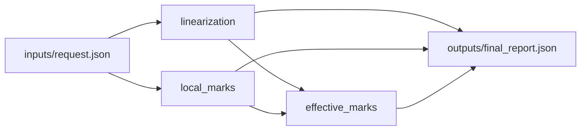

# N03 多继承测试标记的 MRO 汇合

设计目标 M；实测未校准。结构风格 `reasoning4`，3 个组件，组件 DAG 宽度 2。

从有效多继承图计算类的 C3 顺序，并按顺序收集本类及祖先各自声明的测试标记。

[TASK](../../tasks/reasoning4/class_marker_mro/TASK.md) · [工作区规格](../../tasks/reasoning4/class_marker_mro/workspace/README.md)

## 核心组件

- `linearization`：classes 是 {类名:{bases:有序直接基类列表,marks:本地标记JSON值列表}}。输入是无环且可 C3 线性化的有效类图，根类 bases=[]。返回 target 的 C3 类名列表，首项是自己。不执行用户类代码。
  输入绑定：`{"classes": "inputs/request.json#/classes", "target": "inputs/request.json#/target"}`；组件产物 `outputs/linearization.json`。
- `local_marks`：返回每个类自身声明的 marks 的独立副本字典，不能把继承标记混入本地标记。
  输入绑定：`{"classes": "inputs/request.json#/classes"}`；组件产物 `outputs/local_marks.json`。
- `effective_marks`：按 mro 顺序逐类连接本地标记列表，保留同名不同参数的标记和本地列表顺序。返回 {mro,marks}。
  输入绑定：`{"mro": "outputs/linearization.json#", "local": "outputs/local_marks.json#"}`；组件产物 `outputs/effective_marks.json`。

## 评分与非核心范围

A/B/D/P 共 17 个冻结验收单元，接口 bundle 包含两组干净目录独立构建。上限2，Reward=2×(0.5×K/N+0.5×Strict)，完整性失败清零。

不测元类执行、自定义描述符、非法继承图的精确异常文案。

## 来源与原始标签

- [pytest-dev__pytest-10356](https://github.com/pytest-dev/pytest/pull/10356)：1-4 hours；人工预计修复时间，不是模型通过率。

## 去重依据

旧题聚合文档和已知继承信息；本题求解有效类线性化并收集测试标记，不生成 API 文档。
