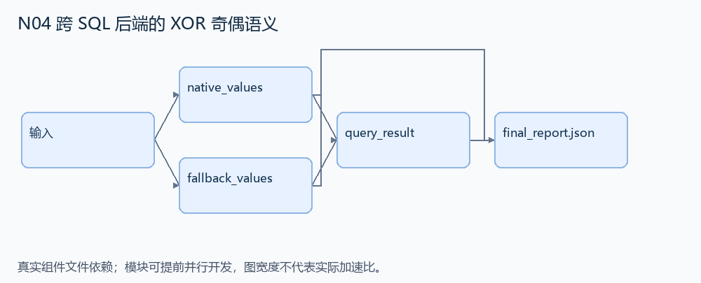
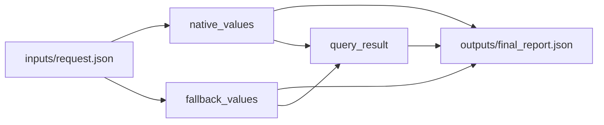

# N04 跨 SQL 后端的 XOR 奇偶语义

设计目标 M；实测未校准。结构风格 `context8`，3 个组件，组件 DAG 宽度 2。

把同一布尔谓词树分别编译为原生 XOR 和无 XOR 后端可执行的表达式，使查询选择一致。

[TASK](../../tasks/context8/xor_backend_parity/TASK.md) · [工作区规格](../../tasks/context8/xor_backend_parity/workspace/README.md)

## 核心组件

- `native_values`：ast 为字段名字符串，或 {op:'and'|'or'|'xor',args:[AST,...]}。args 非空，字段为非空布尔值。按布尔逻辑计算每行真假，xor 为真项数的奇偶性。返回 [bool,...]，按 rows 原顺序。
  输入绑定：`{"ast": "inputs/request.json#/ast", "rows": "inputs/request.json#/rows"}`；组件产物 `outputs/native_values.json`。
- `fallback_values`：为不支持原生 XOR 的 SQLite 编译参数表达式（字段写成 :字段），实际执行每行。返回 {sql:可用于 SELECT(expression) 的SQLite表达式,values:[bool,...]}。允许任何语义等价表达式，不要求固定SQL文本。xor 的 fallback 必须保持奇偶性。
  输入绑定：`{"ast": "inputs/request.json#/ast", "rows": "inputs/request.json#/rows"}`；组件产物 `outputs/fallback_values.json`。
- `query_result`：若两后端 values 一致，返回 {values:真假列表,selected_ids:按输入顺序选中行ID}。消费实际后端结果，不使用固定答案。
  输入绑定：`{"native": "outputs/native_values.json#", "fallback": "outputs/fallback_values.json#", "rows": "inputs/request.json#/rows"}`；组件产物 `outputs/query_result.json`。

## 评分与非核心范围

A/B/D/P 共 17 个冻结验收单元，接口 bundle 包含两组干净目录独立构建。上限2，Reward=2×(0.5×K/N+0.5×Strict)，完整性失败清零。

不引入 SQL NULL 三值逻辑、任意 SQL 注入输入或精确 SQL 文本匹配。

## 来源与原始标签

- [django__django-16901](https://github.com/django/django/pull/16901)：15 min - 1 hour；人工预计修复时间，不是模型通过率。

## 去重依据

旧题涉及播放列表条件与导出；本题专门检验后端 XOR 语义等价，数据和算法内核均不同。
