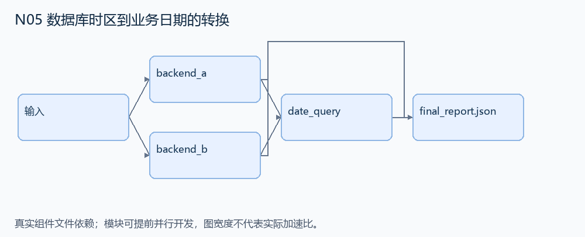
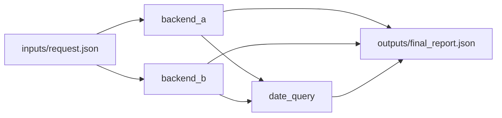

# N05 数据库时区到业务日期的转换

设计目标 M；实测未校准。结构风格 `multistage4`，3 个组件，组件 DAG 宽度 2。

从各数据库的本地时间表示得到业务时区的正确日期，生成等价的后端查询计划和筛选结果。

[TASK](../../tasks/multistage4/database_timezone_dates/TASK.md) · [工作区规格](../../tasks/multistage4/database_timezone_dates/workspace/README.md)

## 核心组件

- `backend_a`：rows=[{id,local:'YYYY-MM-DDTHH:MM:SS'}]，source/target 为相对 UTC 的整数分钟偏移（±720以内）。返回 [{id,date:'YYYY-MM-DD'}]，须先从数据库本地区时间换到业务时区再取日期。
  输入绑定：`{"rows": "inputs/request.json#/rows", "source": "inputs/request.json#/source", "target": "inputs/request.json#/target"}`；组件产物 `outputs/backend_a.json`。
- `backend_b`：同 backend_a 的日期语义，用独立后端路径处理；同区时不可重复偏移。
  输入绑定：`{"rows": "inputs/request.json#/rows", "source": "inputs/request.json#/source", "target": "inputs/request.json#/target"}`；组件产物 `outputs/backend_b.json`。
- `date_query`：两后端一致时返回 {dates:a,selected_ids:日期等于 date 的行ID}。
  输入绑定：`{"a": "outputs/backend_a.json#", "b": "outputs/backend_b.json#", "date": "inputs/request.json#/date"}`；组件产物 `outputs/date_query.json`。

## 评分与非核心范围

A/B/D/P 共 17 个冻结验收单元，接口 bundle 包含两组干净目录独立构建。上限2，Reward=2×(0.5×K/N+0.5×Strict)，完整性失败清零。

不扩展 DST、历史时区表、真实 MySQL/Oracle、无效时间字符串。

## 来源与原始标签

- [django__django-11138](https://github.com/django/django/pull/11138)：1-4 hours；人工预计修复时间，不是模型通过率。

## 去重依据

旧题是循环日程和通知；本题是数据库时间解释与跨后端查询保真。
