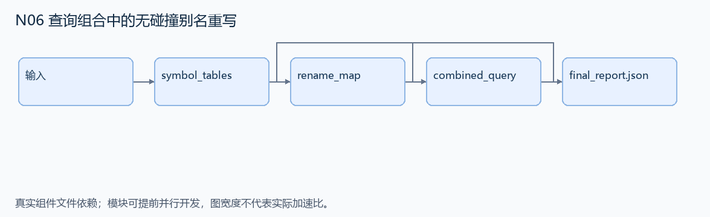
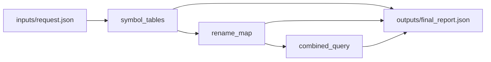

# N06 查询组合中的无碰撞别名重写

设计目标 M；实测未校准。结构风格 `reasoning4`，3 个组件，组件 DAG 宽度 1。

组合两棵简化查询树，分配无碰撞表别名，并同步重写 JOIN 和谓词引用。

[TASK](../../tasks/reasoning4/simultaneous_query_aliases/TASK.md) · [工作区规格](../../tasks/reasoning4/simultaneous_query_aliases/workspace/README.md)

## 核心组件

- `symbol_tables`：left/right 是 {tables:{alias:表名},clauses:[{alias,field,value}]}；每个 clause.alias 都在对应 tables 内。返回 {left:排序别名列表,right:排序别名列表}。
  输入绑定：`{"left": "inputs/request.json#/left", "right": "inputs/request.json#/right"}`；组件产物 `outputs/symbol_tables.json`。
- `rename_map`：为右查询的每个原别名按字典序分配新别名 T0,T1,...，跳过左右原别名及已分配名称。返回 {原右别名:新别名}。此公开命名规则用于稳定输出；替换必须同时进行，不能串行替换导致二次改名。
  输入绑定：`{"symbols": "outputs/symbol_tables.json#"}`；组件产物 `outputs/rename_map.json`。
- `combined_query`：返回 {tables:左表映射与重命名后右表映射,branches:[左clauses,按原映射同时改名的右clauses]}。保留每个 clause 的 field/value 与原顺序，两分支表示 OR，不把字符串 value 内的别名文本当引用改写。
  输入绑定：`{"left": "inputs/request.json#/left", "right": "inputs/request.json#/right", "mapping": "outputs/rename_map.json#"}`；组件产物 `outputs/combined_query.json`。

## 评分与非核心范围

A/B/D/P 共 17 个冻结验收单元，接口 bundle 包含两组干净目录独立构建。上限2，Reward=2×(0.5×K/N+0.5×Strict)，完整性失败清零。

不测任意 SQL 方言、数据库连接、格式化空格或别名名称的唯一指定。

## 来源与原始标签

- [django__django-15128](https://github.com/django/django/pull/15128)：1-4 hours；人工预计修复时间，不是模型通过率。

## 去重依据

旧题是架构演进分析；本题是编译器符号重命名和查询语义，不能用旧配置/迁移算法替代。
