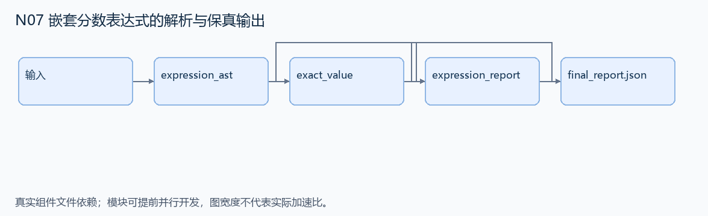
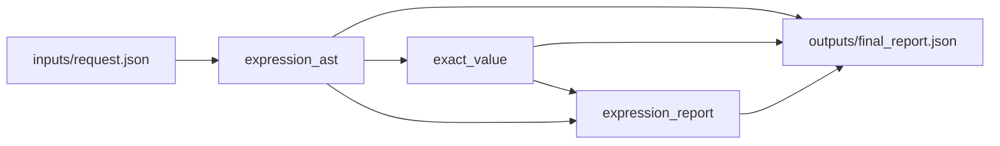

# N07 嵌套分数表达式的解析与保真输出

设计目标 M；实测未校准。结构风格 `reasoning4`，3 个组件，组件 DAG 宽度 1。

解析有限 LaTeX 分数语法，构造正确表达式树，并输出保持除法结合关系的表示与数值结果。

[TASK](../../tasks/reasoning4/nested_fraction_parser/TASK.md) · [工作区规格](../../tasks/reasoning4/nested_fraction_parser/workspace/README.md)

## 核心组件

- `expression_ast`：解析公开语法：整数、单字母变量、花括号/圆括号分组、+、*、^和\frac{expr}{expr}。+/*左结合，^只跟非负整数字面量；\frac保留完整分子分母。返回AST：['int',n]、['var',name]、['add'|'mul'|'div'|'pow',left,right]。无隐式乘法、所有输入合法，深度≤8。
  输入绑定：`{"latex": "inputs/request.json#/latex"}`；组件产物 `outputs/expression_ast.json`。
- `exact_value`：使用有理数解释AST，values给每个变量整数值且所有分母非零。返回 {numerator:最简有符号整数,denominator:正整数}。
  输入绑定：`{"ast": "outputs/expression_ast.json#", "values": "inputs/request.json#/values"}`；组件产物 `outputs/exact_value.json`。
- `expression_report`：返回 {ast:输入AST,value:输入有理数值,text:全括号中缀表示}。int/var直接打印，add/mul/div/pow分别打印 (left+right)/(left*right)/(left/right)/(left^right)，此处斜线表示规则分隔而非输出串；每个二元节点恰有一对外括号。
  输入绑定：`{"ast": "outputs/expression_ast.json#", "value": "outputs/exact_value.json#"}`；组件产物 `outputs/expression_report.json`。

## 评分与非核心范围

A/B/D/P 共 17 个冻结验收单元，接口 bundle 包含两组干净目录独立构建。上限2，Reward=2×(0.5×K/N+0.5×Strict)，完整性失败清零。

不测任意 LaTeX 宏、非法语法报错细节、符号证明或除零稳健性。

## 来源与原始标签

- **SWE-bench Verified**：[`sympy__sympy-21612`](https://github.com/sympy/sympy/pull/21612)；原始标注：15 min - 1 hour。

原题核心：嵌套分母缺括号，使除以分数变成连续除法。

改编范围：只保留变量、有理数、加乘幂和 frac 的公开子集；用 Fraction 与小型 AST 代替完整 SymPy/ANTLR。

[本题完整来源追溯](../原题来源与改编说明.md#n07) · [机器索引](../../review/source_provenance_v1.json)

原始标签不直接决定改编题难度；最终业务范围以当前工作区规格为准。

## 去重依据

旧题分析 Python 导入；本题处理数学表达式结合性，不共享导入使用分析算法。
