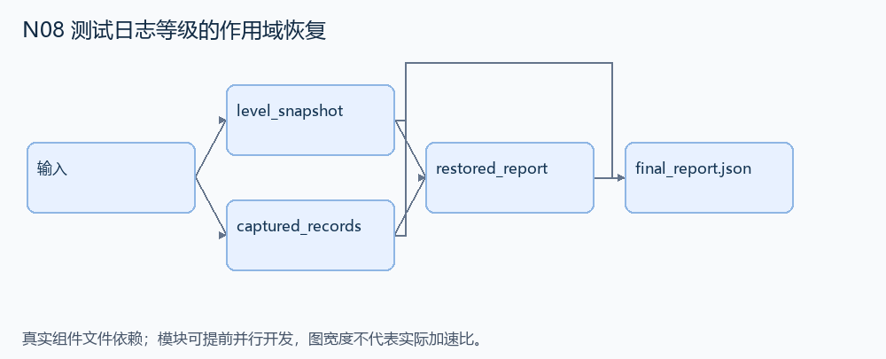
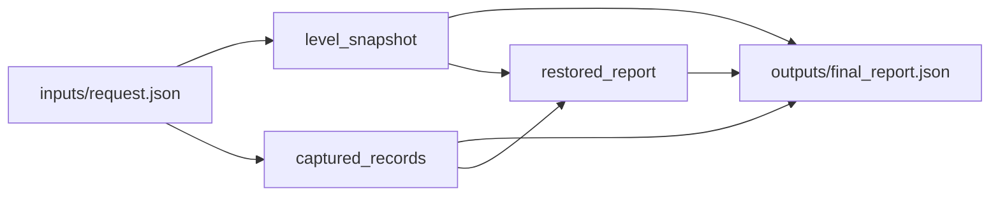

# N08 测试日志等级的作用域恢复

设计目标 M；实测未校准。结构风格 `context8`，3 个组件，组件 DAG 宽度 2。

为简化日志捕获组件实现等级设置和测试结束恢复，保证后续测试不继承前一个测试的 logger/handler 修改。

[TASK](../../tasks/context8/log_level_scope_restore/TASK.md) · [工作区规格](../../tasks/context8/log_level_scope_restore/workspace/README.md)

## 核心组件

- `level_snapshot`：initial={handler:整数阈值,loggers:{名称:整数阈值}}。返回独立拷贝，保存测试开始时等级。
  输入绑定：`{"initial": "inputs/request.json#/initial"}`；组件产物 `outputs/level_snapshot.json`。
- `captured_records`：events依次为 {kind:'set',logger,level}（同时设置该logger与handler），或 {kind:'emit',logger,level,text}。日志级别>=logger阈值且>=handler阈值才捕获。返回 {state:测试末等级,captured:[捕获的text]}；不修改输入。
  输入绑定：`{"initial": "inputs/request.json#/initial", "events": "inputs/request.json#/events"}`；组件产物 `outputs/captured_records.json`。
- `restored_report`：结束时从首次快照恢复全部等级，再处理下一测试的 emit 事件。返回 {restored:快照,captured:上个测试捕获文本,next_captured:下一测试可见文本}。
  输入绑定：`{"snapshot": "outputs/level_snapshot.json#", "capture": "outputs/captured_records.json#", "next_events": "inputs/request.json#/next_events"}`；组件产物 `outputs/restored_report.json`。

## 评分与非核心范围

A/B/D/P 共 17 个冻结验收单元，接口 bundle 包含两组干净目录独立构建。上限2，Reward=2×(0.5×K/N+0.5×Strict)，完整性失败清零。

不测多线程竞态、嵌套 fixture、任意 logging 插件或精确打印格式。

## 来源与原始标签

- [pytest-dev__pytest-7571](https://github.com/pytest-dev/pytest/pull/7571)：15 min - 1 hour；人工预计修复时间，不是模型通过率。

## 去重依据

旧题序列化异常链；本题是日志组件作用域隔离，状态契约不同。
