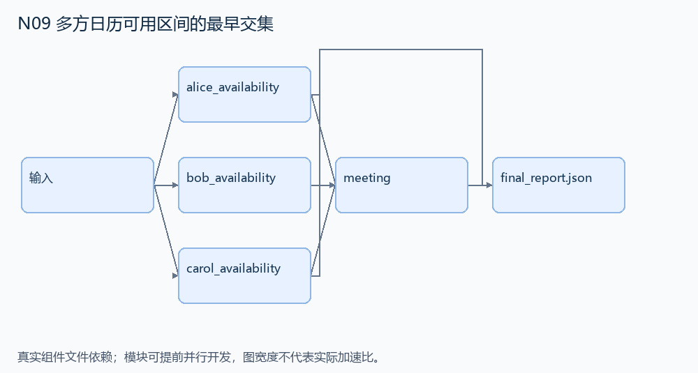
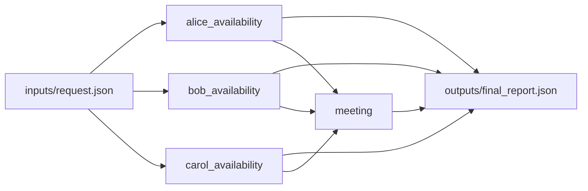

# N09 多方日历可用区间的最早交集

设计目标 M；实测未校准。结构风格 `multistage4`，4 个组件，组件 DAG 宽度 3。

读取三份小型 ICS 日历，综合每个人的硬可用时间和已有忙碌事件，找到最早可行的一小时会议并输出 ICS。

[TASK](../../tasks/multistage4/calendar_interval_intersection/TASK.md) · [工作区规格](../../tasks/multistage4/calendar_interval_intersection/workspace/README.md)

## 核心组件

- `alice_availability`：读取有效UTC日历子集 BEGIN:VEVENT/DTSTART/DTEND。无循环/全天事件。对 days 各日从 rule.start/end（午夜后分钟）可用时段扣除既有事件和 breaks；weekday_end 可按星期0=周一缩短结束。若 late_buffer 非null且某事件结束分钟>=threshold，将该事件忙碌结束再延长指定分钟。所有区间半开；返回按开始排序的 [startUTC,endUTC]，格式 YYYYMMDDTHHMMSSZ。事件可覆盖一天，窗口保证最终有解。
  输入绑定：`{"ics": "inputs/request.json#/calendars/alice", "rule": "inputs/request.json#/rules/alice", "days": "inputs/request.json#/days"}`；组件产物 `outputs/alice_availability.json`。
- `bob_availability`：读取有效UTC日历子集 BEGIN:VEVENT/DTSTART/DTEND。无循环/全天事件。对 days 各日从 rule.start/end（午夜后分钟）可用时段扣除既有事件和 breaks；weekday_end 可按星期0=周一缩短结束。若 late_buffer 非null且某事件结束分钟>=threshold，将该事件忙碌结束再延长指定分钟。所有区间半开；返回按开始排序的 [startUTC,endUTC]，格式 YYYYMMDDTHHMMSSZ。事件可覆盖一天，窗口保证最终有解。
  输入绑定：`{"ics": "inputs/request.json#/calendars/bob", "rule": "inputs/request.json#/rules/bob", "days": "inputs/request.json#/days"}`；组件产物 `outputs/bob_availability.json`。
- `carol_availability`：读取有效UTC日历子集 BEGIN:VEVENT/DTSTART/DTEND。无循环/全天事件。对 days 各日从 rule.start/end（午夜后分钟）可用时段扣除既有事件和 breaks；weekday_end 可按星期0=周一缩短结束。若 late_buffer 非null且某事件结束分钟>=threshold，将该事件忙碌结束再延长指定分钟。所有区间半开；返回按开始排序的 [startUTC,endUTC]，格式 YYYYMMDDTHHMMSSZ。事件可覆盖一天，窗口保证最终有解。
  输入绑定：`{"ics": "inputs/request.json#/calendars/carol", "rule": "inputs/request.json#/rules/carol", "days": "inputs/request.json#/days"}`；组件产物 `outputs/carol_availability.json`。
- `meeting`：求三个人可用时间的共同交集，选择最早能容纳连续60分钟的分钟起点。返回 {start:UTC字符串,end:UTC字符串,attendees:输入列表,summary:'Team Planning Meeting'}。只以硬可行且最早为目标，软偏好不参与正式评分。
  输入绑定：`{"alice": "outputs/alice_availability.json#", "bob": "outputs/bob_availability.json#", "carol": "outputs/carol_availability.json#", "attendees": "inputs/request.json#/attendees"}`；组件产物 `outputs/meeting.json`。

## 评分与非核心范围

A/B/D/P 共 23 个冻结验收单元，接口 bundle 包含两组干净目录独立构建。上限2，Reward=2×(0.5×K/N+0.5×Strict)，完整性失败清零。

不加时区/DST、循环日历、任意 ICS 损坏输入、严格文本格式、资源预算或隐含软偏好排名。

## 来源与原始标签

- **Terminal-Bench 2.0**：[`constraints-scheduling`](https://github.com/harbor-framework/terminal-bench-2/blob/2fd12b88aafdd04a52c298e3940bcb189f9766d6/constraints-scheduling/instruction.md)；原始标注：medium。

原题核心：上游要求综合 Alice/Bob/Carol 的日历、工作时间、午休及特定缓冲限制，生成不冲突的 Team Planning Meeting。

改编范围：保留硬约束与分钟粒度最早可行解；只支持显式 UTC 的有限 VEVENT 子集。上游 earliest 与软偏好优先关系不完全清晰，本改编明确以最早硬可行为唯一正式目标，软偏好只作解释，不计核心分。

[本题完整来源追溯](../原题来源与改编说明.md#n09) · [机器索引](../../review/source_provenance_v1.json)

原始标签不直接决定改编题难度；最终业务范围以当前工作区规格为准。

## 去重依据

旧题是指定日程的取消、采购或循环提醒；本题求多人可用区间的公共交集，不复用取消通知流程。
