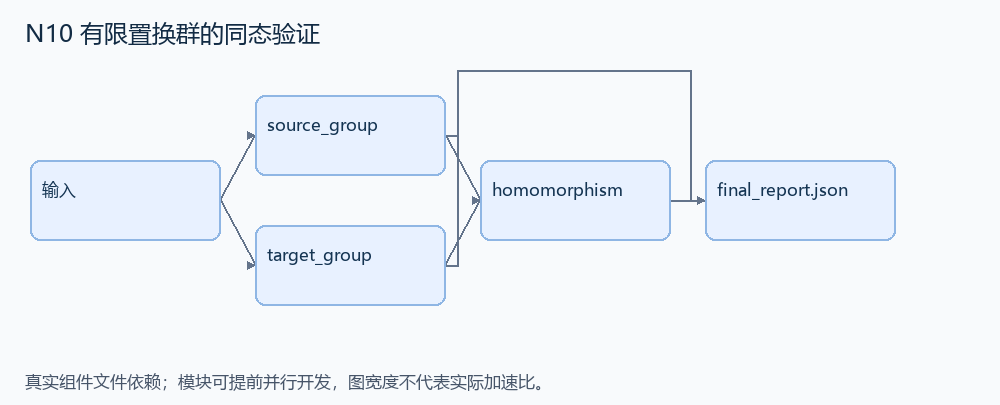
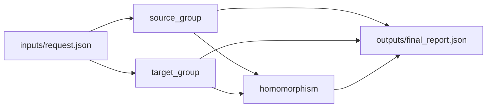

# N10 有限置换群的同态验证

设计目标 M；实测未校准。结构风格 `reasoning4`，3 个组件，组件 DAG 宽度 2。

根据有限群的生成元及其目标像，检验它们是否定义一致的同态，并给出所有群元素的映射。

[TASK](../../tasks/reasoning4/finite_group_homomorphism/TASK.md) · [工作区规格](../../tasks/reasoning4/finite_group_homomorphism/workspace/README.md)

## 核心组件

- `source_group`：generators 是同长度置换数组列表，置换表示 i→perm[i]。复合 a*b 定义为 a[b[i]]。从单位元闭包遍历，返回按置换字典序排序的全部元素列表。作用域≤5，群阶≤120。
  输入绑定：`{"generators": "inputs/request.json#/generators"}`；组件产物 `outputs/source_group.json`。
- `target_group`：对目标生成元像使用相同置换复合规则计算目标子群并排序。
  输入绑定：`{"generators": "inputs/request.json#/images"}`；组件产物 `outputs/target_group.json`。
- `homomorphism`：检查 generators[i]→images[i] 是否定义同态。返回 {valid:false,mapping:[]} 或 {valid:true,mapping:[{source:源置换,target:目标置换},...]}，mapping按源置换字典序。不同生成词到同一源元素必须得到同一像，包含逆元形成的关系。不是单独检查每个像为合法置换。
  输入绑定：`{"source": "outputs/source_group.json#", "target": "outputs/target_group.json#", "generators": "inputs/request.json#/generators", "images": "inputs/request.json#/images"}`；组件产物 `outputs/homomorphism.json`。

## 评分与非核心范围

A/B/D/P 共 17 个冻结验收单元，接口 bundle 包含两组干净目录独立构建。上限2，Reward=2×(0.5×K/N+0.5×Strict)，完整性失败清零。

不要求大型群算法、任意符号关系或指定的生成元词输出。

## 来源与原始标签

- **SWE-bench Verified**：[`sympy__sympy-24443`](https://github.com/sympy/sympy/pull/24443)；原始标注：15 min - 1 hour。

原题核心：PermutationGroup 的同态检查处理逆生成元错误，连 D3 的恒等映射也拒绝。

改编范围：限置换作用于至多 5 个元素、群阶至多 120；使用闭包遍历和置换数组，不安装 SymPy，也不扩展一般无限群。

[本题完整来源追溯](../原题来源与改编说明.md#n10) · [机器索引](../../review/source_provenance_v1.json)

原始标签不直接决定改编题难度；最终业务范围以当前工作区规格为准。

## 去重依据

旧题的人员指派/区间选择与本题的有限群关系检查无共用算法；名称中均有 reasoning 不构成重复。
