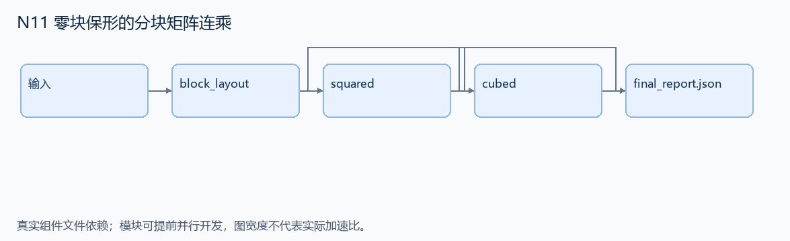

# N11 零块保形的分块矩阵连乘

设计目标 M；实测未校准。结构风格 `reasoning4`，3 个组件，组件 DAG 宽度 1。

对小型分块矩阵完成多次乘法，保留零块的行列形状，保证中间结果还能继续参与运算。

[TASK](../../tasks/reasoning4/typed_zero_block_products/TASK.md) · [工作区规格](../../tasks/reasoning4/typed_zero_block_products/workspace/README.md)

## 核心组件

- `block_layout`：matrix是二维块列表，每块 {rows,cols,data:整数二维列表或null}，null表示有形状的零矩阵。相同块行的rows一致，相同块列的cols一致；总体为方阵且块行列分割相同。返回 {row_sizes,col_sizes}。
  输入绑定：`{"matrix": "inputs/request.json#/matrix"}`；组件产物 `outputs/block_layout.json`。
- `squared`：计算 B²，返回同分块结构；每个块仍含 rows/cols。全零块 data=null，其他块 data为整数二维列表。不得折叠成无形状标量0。
  输入绑定：`{"matrix": "inputs/request.json#/matrix", "layout": "outputs/block_layout.json#"}`；组件产物 `outputs/squared.json`。
- `cubed`：消费 B² 再乘 B，返回 {layout:输入layout,blocks:B³的有形状分块矩阵}；使用与 squared相同零块表示。
  输入绑定：`{"squared": "outputs/squared.json#", "matrix": "inputs/request.json#/matrix", "layout": "outputs/block_layout.json#"}`；组件产物 `outputs/cubed.json`。

## 评分与非核心范围

A/B/D/P 共 17 个冻结验收单元，接口 bundle 包含两组干净目录独立构建。上限2，Reward=2×(0.5×K/N+0.5×Strict)，完整性失败清零。

不实现一般计算机代数、NaN 比较、非法维度异常体系。

## 来源与原始标签

- [sympy__sympy-17630](https://github.com/sympy/sympy/pull/17630)：1-4 hours；人工预计修复时间，不是模型通过率。

## 去重依据

旧拼接题不做块乘法；N01 的布尔依赖矩阵也不同于本题的有形状零元与整数矩阵连乘。
