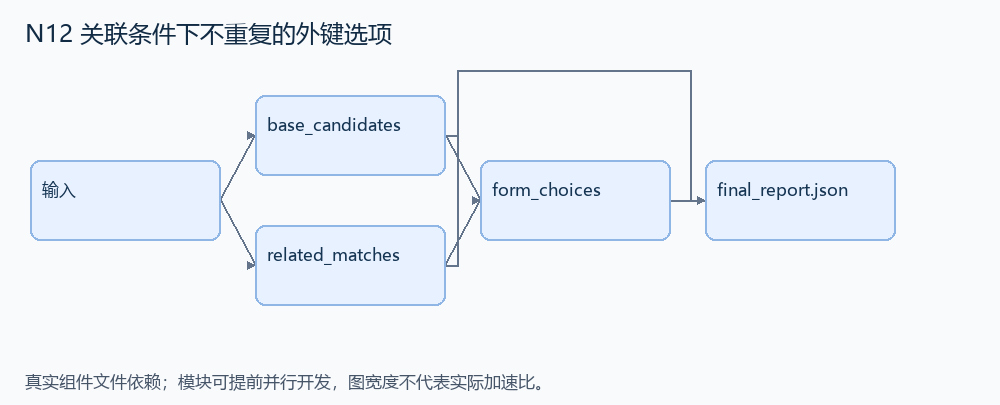
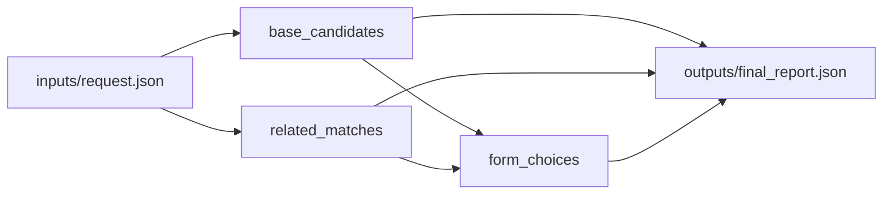

# N12 关联条件下不重复的外键选项

设计目标 M；实测未校准。结构风格 `multistage4`，3 个组件，组件 DAG 宽度 2。

按关联记录筛选外键候选，产生一份身份唯一、条件正确的表单选项。

[TASK](../../tasks/multistage4/foreign_key_unique_choices/TASK.md) · [工作区规格](../../tasks/multistage4/foreign_key_unique_choices/workspace/README.md)

## 核心组件

- `base_candidates`：entities=[{id:整数,name,active:bool}]。返回active=true的实体列表，保持输入顺序，不按name合并实体。
  输入绑定：`{"entities": "inputs/request.json#/entities"}`；组件产物 `outputs/base_candidates.json`。
- `related_matches`：relations=[{entity:ID,funny:bool,weight:整数}]。返回每条 funny=true且weight>=minimum的关联记录的entity ID，保留关系顺序及重复值。条件必须在同一关联行成立。
  输入绑定：`{"relations": "inputs/request.json#/relations", "minimum": "inputs/request.json#/minimum"}`；组件产物 `outputs/related_matches.json`。
- `form_choices`：按实体身份做半连接，返回 [{id,label:name}]。每个候选最多一次，保持候选原顺序；同名不同ID仍为不同选项。
  输入绑定：`{"candidates": "outputs/base_candidates.json#", "matches": "outputs/related_matches.json#"}`；组件产物 `outputs/form_choices.json`。

## 评分与非核心范围

A/B/D/P 共 17 个冻结验收单元，接口 bundle 包含两组干净目录独立构建。上限2，Reward=2×(0.5×K/N+0.5×Strict)，完整性失败清零。

不测试任意 ORM API、分页性能、国际化表单或非法谓词文本。

## 来源与原始标签

- **SWE-bench Verified**：[`django__django-13315`](https://github.com/django/django/pull/13315)；原始标注：15 min - 1 hour。

原题核心：limit_choices_to 经 JOIN 匹配多条关联行时，为同一目标生成重复选项。

改编范围：用小型人物/关联表和有限谓词 DSL 替代 ORM；保留存在性语义与目标身份，输出选项和匹配解释。

[本题完整来源追溯](../原题来源与改编说明.md#n12) · [机器索引](../../review/source_provenance_v1.json)

原始标签不直接决定改编题难度；最终业务范围以当前工作区规格为准。

## 去重依据

旧大学查询侧重统计与集合；本题修复关联多重性到 UI 选项的身份语义。N21 优化性能而保持既定查询结果，核心要求不同。
