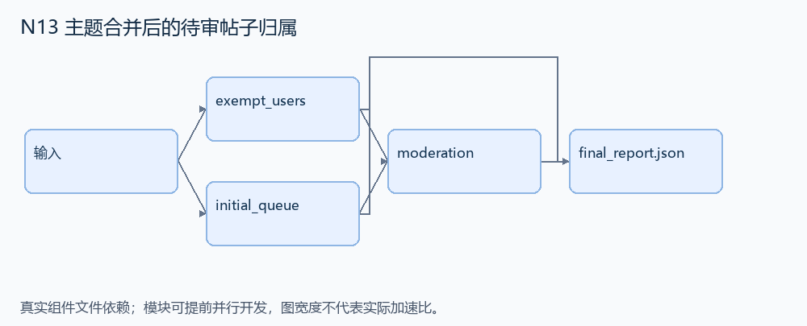
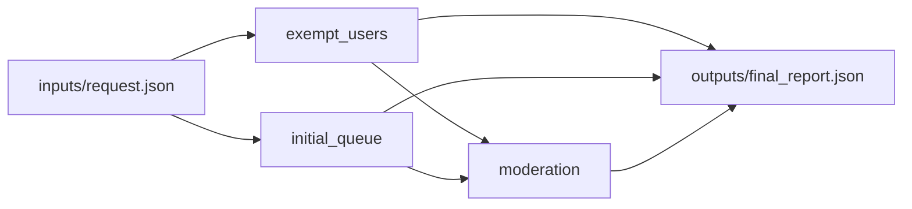

# N13 主题合并后的待审帖子归属

设计目标 M；实测未校准。结构风格 `context8`，3 个组件，组件 DAG 宽度 2。

执行有限的发帖、主题合并与审批序列，使待审帖子始终归属有效主题，豁免组仍可直接发帖。

[TASK](../../tasks/context8/queued_posts_topic_merge/TASK.md) · [工作区规格](../../tasks/context8/queued_posts_topic_merge/workspace/README.md)

## 核心组件

- `exempt_users`：memberships={用户ID:[组名]}；返回属于任一豁免组的用户ID，按字典序。
  输入绑定：`{"memberships": "inputs/request.json#/memberships", "exempt_groups": "inputs/request.json#/exempt_groups"}`；组件产物 `outputs/exempt_users.json`。
- `initial_queue`：将初始待审 posts=[{id,tid,user}] 独立拷贝，按post ID排序返回。所有引用为已知主题。
  输入绑定：`{"posts": "inputs/request.json#/queue"}`；组件产物 `outputs/initial_queue.json`。
- `moderation`：顺序执行有限事件。post={kind:'post',id,tid,user}：豁免者直接published，否则入queue。merge={kind:'merge',sources:[活跃主题],target:另一活跃主题}：删除source主题并把所有待审/已发布帖子tid迁到target。approve={kind:'approve',id:待审post}：移到published。返回 {topics:排序活跃ID,queue:按id排序帖子,published:按id排序帖子}。不加入并发、撤销或失败重试。
  输入绑定：`{"topics": "inputs/request.json#/topics", "queue": "outputs/initial_queue.json#", "exempt": "outputs/exempt_users.json#", "events": "inputs/request.json#/events"}`；组件产物 `outputs/moderation.json`。

## 评分与非核心范围

A/B/D/P 共 17 个冻结验收单元，接口 bundle 包含两组干净目录独立构建。上限2，Reward=2×(0.5×K/N+0.5×Strict)，完整性失败清零。

不加并发仲裁、回滚、重复事件故障注入、未公开的精确错误字符串。

## 来源与原始标签

- [instance_NodeBB__NodeBB-0c81642997ea1d827dbd02c311db9d4976112cd4-vf2cf3cbd463b7ad942381f1c6d077626485a1e9e](https://github.com/scaleapi/SWE-bench_Pro-os/blob/66f92766bba642462d4bbe5479e83f91f9211862/v2/tasks/instance_NodeBB__NodeBB-0c81642997ea1d827dbd02c311db9d4976112cd4-vf2cf3cbd463b7ad942381f1c6d077626485a1e9e/instruction.md)：非 HARD51（hard=false）；不能据此称为 easy/medium；HARD51 子集成员标志；无可直接继承的中等标签。

## 去重依据

旧身份题有祖先撤销和会话联动；本题只有有限队列引用迁移，没有复杂会话历史。
