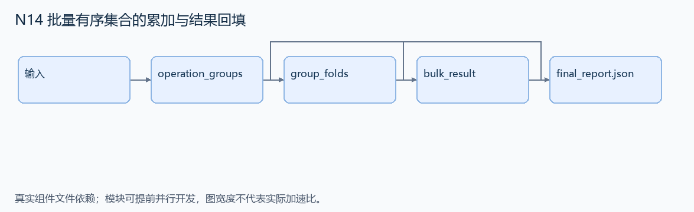
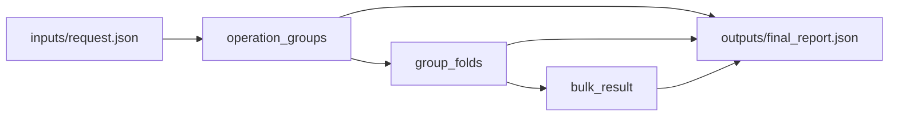

# N14 批量有序集合的累加与结果回填

设计目标 M；实测未校准。结构风格 `multistage4`，3 个组件，组件 DAG 宽度 1。

批量更新多个集合成员的分数，同时按原操作顺序返回每次更新后的分数。

[TASK](../../tasks/multistage4/bulk_sorted_set_updates/TASK.md) · [工作区规格](../../tasks/multistage4/bulk_sorted_set_updates/workspace/README.md)

## 核心组件

- `operation_groups`：initial 是 {set_key:{member:整数分数}}；operations 是 [{key,member,delta:整数}]。按 (key,member) 分组并按键/成员字典序返回列表，每组为 {key,member,initial:原分数或0,operations:[{index:原始0基位置,delta}]}，保留组内原顺序。
  输入绑定：`{"initial": "inputs/request.json#/initial", "operations": "inputs/request.json#/operations"}`；组件产物 `outputs/operation_groups.json`。
- `group_folds`：独立计算各组有序前缀和。返回列表 [{key,member,final:最终分数,results:[{index,score:本次操作后的分数}]}]，组顺序不变。
  输入绑定：`{"groups": "outputs/operation_groups.json#"}`；组件产物 `outputs/group_folds.json`。
- `bulk_result`：合并分组结果。返回 {scores:[按操作原位置的分数],sets:保留未操作成员的最终集合字典}。同一成员多次增分不可用最终值回填先前操作。count 等于操作数。
  输入绑定：`{"folds": "outputs/group_folds.json#", "initial": "inputs/request.json#/initial", "count": "inputs/request.json#/count"}`；组件产物 `outputs/bulk_result.json`。

## 评分与非核心范围

A/B/D/P 共 17 个冻结验收单元，接口 bundle 包含两组干净目录独立构建。上限2，Reward=2×(0.5×K/N+0.5×Strict)，完整性失败清零。

不加事务失败恢复、NaN/Infinity、未规定排序平局或性能倍数。

## 来源与原始标签

- **SWE-bench Pro**：[`instance_NodeBB__NodeBB-6ea3b51f128dd270281db576a1b59270d5e45db0-vnan`](https://github.com/scaleapi/SWE-bench_Pro-os/blob/66f92766bba642462d4bbe5479e83f91f9211862/v2/tasks/instance_NodeBB__NodeBB-6ea3b51f128dd270281db576a1b59270d5e45db0-vnan/instruction.md)；原始标注：非 HARD51（hard=false）；不能据此称为 easy/medium。

原题核心：NodeBB 缺少统一批量增分接口，要求不存在成员初始化、重复成员累加和结果顺序一致。

改编范围：采用内存后端与 SQLite 后端的可见适配器；标准输入合法增量，不要求真实 Redis/MongoDB 或并发写入。

[本题完整来源追溯](../原题来源与改编说明.md#n14) · [机器索引](../../review/source_provenance_v1.json)

原始标签不直接决定改编题难度；最终业务范围以当前工作区规格为准。

## 去重依据

旧题求受限配额重分配；本题是确定性批处理前缀和，不做资源优化或共享预算求解。
