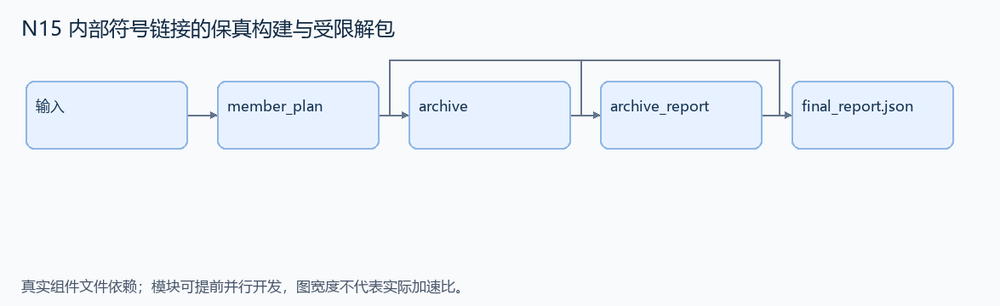
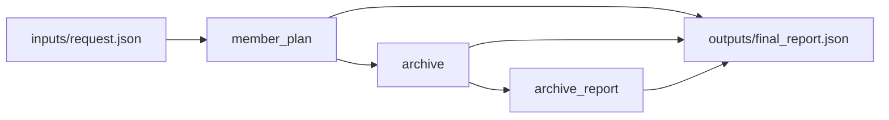

# N15 内部符号链接的保真构建与受限解包

设计目标 M；实测未校准。结构风格 `linux2`，3 个组件，组件 DAG 宽度 1。

构建保留内部符号链接的归档，并在声明的目标目录内安全解包，核对清单和实际成员。

[TASK](../../tasks/linux2/symlink_preserving_archive/TASK.md) · [工作区规格](../../tasks/linux2/symlink_preserving_archive/workspace/README.md)

## 核心组件

- `member_plan`：输入为受控虚拟 collection 根目录，nodes=[{path,kind:'file'|'dir'|'symlink',content或target}]，symlink相对所在目录解析。没有循环/悬空链接；外部文件内容由external_files以绝对虚拟路径给出，不读实际工作区外文件。规范化后落在/collection外的成员路径拒绝；内部链接保留为symlink，其相对linkname不展开；外部文件链接复制内容为普通file。返回 {members:按name排序[{name,type,content(仅file),linkname(仅symlink)}],rejected:排序拒绝path}。目录没有多余字段。
  输入绑定：`{"nodes": "inputs/request.json#/nodes", "external_files": "inputs/request.json#/external_files"}`；组件产物 `outputs/member_plan.json`。
- `archive`：用tarfile生成真实tar，返回 {tar:base64字节,rejected:计划中的拒绝路径}。成员语义必须与plan一致；允许任何合法tar编码，不按压缩字节逐字匹配。
  输入绑定：`{"plan": "outputs/member_plan.json#"}`；组件产物 `outputs/archive.json`。
- `archive_report`：实际读取tar成员，不展开符号链接目录。返回 {members:与member_plan同格式且按name排序,rejected:输入rejected}。内部文件/目录链接均保留，不能把目录链接子项复制进去。
  输入绑定：`{"archive": "outputs/archive.json#"}`；组件产物 `outputs/archive_report.json`。

## 评分与非核心范围

A/B/D/P 共 18 个冻结验收单元，接口 bundle 包含两组干净目录独立构建。上限2，Reward=2×(0.5×K/N+0.5×Strict)，完整性失败清零。

不引入 TOCTOU 竞态、任意损坏 tar、精确异常文案、访问真实工作区之外的文件。

## 来源与原始标签

- **SWE-bench Pro**：[`instance_ansible__ansible-a20a52701402a12f91396549df04ac55809f68e9-v1055803c3a812189a1133297f7f5468579283f86`](https://github.com/scaleapi/SWE-bench_Pro-os/blob/66f92766bba642462d4bbe5479e83f91f9211862/v2/tasks/instance_ansible__ansible-a20a52701402a12f91396549df04ac55809f68e9-v1055803c3a812189a1133297f7f5468579283f86/instruction.md)；原始标注：非 HARD51（hard=false）；不能据此称为 easy/medium。
- **SWE-bench Pro**：[`instance_ansible__ansible-d30fc6c0b359f631130b0e979d9a78a7b3747d48-v1055803c3a812189a1133297f7f5468579283f86`](https://github.com/scaleapi/SWE-bench_Pro-os/blob/66f92766bba642462d4bbe5479e83f91f9211862/v2/tasks/instance_ansible__ansible-d30fc6c0b359f631130b0e979d9a78a7b3747d48-v1055803c3a812189a1133297f7f5468579283f86/instruction.md)；原始标注：非 HARD51（hard=false）；不能据此称为 easy/medium。

原题核心：Ansible 两个源题分别处理 tar 路径越界和内部符号链接被错误展开。

改编范围：明确为双源组合改编；测试素材均在受控目录或虚拟文件表内。保留内部文件/目录链接、相对 linkname 和目标目录包含关系。

[本题完整来源追溯](../原题来源与改编说明.md#n15) · [机器索引](../../review/source_provenance_v1.json)

原始标签不直接决定改编题难度；最终业务范围以当前工作区规格为准。

## 去重依据

与旧归档题同域；旧题核心为指令选择/支持模块依赖，本题核心为链接身份及 containment。禁止复用旧清单选项换皮作为新题。
