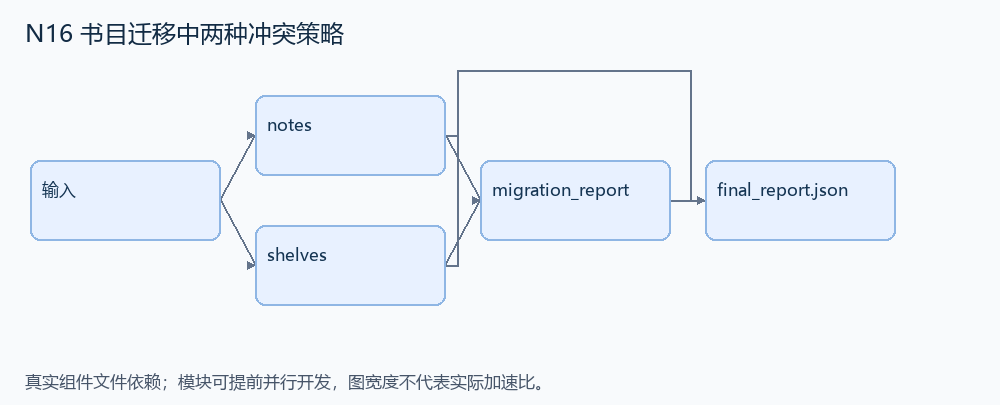
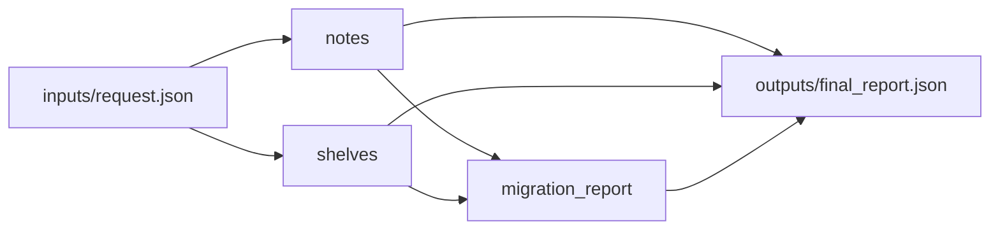

# N16 书目迁移中两种冲突策略

设计目标 M；实测未校准。结构风格 `multistage4`，3 个组件，组件 DAG 宽度 2。

迁移 work_id 时，让书评保留所有冲突记录，而书架沿用删除旧项策略，返回准确的操作统计。

[TASK](../../tasks/multistage4/booknote_migration_conflicts/TASK.md) · [工作区规格](../../tasks/multistage4/booknote_migration_conflicts/workspace/README.md)

## 核心组件

- `notes`：rows={work_id:笔记文本}。old存在；若new已存在且不同于old，保持所有笔记，统计 {rows_changed:0,rows_deleted:0,failed_deletes:1}。new不存在则迁移键，changed=1；old==new无操作。返回 {rows:更新字典,stats:上述三个计数}。
  输入绑定：`{"rows": "inputs/request.json#/notes", "old": "inputs/request.json#/old", "new": "inputs/request.json#/new"}`；组件产物 `outputs/notes.json`。
- `shelves`：与notes使用相同输入结构，但发生目标键冲突时保留目标、删除old，stats={rows_changed:0,rows_deleted:1,failed_deletes:0}。无冲突则迁移。
  输入绑定：`{"rows": "inputs/request.json#/shelves", "old": "inputs/request.json#/old", "new": "inputs/request.json#/new"}`；组件产物 `outputs/shelves.json`。
- `migration_report`：返回 {notes:notes结果,shelves:shelves结果}。不得给两类表统一应用delete-on-conflict。
  输入绑定：`{"notes": "outputs/notes.json#", "shelves": "outputs/shelves.json#"}`；组件产物 `outputs/migration_report.json`。

## 评分与非核心范围

A/B/D/P 共 17 个冻结验收单元，接口 bundle 包含两组干净目录独立构建。上限2，Reward=2×(0.5×K/N+0.5×Strict)，完整性失败清零。

不要求完整书目服务、所有数据库驱动、错误信息逐字匹配或并发迁移。

## 来源与原始标签

- **SWE-bench Pro**：[`instance_internetarchive__openlibrary-5069b09e5f64428dce59b33455c8bb17fe577070-v8717e18970bcdc4e0d2cea3b1527752b21e74866`](https://github.com/scaleapi/SWE-bench_Pro-os/blob/66f92766bba642462d4bbe5479e83f91f9211862/v2/tasks/instance_internetarchive__openlibrary-5069b09e5f64428dce59b33455c8bb17fe577070-v8717e18970bcdc4e0d2cea3b1527752b21e74866/instruction.md)；原始标注：非 HARD51（hard=false）；不能据此称为 easy/medium。

原题核心：OpenLibrary 的 Booknotes 冲突更新会误删笔记；Booknotes 与 Bookshelves 必须采用不同冲突行为。

改编范围：用两个小表和 SQLite 实现，保留每种表的冲突契约与固定三项统计；兼容异常类型由可见适配层提供，不安装 PostgreSQL。

[本题完整来源追溯](../原题来源与改编说明.md#n16) · [机器索引](../../review/source_provenance_v1.json)

原始标签不直接决定改编题难度；最终业务范围以当前工作区规格为准。

## 去重依据

MP22 导入 MARC 书目字段；本题不解析 MARC，而是执行数据库身份迁移及冲突保护。
