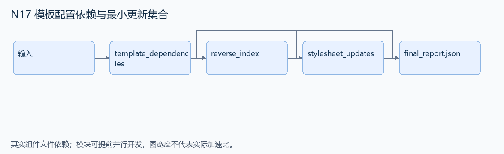
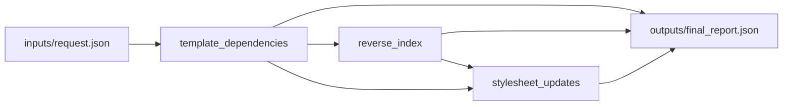

# N17 模板配置依赖与最小更新集合

设计目标 M；实测未校准。结构风格 `reasoning4`，3 个组件，组件 DAG 宽度 1。

识别模板中真正使用的 conf 配置项，并根据配置变更找到应重新生成的样式模板。

[TASK](../../tasks/reasoning4/template_configuration_dependencies/TASK.md) · [工作区规格](../../tasks/reasoning4/template_configuration_dependencies/workspace/README.md)

## 核心组件

- `template_dependencies`：templates={模板ID:文本}，只分析 {{ Python兼容表达式 }}；支持 conf 属性、静态字符串下标与算术表达式，不执行模板。提取conf开头访问链，把下标转点号；以options中最长合法前缀作为配置项，忽略notconf及模板普通文本。输入每个conf链至少有一个合法前缀。返回 {模板ID:排序唯一配置键列表}。
  输入绑定：`{"templates": "inputs/request.json#/templates", "options": "inputs/request.json#/options"}`；组件产物 `outputs/template_dependencies.json`。
- `reverse_index`：返回 {配置键:排序模板ID列表}。
  输入绑定：`{"dependencies": "outputs/template_dependencies.json#"}`；组件产物 `outputs/reverse_index.json`。
- `stylesheet_updates`：changed为合法配置键列表。返回 {dependencies:全部依赖,affected:依赖与changed相交的排序模板ID列表}。
  输入绑定：`{"dependencies": "outputs/template_dependencies.json#", "reverse": "outputs/reverse_index.json#", "changed": "inputs/request.json#/changed"}`；组件产物 `outputs/stylesheet_updates.json`。

## 评分与非核心范围

A/B/D/P 共 17 个冻结验收单元，接口 bundle 包含两组干净目录独立构建。上限2，Reward=2×(0.5×K/N+0.5×Strict)，完整性失败清零。

不实现完整 Jinja 执行器、动态任意下标、精确无效配置异常文案。

## 来源与原始标签

- **SWE-bench Pro**：[`instance_qutebrowser__qutebrowser-35168ade46184d7e5b91dfa04ca42fe2abd82717-v363c8a7e5ccdf6968fc7ab84a2053ac78036691d`](https://github.com/scaleapi/SWE-bench_Pro-os/blob/66f92766bba642462d4bbe5479e83f91f9211862/v2/tasks/instance_qutebrowser__qutebrowser-35168ade46184d7e5b91dfa04ca42fe2abd82717-v363c8a7e5ccdf6968fc7ab84a2053ac78036691d/instruction.md)；原始标注：非 HARD51（hard=false）；不能据此称为 easy/medium。

原题核心：qutebrowser 无法静态提取 Jinja2 模板对 conf 命名空间的依赖。

改编范围：保留属性、字典下标和表达式中的 conf 引用；公开一个有限模板表达式语法及合法配置表。最小更新集合是本项目追加的直接消费者。

[本题完整来源追溯](../原题来源与改编说明.md#n17) · [机器索引](../../review/source_provenance_v1.json)

原始标签不直接决定改编题难度；最终业务范围以当前工作区规格为准。

## 去重依据

同属静态分析，但旧题分析 Python 导入与模块闭包；本题分析模板配置命名空间和重生成范围。
