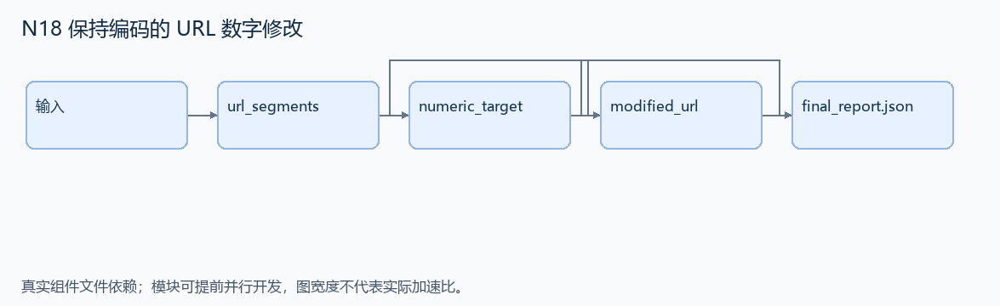
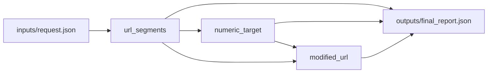

# N18 保持编码的 URL 数字修改

设计目标 M；实测未校准。结构风格 `context8`，3 个组件，组件 DAG 宽度 1。

在指定 URL 段中修改最后一个可操作数字，同时保持其他段与百分号编码原样。

[TASK](../../tasks/context8/encoded_url_numbers/TASK.md) · [工作区规格](../../tasks/context8/encoded_url_numbers/workspace/README.md)

## 核心组件

- `url_segments`：解析合法的 scheme://host[:port]/path[?query][#anchor]。本题限定 ASCII host，无 userinfo/IPv6。返回 {scheme,host,port,path,query,anchor}；缺失 port/query/anchor 用 null，保留原始字节和空 query/anchor。path 可为空；不得 unquote。
  输入绑定：`{"url": "inputs/request.json#/url"}`；组件产物 `outputs/url_segments.json`。
- `numeric_target`：依 host,port,path,query,anchor 的 URL 顺序，在给定 segments 中找到最后一个可修改连续 ASCII 数字串。合法 %XX 三字符内的数字必须屏蔽；其后的普通数字可修改。返回 {segment,start,end,text}，start/end 是对应原始段的0基半开跨度。输入保证存在可选数字。
  输入绑定：`{"parts": "outputs/url_segments.json#", "segments": "inputs/request.json#/segments"}`；组件产物 `outputs/numeric_target.json`。
- `modified_url`：operation=increment/decrement，count 是非负整数，输入保证结果非负。仅替换目标跨度；原字符串若有前导零，尽可能保持原宽度，超出时扩宽；原值无前导零则不补零。返回完整新 URL 字符串，其余部分逐字保持。
  输入绑定：`{"parts": "outputs/url_segments.json#", "target": "outputs/numeric_target.json#", "operation": "inputs/request.json#/operation", "count": "inputs/request.json#/count"}`；组件产物 `outputs/modified_url.json`。

## 评分与非核心范围

A/B/D/P 共 20 个冻结验收单元，接口 bundle 包含两组干净目录独立构建。上限2，Reward=2×(0.5×K/N+0.5×Strict)，完整性失败清零。

不继承所有 QUrl 标准化细节、畸形 URL 修复、未知参数异常体系。

## 来源与原始标签

- **SWE-bench Pro**：[`instance_qutebrowser__qutebrowser-deeb15d6f009b3ca0c3bd503a7cef07462bd16b4-v363c8a7e5ccdf6968fc7ab84a2053ac78036691d`](https://github.com/scaleapi/SWE-bench_Pro-os/blob/66f92766bba642462d4bbe5479e83f91f9211862/v2/tasks/instance_qutebrowser__qutebrowser-deeb15d6f009b3ca0c3bd503a7cef07462bd16b4-v363c8a7e5ccdf6968fc7ab84a2053ac78036691d/instruction.md)；原始标注：HARD51 成员（hard=true）。

原题核心：qutebrowser 修改了 %XX 内的数字，或解码重编码后丢失原始编码。

改编范围：移除 Qt，以原始字符串跨度和有限 URL 分段表示实现；保留作用域、默认 path/query、零填充及非负减法这些源题核心语义。

[本题完整来源追溯](../原题来源与改编说明.md#n18) · [机器索引](../../review/source_provenance_v1.json)

原始标签不直接决定改编题难度；最终业务范围以当前工作区规格为准。

## 去重依据

旧题组装 multipart 字节；本题定位编码字符串内的数字，不共享 MIME 组装算法。
