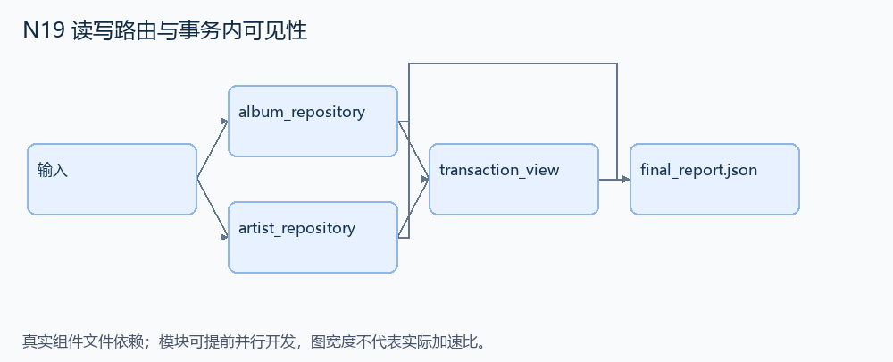
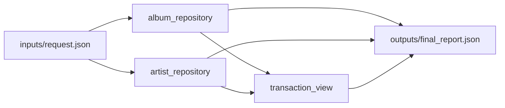

# N19 读写路由与事务内可见性

设计目标 M；实测未校准。结构风格 `multistage4`，3 个组件，组件 DAG 宽度 2。

让多个简化仓储通过统一数据库抽象读写；事务内读取必须看到本事务之前的写入，提交后能正常读取。

[TASK](../../tasks/multistage4/transaction_repository_routing/TASK.md) · [工作区规格](../../tasks/multistage4/transaction_repository_routing/workspace/README.md)

## 核心组件

- `album_repository`：返回 definition 独立副本。definition={table:SQLite表名,columns:['id','name']}，所有名称为可信固定标识符。仓储只能通过上游统一数据库连接工作。
  输入绑定：`{"definition": "inputs/request.json#/repositories/albums"}`；组件产物 `outputs/album_repository.json`。
- `artist_repository`：同album_repository，提供第二个仓储适配定义。
  输入绑定：`{"definition": "inputs/request.json#/repositories/artists"}`；组件产物 `outputs/artist_repository.json`。
- `transaction_view`：在本地SQLite执行有限脚本。事件 begin/commit；put={kind:'put',repo:'album'|'artist',id,name}；get={kind:'get',repo,id}。事务中put/get均走事务连接，事务外get走read、put走write；get返回对应name或null。初始数据initial={albums:[{id,name}],artists:[...]}。返回 {reads:[get结果],routes:[每个put/get的'transaction'|'read'|'write'],final:{albums:按id排序行,artists:按id排序行}}。只测顺序事务，无锁竞争/重试。
  输入绑定：`{"album": "outputs/album_repository.json#", "artist": "outputs/artist_repository.json#", "initial": "inputs/request.json#/initial", "events": "inputs/request.json#/events"}`；组件产物 `outputs/transaction_view.json`。

## 评分与非核心范围

A/B/D/P 共 17 个冻结验收单元，接口 bundle 包含两组干净目录独立构建。上限2，Reward=2×(0.5×K/N+0.5×Strict)，完整性失败清零。

不加压力测试、锁争用竞态、分布式事务、重试/崩溃恢复协议。

## 来源与原始标签

- **SWE-bench Pro**：[`instance_navidrome__navidrome-55bff343cdaad1f04496f724eda4b55d422d7f17`](https://github.com/scaleapi/SWE-bench_Pro-os/blob/66f92766bba642462d4bbe5479e83f91f9211862/v2/tasks/instance_navidrome__navidrome-55bff343cdaad1f04496f724eda4b55d422d7f17/instruction.md)；原始标注：非 HARD51（hard=false）；不能据此称为 easy/medium。

原题核心：Navidrome 直接传原始 sql.DB，读写/事务路径混杂，造成并发访问停滞或操作偏离事务。

改编范围：保留 ReadDB/WriteDB 抽象与事务 builder 的传播，缩为两个仓储和本地 SQLite；首版只验有限顺序事务。

[本题完整来源追溯](../原题来源与改编说明.md#n19) · [机器索引](../../review/source_provenance_v1.json)

原始标签不直接决定改编题难度；最终业务范围以当前工作区规格为准。

## 去重依据

旧支付题有结算联动与复杂约束；N16 是表特定冲突策略。本题只研究连接/事务身份传播和读己之写。
