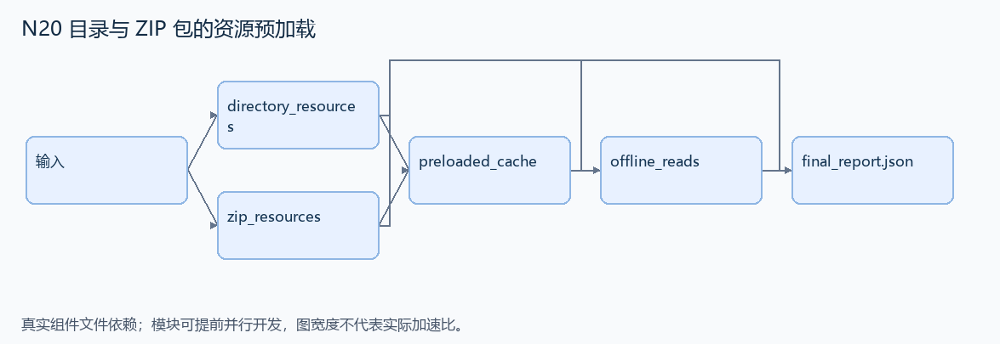
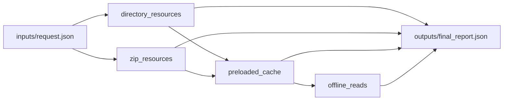

# N20 目录与 ZIP 包的资源预加载

设计目标 M；实测未校准。结构风格 `context8`，4 个组件，组件 DAG 宽度 2。

从普通目录或 ZIP 包中发现指定 HTML/JS 资源，构建同一缓存，并在预加载后通过缓存返回内容。

[TASK](../../tasks/context8/directory_zip_resource_cache/TASK.md) · [工作区规格](../../tasks/context8/directory_zip_resource_cache/workspace/README.md)

## 核心组件

- `directory_resources`：files={POSIX相对路径:UTF8内容}，patterns=[{directory,extension}]。在目录载体中发现每个目录直接子文件，后缀匹配，返回排序唯一路径；不递归其他目录。只用受控临时目录，输入路径合法。
  输入绑定：`{"files": "inputs/request.json#/files", "patterns": "inputs/request.json#/patterns"}`；组件产物 `outputs/directory_resources.json`。
- `zip_resources`：与directory_resources相同，但载体为zipfile.Path，不依赖其未提供的glob方法。
  输入绑定：`{"files": "inputs/request.json#/files", "patterns": "inputs/request.json#/patterns"}`；组件产物 `outputs/zip_resources.json`。
- `preloaded_cache`：两载体路径集合一致时，返回 {路径:内容} 的预加载缓存，不纳入不匹配文件。
  输入绑定：`{"directory": "outputs/directory_resources.json#", "zip": "outputs/zip_resources.json#", "files": "inputs/request.json#/files"}`；组件产物 `outputs/preloaded_cache.json`。
- `offline_reads`：仅根据缓存按requests顺序返回 {paths:排序缓存键,values:请求内容列表}。原载体不作为本接口输入；在无源文件新目录也能构建。
  输入绑定：`{"cache": "outputs/preloaded_cache.json#", "requests": "inputs/request.json#/requests"}`；组件产物 `outputs/offline_reads.json`。

## 评分与非核心范围

A/B/D/P 共 22 个冻结验收单元，接口 bundle 包含两组干净目录独立构建。上限2，Reward=2×(0.5×K/N+0.5×Strict)，完整性失败清零。

不测试损坏 ZIP、任意包导入机制、LZMA 压缩支持或严格错误消息。

## 来源与原始标签

- **SWE-bench Pro**：[`instance_qutebrowser__qutebrowser-3d01c201b8aa54dd71d4f801b1dd12feb4c0a08a-v5fc38aaf22415ab0b70567368332beee7955b367`](https://github.com/scaleapi/SWE-bench_Pro-os/blob/66f92766bba642462d4bbe5479e83f91f9211862/v2/tasks/instance_qutebrowser__qutebrowser-3d01c201b8aa54dd71d4f801b1dd12feb4c0a08a-v5fc38aaf22415ab0b70567368332beee7955b367/instruction.md)；原始标注：非 HARD51（hard=false）；不能据此称为 easy/medium。

原题核心：qutebrowser 的资源 glob 与预加载在 Path、zipfile.Path 和冻结模式下不一致。

改编范围：仅保留源题列明的目录和扩展名、POSIX 相对路径、两种载体及缓存命中语义；不运行浏览器。

[本题完整来源追溯](../原题来源与改编说明.md#n20) · [机器索引](../../review/source_provenance_v1.json)

原始标签不直接决定改编题难度；最终业务范围以当前工作区规格为准。

## 去重依据

旧题发现模块后打包；N15 保留符号链接。本题读取既有包的静态资源并建立脱离载体的缓存。
