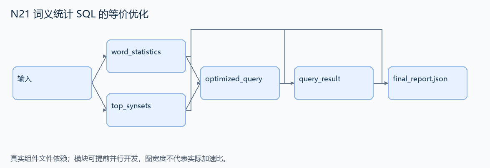
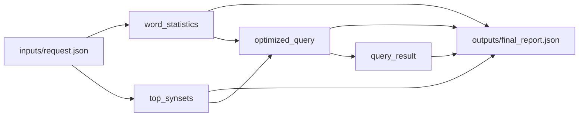

# N21 词义统计 SQL 的等价优化

设计目标 M；实测未校准。结构风格 `reasoning4`，4 个组件，组件 DAG 宽度 2。

把含重复相关子查询的词义统计 SQL 改写为更少重复工作的查询，保持列名、结果和顺序一致。

[TASK](../../tasks/reasoning4/equivalent_sql_aggregation/TASK.md) · [工作区规格](../../tasks/reasoning4/equivalent_sql_aggregation/workspace/README.md)

## 核心组件

- `word_statistics`：tables包含words(wordid,word)、senses(wordid,synsetid)、synsets(synsetid,domainid,posid)。按wordid返回统计列表 [{word_id,word,total_synsets,total_senses,distinct_domains,distinct_posids}]，词没有sense也列出0；所有引用合法。
  输入绑定：`{"tables": "inputs/request.json#/tables"}`；组件产物 `outputs/word_statistics.json`。
- `top_synsets`：每词按sense行数最多选synset，平局取较小synsetid。返回 [{word_id,top_synsetid,top_synset_sense_count}]，按word_id，只包含至少一个sense的词。
  输入绑定：`{"tables": "inputs/request.json#/tables"}`；组件产物 `outputs/top_synsets.json`。
- `optimized_query`：返回通用只读SQLite查询字符串。对所有合法表均应输出8列：word_id,word,total_synsets,total_senses,distinct_domains,distinct_posids,top_synsetid,top_synset_sense_count；只保留total_synsets>=2、distinct_domains>=2、total_senses>=2。按total_senses/total_synsets/distinct_domains降序，再word_id升序，LIMIT 500。不能把当前统计结果硬编码为SQL常量；评测复用该SQL于不同正常数据库。接受任意等价SQL；公开工作量预算为 SQLite VM 步数 <= 200*len(senses)+20000，原始相关子查询作为负例。
  输入绑定：`{"statistics": "outputs/word_statistics.json#", "ranks": "outputs/top_synsets.json#"}`；组件产物 `outputs/optimized_query.json`。
- `query_result`：实际在只读SQLite表执行sql，返回 {columns:上述8列名,rows:查询结果二维列表}；不输出或比较SQLite特定格式的执行计划。
  输入绑定：`{"sql": "outputs/optimized_query.json#", "tables": "inputs/request.json#/tables"}`；组件产物 `outputs/query_result.json`。

## 评分与非核心范围

A/B/D/P 共 23 个冻结验收单元，接口 bundle 包含两组干净目录独立构建。上限2，Reward=2×(0.5×K/N+0.5×Strict)，完整性失败清零。

不加真实大数据库下载、墙钟 1.05 倍门槛、SQL 字符数限制或无关语法风格限制。

## 来源与原始标签

- [query-optimize](https://github.com/harbor-framework/terminal-bench-2/blob/2fd12b88aafdd04a52c298e3940bcb189f9766d6/query-optimize/instruction.md)：medium；task.toml 作者设计标签；未核验逐题实测分档。

## 去重依据

N12 修复选项身份；本题保持既定统计语义并减少重复计算。不能用只改表名的旧关系查询复用题面。
