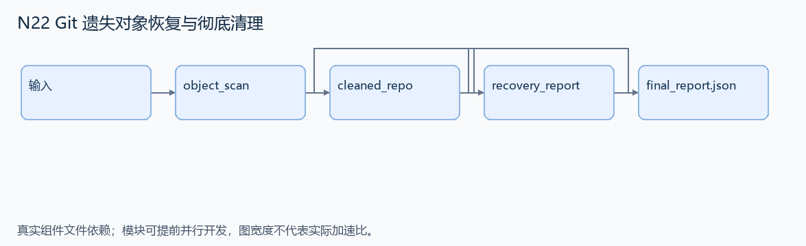
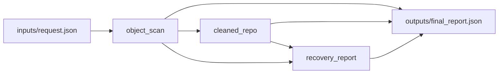

# N22 Git 遗失对象恢复与彻底清理

设计目标 M；实测未校准。结构风格 `linux2`，3 个组件，组件 DAG 宽度 1。

从本地测试仓库中恢复被重写历史遗失的合成标记，再清理仓库内相关对象，保留无关文件和提交说明。

[TASK](../../tasks/linux2/git_lost_objects_cleanup/TASK.md) · [工作区规格](../../tasks/linux2/git_lost_objects_cleanup/workspace/README.md)

## 核心组件

- `object_scan`：bundle是gzip-tar的base64，解包后为本地合成Git仓库，含一个历史重写后不可达对象中的secret[...]标记。通过Git对象枚举恢复，返回 {secret:完整标记}。普通文件及正常提交说明必须保持。没有真实密钥/远程服务。
  输入绑定：`{"bundle": "inputs/request.json#/bundle"}`；组件产物 `outputs/object_scan.json`。
- `cleaned_repo`：先确认已恢复标记，再删除仓库中的该标记，包括reflog和不可达对象；保留普通工作区内容与正常提交说明。返回 {bundle:清理后完整仓库tar.gz的base64,files:{普通相对路径:SHA256},messages:[git log --format=%s按新到旧]}。允许任意语义正确仓库重打包，不比tar字节。
  输入绑定：`{"bundle": "inputs/request.json#/bundle", "scan": "outputs/object_scan.json#"}`；组件产物 `outputs/cleaned_repo.json`。
- `recovery_report`：实际读取清理后的仓库，枚举全部对象验证无secret[...]；返回 {secret:恢复标记,files:普通文件SHA256映射,messages:正常提交说明列表,remaining_secret_objects:0}。
  输入绑定：`{"scan": "outputs/object_scan.json#", "cleaned": "outputs/cleaned_repo.json#"}`；组件产物 `outputs/recovery_report.json`。

## 评分与非核心范围

A/B/D/P 共 19 个冻结验收单元，接口 bundle 包含两组干净目录独立构建。上限2，Reward=2×(0.5×K/N+0.5×Strict)，完整性失败清零。

不加真实密钥、托管服务、复杂 signed commits 或所有 pack 损坏恢复。

## 来源与原始标签

- [git-leak-recovery](https://github.com/harbor-framework/terminal-bench-2/blob/2fd12b88aafdd04a52c298e3940bcb189f9766d6/git-leak-recovery/instruction.md)：medium；task.toml 作者设计标签；未核验逐题实测分档。

## 去重依据

旧题是权限/安全边界组件；本题操作 Git 对象可达性及垃圾回收，不是一般日志脱敏。
