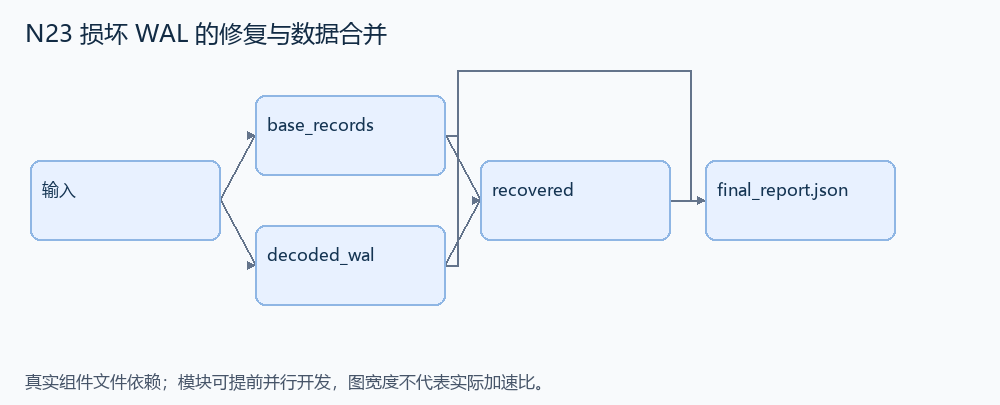
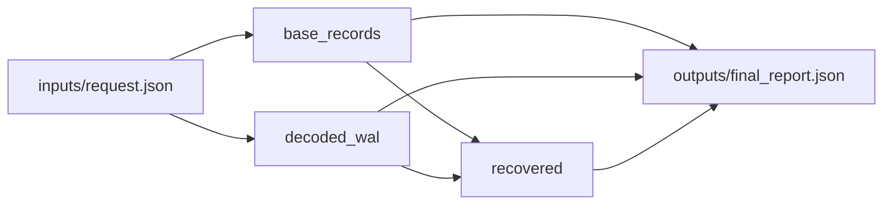

# N23 损坏 WAL 的修复与数据合并

设计目标 M；实测未校准。结构风格 `linux2`，3 个组件，组件 DAG 宽度 2。

修复受控变换过的 SQLite WAL，使数据库可读取，并导出包含更新与新增记录的完整 JSON。

[TASK](../../tasks/linux2/sqlite_wal_recovery/TASK.md) · [工作区规格](../../tasks/linux2/sqlite_wal_recovery/workspace/README.md)

## 核心组件

- `base_records`：解码base64的真实SQLite基础库，在临时目录只读查询items(id,name,value)，按id返回记录列表。
  输入绑定：`{"base_b64": "inputs/request.json#/base_b64"}`；组件产物 `outputs/base_records.json`。
- `decoded_wal`：公开有限破坏模型：codec.scheme='xor-byte'，每个WAL字节与codec.key(0..255)异或。还原真实WAL，返回base64字节串。不要求猜未知密码或修复任意损坏页。
  输入绑定：`{"encoded_wal_b64": "inputs/request.json#/encoded_wal_b64", "codec": "inputs/request.json#/codec"}`；组件产物 `outputs/decoded_wal.json`。
- `recovered`：把真实基础库及还原WAL按同名.db/-wal放到临时目录，让SQLite恢复并查询。返回 {records:按id排序的全部记录,base_count:基础记录数,database:原base64库,wal:还原WAL的base64}。不能仅追加两个记录列表，WAL含旧行更新。组件封装写 outputs/recovery_snapshot.json，业务列表单独写 outputs/recovered.json，不得互相覆盖。
  输入绑定：`{"base_b64": "inputs/request.json#/base_b64", "wal_b64": "outputs/decoded_wal.json#", "base": "outputs/base_records.json#"}`；组件产物 `outputs/recovery_snapshot.json`。

## 评分与非核心范围

A/B/D/P 共 20 个冻结验收单元，接口 bundle 包含两组干净目录独立构建。上限2，Reward=2×(0.5×K/N+0.5×Strict)，完整性失败清零。

不加入任意 torn-page、交易并发、未知加密破解、文件系统崩溃模拟。

## 来源与原始标签

- [db-wal-recovery](https://github.com/harbor-framework/terminal-bench-2/blob/2fd12b88aafdd04a52c298e3940bcb189f9766d6/db-wal-recovery/instruction.md)：medium；task.toml 作者设计标签；未核验逐题实测分档。

## 去重依据

旧题做流式检查点链或备份方案认证；本题做有限 WAL 编码修复和实际 SQLite 合并，没有恢复链/预算搜索。
