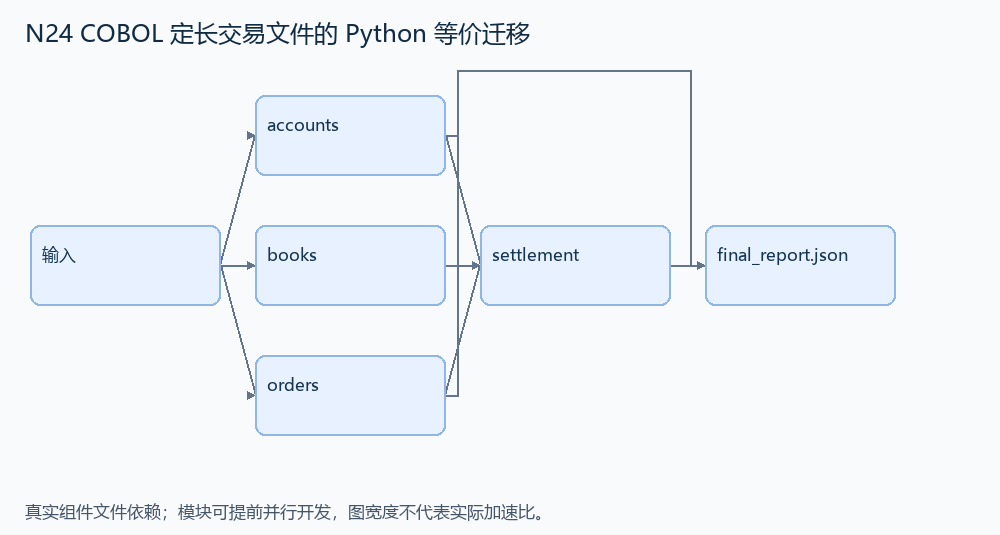
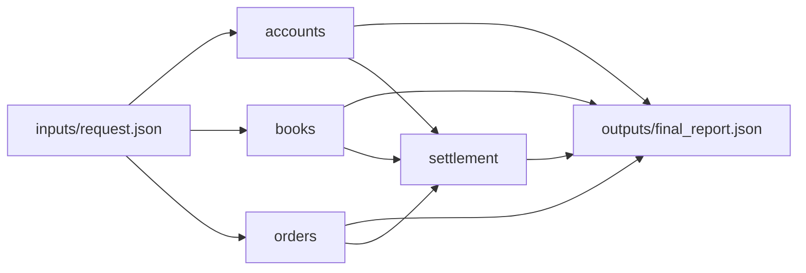

# N24 COBOL 定长交易文件的 Python 等价迁移

设计目标 M；实测未校准。结构风格 `linux2`，4 个组件，组件 DAG 宽度 3。

读取定长账户、图书所有权和交易输入，执行书籍转让，产生与给定 COBOL 程序一致的三个数据文件。

[TASK](../../tasks/linux2/cobol_fixed_records/TASK.md) · [工作区规格](../../tasks/linux2/cobol_fixed_records/workspace/README.md)

## 核心组件

- `accounts`：按34字符定长记录解析账户，字段 ID4/姓名20/余额10。返回 [{id,name:去掉末尾填充空格,balance:整数}]，保持文件顺序。合法 ASCII 输入。
  输入绑定：`{"text": "inputs/request.json#/accounts"}`；组件产物 `outputs/accounts.json`。
- `books`：按28字符定长记录解析图书，字段 ID4/书名20/owner4。返回 [{id,title:去掉末尾空格,owner}]，保持文件顺序。
  输入绑定：`{"text": "inputs/request.json#/books"}`；组件产物 `outputs/books.json`。
- `orders`：逐个解析22字符交易请求：buyer4/seller4/book4/amount10。返回 [{buyer,seller,book,amount:整数}]，保持请求顺序。
  输入绑定：`{"orders": "inputs/request.json#/orders"}`；组件产物 `outputs/orders.json`。
- `settlement`：顺序执行交易。请求中的买卖账户和书均存在，买卖方不同、正常金额且余额足够；当前 owner==seller 才成功。成功时买方余额减金额、卖方增加、owner改买方，向 journal 追加 book4+amount10+seller4+buyer4；不符所有权时三类文件不变。返回 {accounts:重编码定长串,books:重编码定长串,journal:累计交易串,statuses:['accepted'|'rejected',...]}。保持原记录顺序，姓名/书名填充20位，数值填充10位。
  输入绑定：`{"accounts": "outputs/accounts.json#", "books": "outputs/books.json#", "orders": "outputs/orders.json#", "journal": "inputs/request.json#/journal"}`；组件产物 `outputs/settlement.json`。

## 评分与非核心范围

A/B/D/P 共 25 个冻结验收单元，接口 bundle 包含两组干净目录独立构建。上限2，Reward=2×(0.5×K/N+0.5×Strict)，完整性失败清零。

不加信用额度、反洗钱、溢出/负余额极端值、任意损坏 DAT 或崩溃原子性。

## 来源与原始标签

- **Terminal-Bench 2.0**：[`cobol-modernization`](https://github.com/harbor-framework/terminal-bench-2/blob/2fd12b88aafdd04a52c298e3940bcb189f9766d6/cobol-modernization/instruction.md)；原始标注：easy。

原题核心：源程序校验买卖双方及图书所有权，再更新余额、所有者并追加交易记录。

改编范围：保留真实字段宽度及连续有效交易语义；提供源程序与已冻结黄金轨迹，agent 环境只需 Python。GnuCOBOL 仅用于出题方离线生成参考。

[本题完整来源追溯](../原题来源与改编说明.md#n24) · [机器索引](../../review/source_provenance_v1.json)

原始标签不直接决定改编题难度；最终业务范围以当前工作区规格为准。

## 去重依据

旧支付题是复杂结算核对；旧票据题是文本提取归档。本题是有明确参考程序的跨语言定长交易迁移。
