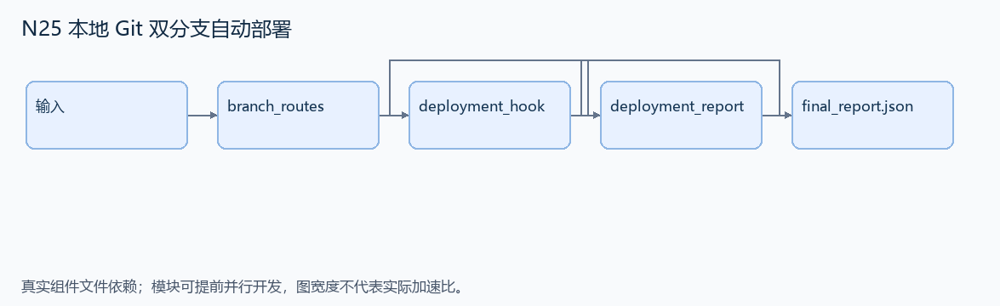
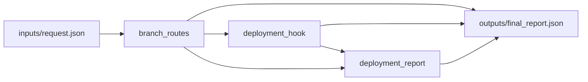

# N25 本地 Git 双分支自动部署

设计目标 M；实测未校准。结构风格 `linux2`，3 个组件，组件 DAG 宽度 1。

搭建本地 bare 仓库和 post-receive hook，将 main/dev 的内容各自部署到对应目录。

[TASK](../../tasks/linux2/local_git_branch_deploy/TASK.md) · [工作区规格](../../tasks/linux2/local_git_branch_deploy/workspace/README.md)

## 核心组件

- `branch_routes`：返回路由映射独立副本，refs/heads/main与refs/heads/dev指向互不包含的相对部署目录。无SSH/Nginx/TLS。
  输入绑定：`{"routes": "inputs/request.json#/routes"}`；组件产物 `outputs/branch_routes.json`。
- `deployment_hook`：返回Python post-receive业务脚本字符串，stdin每行old new ref；一次可有多行。GIT_DIR来自环境，MEDIUM30_DEPLOY_ROOT为部署根。对路由内非删除ref，把new commit树完整部署到对应目录，清除该分支旧文件但不影响另一分支；未路由ref忽略。提供的run_deploy负责创建仓库、安装Python启动shim及真实git push，脚本只需实现业务分派。允许任意正确脚本，不比脚本文本。
  输入绑定：`{"routes": "outputs/branch_routes.json#"}`；组件产物 `outputs/deployment_hook.json`。
- `deployment_report`：调用公开runtime.run_deploy(hook,routes,batches)或等价本地Git流程。batches每批包含待提交branch和完整files快照，需真实git push触发hook。返回 {files:{部署根下相对文件路径:UTF8内容}}。只测试有效提交和本地正常push，不测失败回滚/网络。
  输入绑定：`{"hook": "outputs/deployment_hook.json#", "routes": "outputs/branch_routes.json#", "batches": "inputs/request.json#/batches"}`；组件产物 `outputs/deployment_report.json`。

## 评分与非核心范围

A/B/D/P 共 18 个冻结验收单元，接口 bundle 包含两组干净目录独立构建。上限2，Reward=2×(0.5×K/N+0.5×Strict)，完整性失败清零。

不要求真实 SSH 账户、证书、网络端口、墙钟 3 秒门槛或失败自动回滚。

## 来源与原始标签

- **Terminal-Bench 2.0**：[`git-multibranch`](https://github.com/harbor-framework/terminal-bench-2/blob/2fd12b88aafdd04a52c298e3940bcb189f9766d6/git-multibranch/instruction.md)；原始标注：medium。

原题核心：上游要求 SSH Git 服务、Nginx HTTPS、双分支部署和 push 后自动更新。

改编范围：明确移除 SSH/Nginx/TLS 与 3 秒门槛，改用本地 git push 触发真实 hook；保留 ref→部署目录映射与两个分支互不覆盖。属于环境简化改编。

[本题完整来源追溯](../原题来源与改编说明.md#n25) · [机器索引](../../review/source_provenance_v1.json)

原始标签不直接决定改编题难度；最终业务范围以当前工作区规格为准。

## 去重依据

旧题分析发布依赖/来源；本题执行 Git 接收 hook。N22 操作历史对象恢复，本题处理 ref 驱动的部署，互不复用核心算法。
