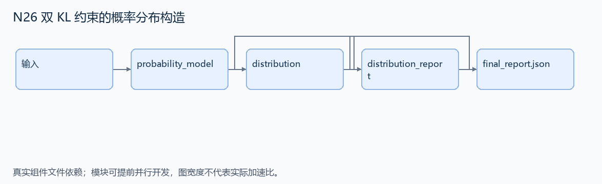
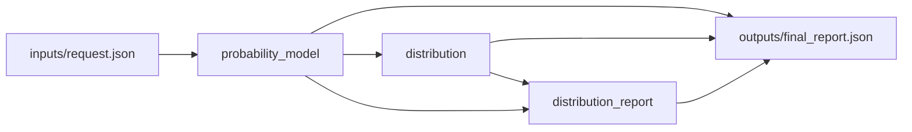

# N26 双 KL 约束的概率分布构造

设计目标 M；实测未校准。结构风格 `reasoning4`，3 个组件，组件 DAG 宽度 1。

构造长度 150000 的正概率向量，使正向与反向 KL 到均匀分布都接近 10，并保存可独立读取的 dist.npy。

[TASK](../../tasks/reasoning4/dual_kl_distribution/TASK.md) · [工作区规格](../../tasks/reasoning4/dual_kl_distribution/workspace/README.md)

## 核心组件

- `probability_model`：返回 {n,groups,targets}。groups为三个正整数且和为n，第1组1个元素；构造分组常数概率可作为标准数值求根的低维参数化。targets={forward,backward}，本版均为10；n=150000。不要求指定算法或特定解。
  输入绑定：`{"n": "inputs/request.json#/n", "groups": "inputs/request.json#/groups", "targets": "inputs/request.json#/targets"}`；组件产物 `outputs/probability_model.json`。
- `distribution`：构造长度model.n的正概率向量列表，和误差<=1e-5；KL(P||U)及KL(U||P)分别与targets误差<=0.001，使用自然对数。返回概率列表，允许任意合法解。可用预装NumPy/SciPy标准求根；无需GPU或训练。
  输入绑定：`{"model": "outputs/probability_model.json#"}`；组件产物 `outputs/distribution.json`。
- `distribution_report`：返回 {size,mass,forward_kl,backward_kl,meets_target:bool}，必须从同一个概率向量实际重算；数值按公开容差验收而非精确字符串。
  输入绑定：`{"probabilities": "outputs/distribution.json#", "model": "outputs/probability_model.json#"}`；组件产物 `outputs/distribution_report.json`。

## 评分与非核心范围

A/B/D/P 共 18 个冻结验收单元，接口 bundle 包含两组干净目录独立构建。上限2，Reward=2×(0.5×K/N+0.5×Strict)，完整性失败清零。

不加精确向量值、特定算法/随机种子、额外精度或性能门槛。正概率和有限 KL 是数学核心，不是通用 NaN 防御用例。

## 来源与原始标签

- **Terminal-Bench 2.0**：[`distribution-search`](https://github.com/harbor-framework/terminal-bench-2/blob/2fd12b88aafdd04a52c298e3940bcb189f9766d6/distribution-search/instruction.md)；原始标注：medium。

原题核心：上游同时要求 KL(P||U)=10 与 KL(U||P)=10，两个误差均不超过 0.001。

改编范围：保留两个耦合数值目标与概率归一化；允许标准低维参数化加求根，不要求全向量训练或 GPU。NumPy/SciPy 提前装入环境。

[本题完整来源追溯](../原题来源与改编说明.md#n26) · [机器索引](../../review/source_provenance_v1.json)

原始标签不直接决定改编题难度；最终业务范围以当前工作区规格为准。

## 去重依据

已有任务没有双 KL 概率构造内核；属于数值计算内容，不是对旧调度题换名字。
