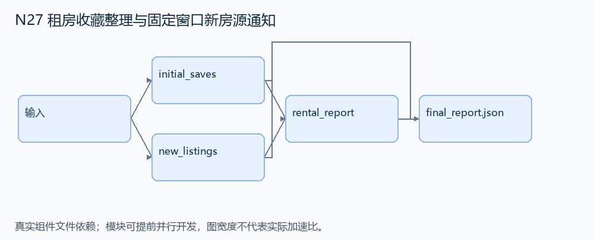
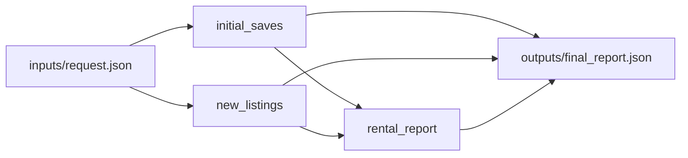

# N27 租房收藏整理与固定窗口新房源通知

设计目标 M；实测未校准。结构风格 `multistage4`，3 个组件，组件 DAG 宽度 2。

整理符合城市与预算的收藏，并在固定四分钟逻辑窗口内将新出现的合格房源通知指定朋友。

[TASK](../../tasks/multistage4/rental_fixed_window_notifications/TASK.md) · [工作区规格](../../tasks/multistage4/rental_fixed_window_notifications/workspace/README.md)

## 核心组件

- `initial_saves`：对初始快照收藏做集合更新：删除指定city中不在闭区间[low,high]的已收藏房源，保存初始列表中同城合格房源，其他城市原收藏不变。返回排序最终ID列表。
  输入绑定：`{"properties": "inputs/request.json#/properties", "saved": "inputs/request.json#/saved", "city": "inputs/request.json#/city", "low": "inputs/request.json#/low", "high": "inputs/request.json#/high"}`；组件产物 `outputs/initial_saves.json`。
- `new_listings`：events=[{at:逻辑秒,property:{id,city,price}}]，ID唯一。仅筛选0<=at<window内合格新房源，按(at,id)返回 [{at,id}]。本版新事件只通知，不额外修改初始收藏。
  输入绑定：`{"events": "inputs/request.json#/events", "window": "inputs/request.json#/window", "city": "inputs/request.json#/city", "low": "inputs/request.json#/low", "high": "inputs/request.json#/high"}`；组件产物 `outputs/new_listings.json`。
- `rental_report`：返回 {saved:初始收藏整理结果,notifications:[{to:friend,property:ID,at:上架逻辑秒}]}。不得把旧合格房源当新事件通知。
  输入绑定：`{"saved": "outputs/initial_saves.json#", "new": "outputs/new_listings.json#", "friend": "inputs/request.json#/friend"}`；组件产物 `outputs/rental_report.json`。

## 评分与非核心范围

A/B/D/P 共 17 个冻结验收单元，接口 bundle 包含两组干净目录独立构建。上限2，Reward=2×(0.5×K/N+0.5×Strict)，完整性失败清零。

不加重复投递恢复、网络延迟、精确秒级响应、任意预算变化或自然语言消息逐字匹配。

## 来源与原始标签

- **GAIA2**：[`scenario_universe_21_xvc7uo`](https://huggingface.co/datasets/meta-agents-research-environments/gaia2/viewer/mini/validation?row=0)；原始标注：未提供所选场景逐题难度；不等同 GAIA 1 的 Level 1/2/3。

原题核心：GAIA2 要删除 Stockholm 非预算收藏、保存已有合格房源，并通知窗口内新上架的合格房源。

改编范围：保留初始收藏、新事件及固定窗口；用注入式逻辑时钟和静态事件清单代替真实等待。城市和价格来自结构化字段，不做开放文本理解。

[本题完整来源追溯](../原题来源与改编说明.md#n27) · [机器索引](../../review/source_provenance_v1.json)

原始标签不直接决定改编题难度；最终业务范围以当前工作区规格为准。

## 去重依据

旧题为联系人排名/循环日程；本题的集合对象是房源，核心为初始集合与新增事件的分离，不是静态联系人排名。
