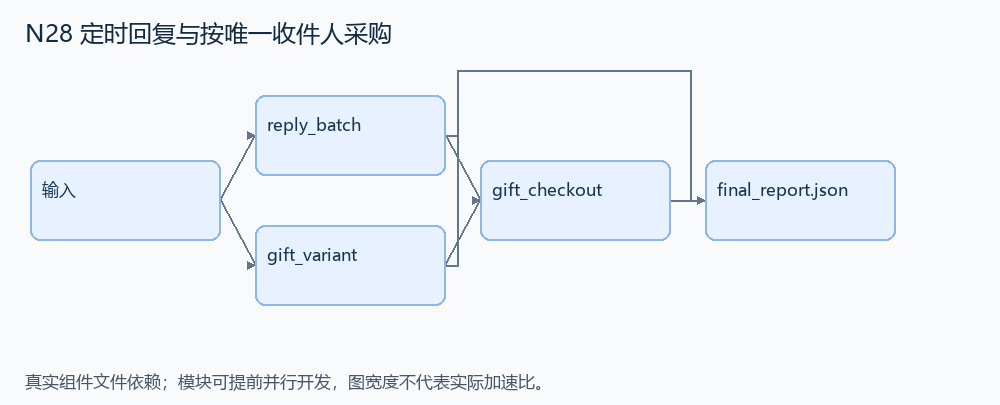
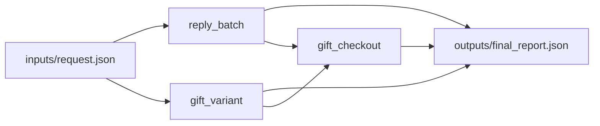

# N28 定时回复与按唯一收件人采购

设计目标 M；实测未校准。结构风格 `multistage4`，3 个组件，组件 DAG 宽度 2。

收集固定四分钟内的新邮件，到点统一回复，再在三十秒逻辑延迟后按不同发件人数采购并创建提醒。

[TASK](../../tasks/multistage4/timed_replies_unique_gifts/TASK.md) · [工作区规格](../../tasks/multistage4/timed_replies_unique_gifts/workspace/README.md)

## 核心组件

- `reply_batch`：emails=[{id,from,at:逻辑秒}]。筛选0<=at<window，按(at,id)排序，统一在window时回复。返回 [{email:ID,to:邮箱,at:window,purpose:'gift_reply'}]。不对自然语言措辞评分。
  输入绑定：`{"emails": "inputs/request.json#/emails", "window": "inputs/request.json#/window"}`；组件产物 `outputs/reply_batch.json`。
- `gift_variant`：selection给brand/color/size/product；唯一定位全部字段相等的商品，返回variant ID。输入保证唯一。
  输入绑定：`{"variants": "inputs/request.json#/variants", "selection": "inputs/request.json#/selection"}`；组件产物 `outputs/gift_variant.json`。
- `gift_checkout`：按实际回复的唯一邮箱数量采购，在window+30逻辑秒checkout。date为当前YYYY-MM-DD。返回 {replies,order:{at,variant,quantity},reminder:{date:当月最后一天,all_day:true,title:'Reminder: Hand Out Gifts'}}。同邮箱多邮件都回复但只算一件礼品。
  输入绑定：`{"replies": "outputs/reply_batch.json#", "variant": "outputs/gift_variant.json#", "window": "inputs/request.json#/window", "date": "inputs/request.json#/date"}`；组件产物 `outputs/gift_checkout.json`。

## 评分与非核心范围

A/B/D/P 共 17 个冻结验收单元，接口 bundle 包含两组干净目录独立构建。上限2，Reward=2×(0.5×K/N+0.5×Strict)，完整性失败清零。

不加库存竞争、付款失败、收件邮箱畸形输入、真实 wall-clock 误差或完整礼品文案逐字检查。

## 来源与原始标签

- [scenario_universe_27_fcbx0i](https://huggingface.co/datasets/meta-agents-research-environments/gaia2/viewer/mini/validation?row=1)：未提供所选场景逐题难度；不等同 GAIA 1 的 Level 1/2/3；场景 category 不是难度。

## 去重依据

旧采购题根据静态名单/需求选购；本题由固定窗口内实际回复的唯一发件人集合驱动数量，没有难题中的反馈重试。
