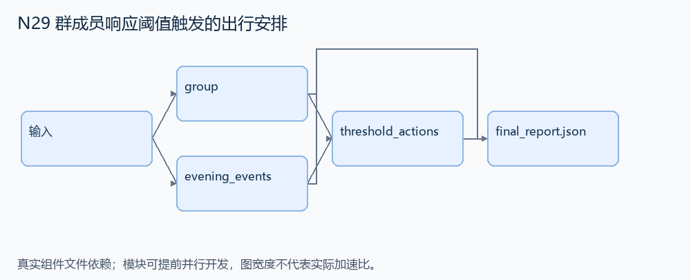
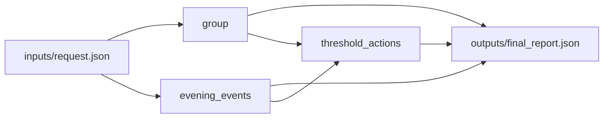

# N29 群成员响应阈值触发的出行安排

设计目标 M；实测未校准。结构风格 `multistage4`，3 个组件，组件 DAG 宽度 2。

创建群聊，在固定窗口内有三名不同参与者发言时，安排一次车辆、发送群通知并删除晚间冲突日程。

[TASK](../../tasks/multistage4/group_response_threshold/TASK.md) · [工作区规格](../../tasks/multistage4/group_response_threshold/workspace/README.md)

## 核心组件

- `group`：contacts=[{id,name}]，names列出唯一姓名。返回 {id:'group:new',title:'Happy Astrid Day!',members:按ID排序目标联系人ID}。
  输入绑定：`{"contacts": "inputs/request.json#/contacts", "names": "inputs/request.json#/names"}`；组件产物 `outputs/group.json`。
- `evening_events`：calendar=[{id,start_minute:当晚午夜后分钟}]；返回开始时间>=1200的事件ID，按ID排序。
  输入绑定：`{"events": "inputs/request.json#/calendar"}`；组件产物 `outputs/evening_events.json`。
- `threshold_actions`：仅统计group:new中members发出的0<=at<window消息，每人只计一次，按(at,id)处理。首次达到threshold时触发一次；之后不再追加订车。返回 {group:输入group,trigger_at:逻辑秒或null,ride:null或{at,pickup:'21:30',vehicle:'van',from:'home',to:'Tegnergatan 8'},notice:null或{at,meet:'20:00'},deleted:触发时evening否则[]}。未达到阈值是正常业务分支。
  输入绑定：`{"group": "outputs/group.json#", "evening": "outputs/evening_events.json#", "messages": "inputs/request.json#/messages", "window": "inputs/request.json#/window", "threshold": "inputs/request.json#/threshold"}`；组件产物 `outputs/threshold_actions.json`。

## 评分与非核心范围

A/B/D/P 共 17 个冻结验收单元，接口 bundle 包含两组干净目录独立构建。上限2，Reward=2×(0.5×K/N+0.5×Strict)，完整性失败清零。

不加成员退群、撤回投票、迟到补偿、支付失败、其他群聊干扰攻击。

## 来源与原始标签

- **GAIA2**：[`scenario_universe_21_ycoch2`](https://huggingface.co/datasets/meta-agents-research-environments/gaia2/viewer/mini/validation?row=12)；原始标注：未提供所选场景逐题难度；不等同 GAIA 1 的 Level 1/2/3。

原题核心：GAIA2 的 Happy Astrid Day 场景，以不同群成员人数而非消息条数触发出行及后续动作。

改编范围：保留三人阈值与五分钟逻辑窗口；结构化联系人和消息事件，单次阈值触发，不加入预约取消、成员撤销或多轮重试。

[本题完整来源追溯](../原题来源与改编说明.md#n29) · [机器索引](../../review/source_provenance_v1.json)

原始标签不直接决定改编题难度；最终业务范围以当前工作区规格为准。

## 去重依据

旧题按静态参会者规划；本题的核心是事件响应阈值决定动作可行性。只有单调一次性门控，未保留困难候选中的多轮补偿历史。
