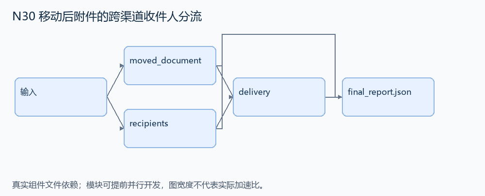
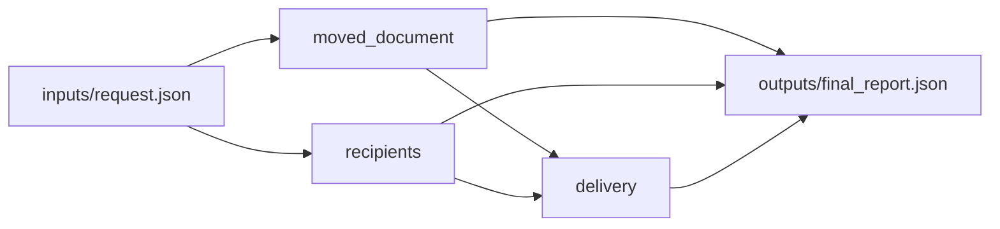

# N30 移动后附件的跨渠道收件人分流

设计目标 M；实测未校准。结构风格 `linux2`，3 个组件，组件 DAG 宽度 2。

移动指定文件后，把同一新路径附件发给按条件定位的联系人，并把可用消息渠道不同的历史教师分成群聊和邮件两组。

[TASK](../../tasks/linux2/moved_attachment_channel_routes/TASK.md) · [工作区规格](../../tasks/linux2/moved_attachment_channel_routes/workspace/README.md)

## 核心组件

- `moved_document`：Files应用的虚拟快照files={相对路径:不透明文件字节的base64}，夹具为可打开的有效xlsx。移动source到destination，目标父目录可创建。返回 {files:移动后快照,attachment:{path:destination,content:原base64,sha256:解码后实际文件字节摘要}}。source存在、destination未占用。只保留字节，不解析xlsx内部。
  输入绑定：`{"files": "inputs/request.json#/files", "source": "inputs/request.json#/source", "destination": "inputs/request.json#/destination"}`；组件产物 `outputs/moved_document.json`。
- `recipients`：people=[{id,teacher:是否现任或曾任历史教师,former,country,pilot:是否曾任飞行员,messages:是否支持Messages}]。目标邮件收件人为email_sender与唯一country=RU且pilot=true联系人之并集。教师排除self后按messages分区。返回 {target_email:排序ID,messages:排序教师ID,fallback_email:排序教师ID}；former不排除教师。
  输入绑定：`{"people": "inputs/request.json#/people", "self": "inputs/request.json#/self", "email_sender": "inputs/request.json#/email_sender"}`；组件产物 `outputs/recipients.json`。
- `delivery`：返回 {files:移动后快照,target_email:{to:目标ID,path,sha256},messages:null或{members:教师ID,path,sha256},fallback_email:null或{to:不可达教师ID,path,sha256},attachment_content:原base64内容}。空分区不创建空群/邮件，所有发送引用移动后文件。
  输入绑定：`{"moved": "outputs/moved_document.json#", "recipients": "outputs/recipients.json#"}`；组件产物 `outputs/delivery.json`。

## 评分与非核心范围

A/B/D/P 共 18 个冻结验收单元，接口 bundle 包含两组干净目录独立构建。上限2，Reward=2×(0.5×K/N+0.5×Strict)，完整性失败清零。

不检查 xlsx 内部结构、邮件自然语言风格、网络服务、地址损坏或重复发送恢复协议。

## 来源与原始标签

- **GAIA2**：[`scenario_universe_27_sqvrhj`](https://huggingface.co/datasets/meta-agents-research-environments/gaia2/viewer/mini/validation?row=80)；原始标注：未提供所选场景逐题难度；不等同 GAIA 1 的 Level 1/2/3。

原题核心：GAIA2 要创建 Cold War 文件夹、移动文档、定位邮件作者和联系人，再按 Messages 可达性分流分享。

改编范围：保留文件移动后路径、多个独立联系人条件、渠道分区及群发；内容仅为不透明小文件，不读取或编辑 xlsx。

[本题完整来源追溯](../原题来源与改编说明.md#n30) · [机器索引](../../review/source_provenance_v1.json)

原始标签不直接决定改编题难度；最终业务范围以当前工作区规格为准。

## 去重依据

同文件操作题族，重复风险中：旧题核心是发送后归档/缺失照片报告/目录邮件整理；本题必须保留双目标定位与按渠道分区。若实施后只剩搬文件发邮件，应替换而非计为新题。
