# Mixed16 v3：16 个任务的组件执行 DAG

这些图用于作者分析与展示，**不得提供给被测代理**。评测只提供对应 `TASK.md` 与 `workspace/`，不要挂载 `_authoring/` 或仓库根目录。

## 图的含义

- 一节点表示一个组件或逻辑产物生成阶段；箭头表示产物/物化边界依赖。这不是实测调用轨迹，也不展开组件内部函数。
- `run_all.py` 是安排这些步骤的编排器，不作为额外的串行计算节点；focused check 和根 `check.py` 属于验收流程，不纳入产物生成 DAG。
- SVG / PNG 使用执行 DAG 的**传递约简**：省略已有间接路径的冗余直接读取边，可达关系完全相同。最终 `integrate.py` 实际仍读取全部组件产物。
- 每任务的 Mermaid 与 JSON 保留全部直接执行依赖；Mermaid 另画出原始输入文件（虚线）。SVG / PNG 在组件内标出本地输入文件，避免将数据文件误当作执行任务。
- 蓝色为组件，橙色为 Linux 物化屏障，紫色为集成，绿色为最终报告。`integrate.py domains` 与最终 `integrate.py` 是不同的逻辑调用。
- 分层为无限资源、仅考虑依赖时的最早拓扑分层，**不代表耗时或加速比**。最大独立宽度按执行节点的最大反链计算；如数仓任务宽度为4，第一层仍只有3个组件。
- 图中的算法输出（如 `critical_path` 的业务 DAG、网络路由图、组继承环）**没有展开成组件依赖**。`artifact_provenance_release` 的条件分支改变输出内容，不会跳过组件节点。

## 校验与复现

实际 `contract.json`（Linux 从物化脚本的受校验 PAYLOAD 静态提取）逐个与作者规格比对；校验无环、最终报告可达、全部读取边、传递约简可达性、分层和独立宽度。契约摘要及完整边表见每任务 JSON，汇总见 `graph_validation.json`。

生成器位于 [`../render_dags.py`](../render_dags.py)，依赖 NetworkX 和 Pillow。中文字体支持通过 `--font` 指定：

```sh
python mixed16-extension-v3/_authoring/render_dags.py --root mixed16-extension-v3
```

## 图集目录


### multistage4

- [01. 跨区域故障切换 — `regional_failover_readiness`](regional_failover_readiness.md)：宽度 3，分层 3 → 1 → 3 → 1 → 1。
- [02. 数仓切换保障 — `warehouse_cutover_assurance`](warehouse_cutover_assurance.md)：宽度 4，分层 3 → 2 → 1 → 1 → 1。
- [03. 制品溯源发布 — `artifact_provenance_release`](artifact_provenance_release.md)：宽度 3，分层 3 → 2 → 1 → 1 → 1。
- [04. 存储分层迁移 — `storage_tiering_migration`](storage_tiering_migration.md)：宽度 3，分层 3 → 1 → 1 → 1 → 1 → 1。

### reasoning4

- [05. 边缘设备灰度发布 — `edge_fleet_rollout`](edge_fleet_rollout.md)：宽度 2，分层 2 → 1 → 1 → 1。
- [06. 租户配额再平衡 — `tenant_quota_rebalance`](tenant_quota_rebalance.md)：宽度 2，分层 2 → 1 → 1 → 1。
- [07. 批处理调度迁移 — `batch_scheduler_transition`](batch_scheduler_transition.md)：宽度 2，分层 2 → 1 → 1 → 1。
- [08. API 下线管理 — `api_deprecation_campaign`](api_deprecation_campaign.md)：宽度 2，分层 2 → 1 → 1 → 1。

### context8

- [09. 支付清算对账 — `payment_settlement_reconciliation`](payment_settlement_reconciliation.md)：宽度 2，分层 2 → 1 → 1 → 1。
- [10. 身份联邦迁移 — `identity_federation_transition`](identity_federation_transition.md)：宽度 2，分层 2 → 1 → 1 → 1。
- [11. 流处理检查点恢复 — `streaming_checkpoint_recovery`](streaming_checkpoint_recovery.md)：宽度 2，分层 2 → 1 → 1 → 1。
- [12. 搜索索引重建 — `search_index_rebuild`](search_index_rebuild.md)：宽度 2，分层 2 → 1 → 1 → 1。

### linux2

- [13. 证书轮换准备 — `certificate_rotation_readiness`](certificate_rotation_readiness.md)：宽度 2，分层 1 → 2 → 1 → 1 → 1。
- [14. 备份恢复认证 — `backup_restore_certification`](backup_restore_certification.md)：宽度 2，分层 1 → 2 → 1 → 1 → 1。
- [15. 可观测数据保留升级 — `observability_retention_upgrade`](observability_retention_upgrade.md)：宽度 2，分层 1 → 2 → 1 → 1 → 1。
- [16. 网络策略收敛 — `network_policy_convergence`](network_policy_convergence.md)：宽度 2，分层 1 → 2 → 1 → 1 → 1。

## 全部图预览


### 01. [跨区域故障切换](regional_failover_readiness.md)

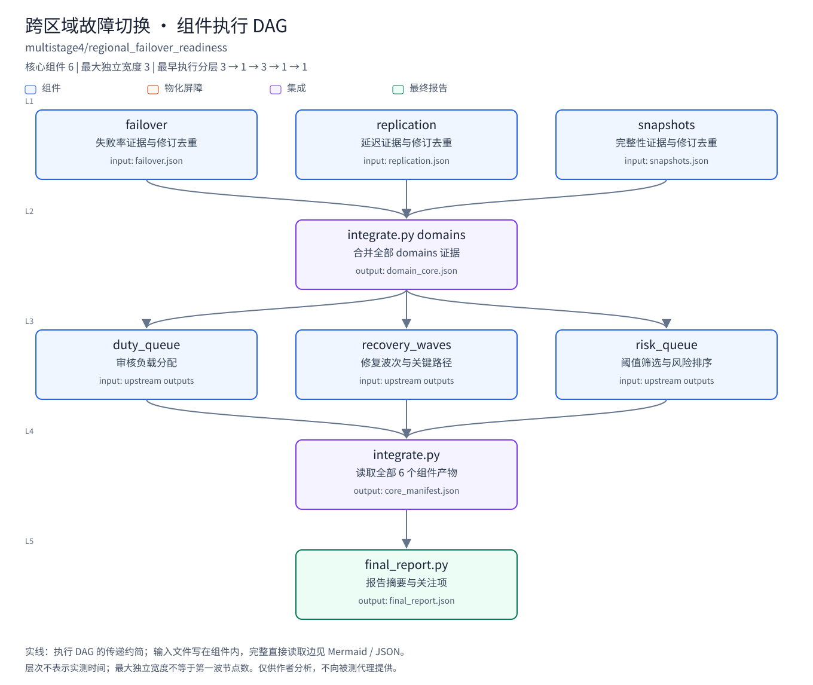


### 02. [数仓切换保障](warehouse_cutover_assurance.md)

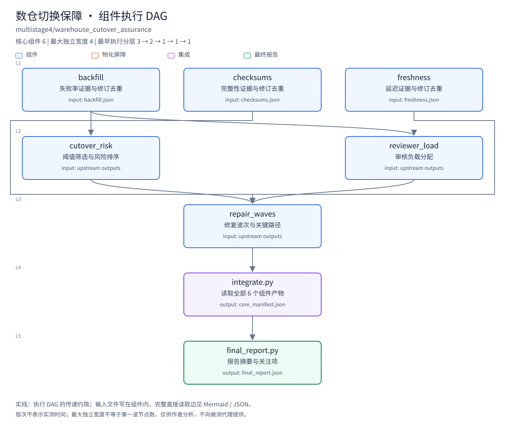


### 03. [制品溯源发布](artifact_provenance_release.md)

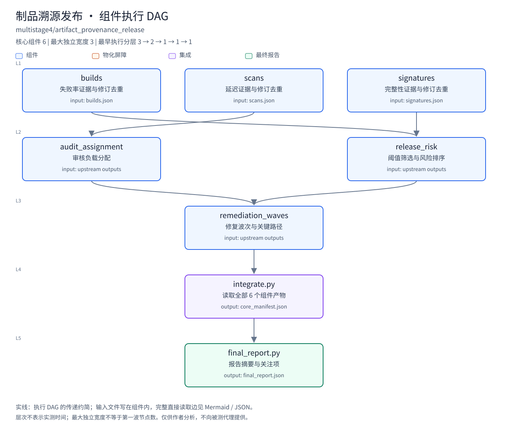


### 04. [存储分层迁移](storage_tiering_migration.md)

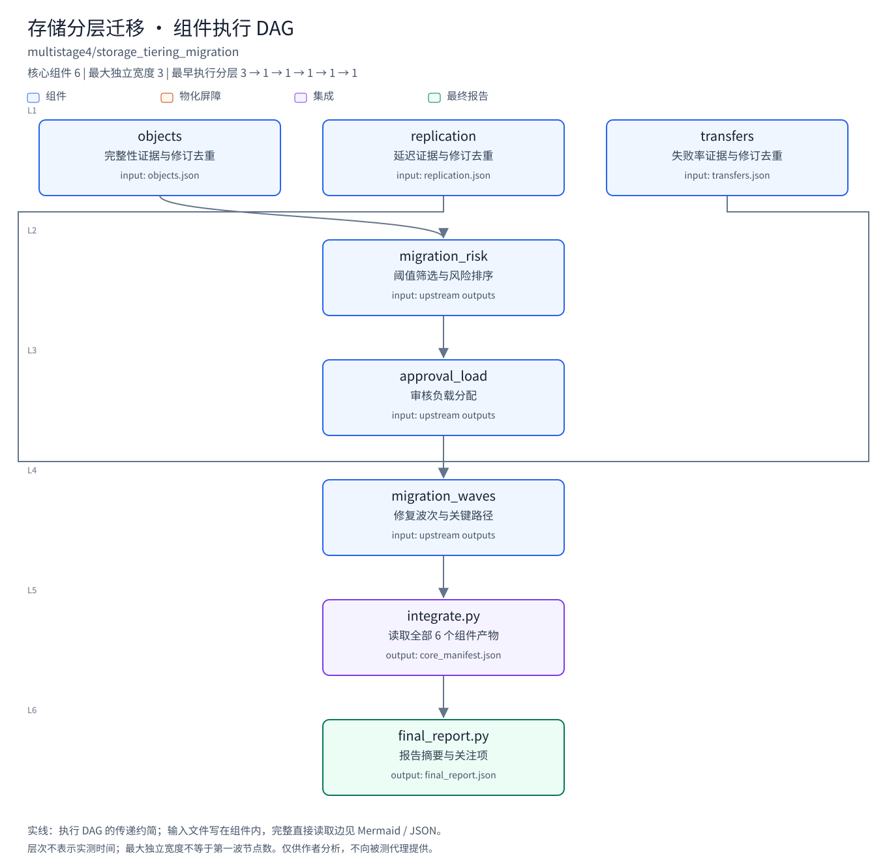


### 05. [边缘设备灰度发布](edge_fleet_rollout.md)

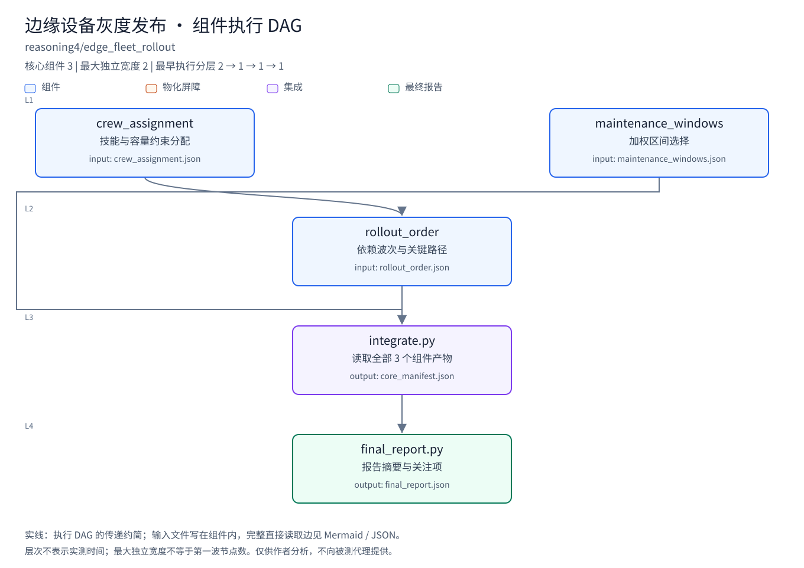


### 06. [租户配额再平衡](tenant_quota_rebalance.md)

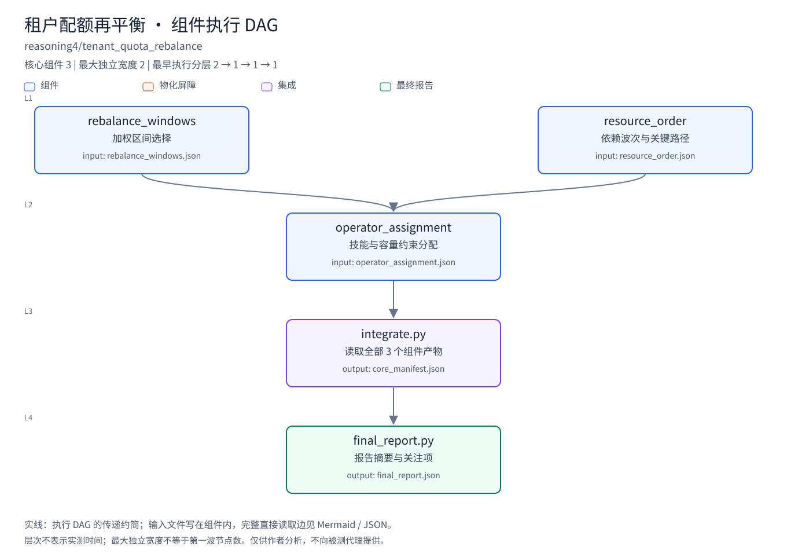


### 07. [批处理调度迁移](batch_scheduler_transition.md)


### 08. [API 下线管理](api_deprecation_campaign.md)

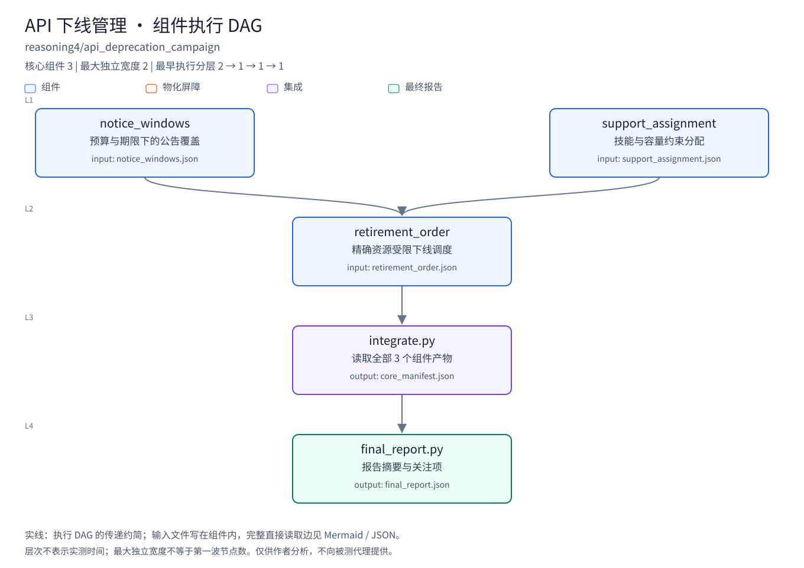


### 09. [支付清算对账](payment_settlement_reconciliation.md)

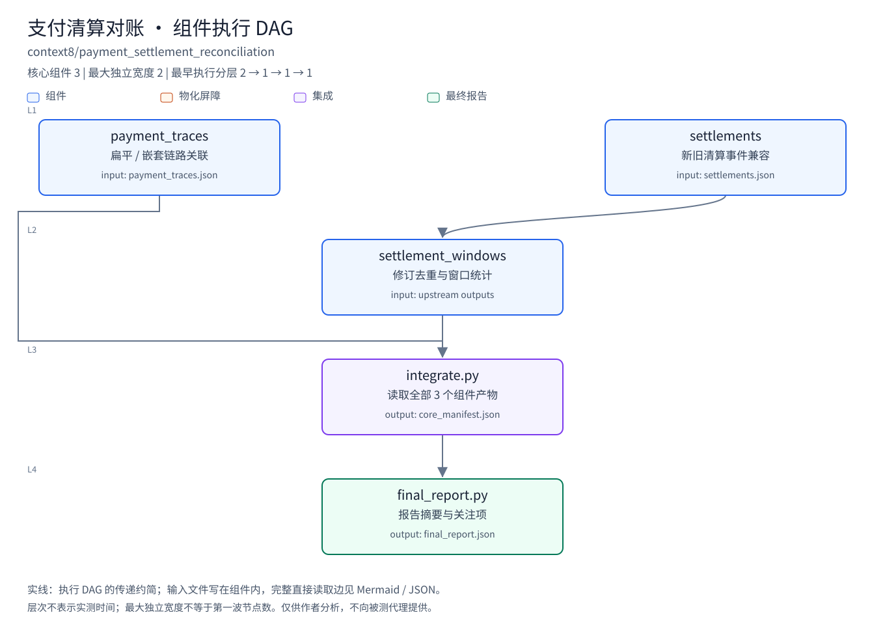


### 10. [身份联邦迁移](identity_federation_transition.md)

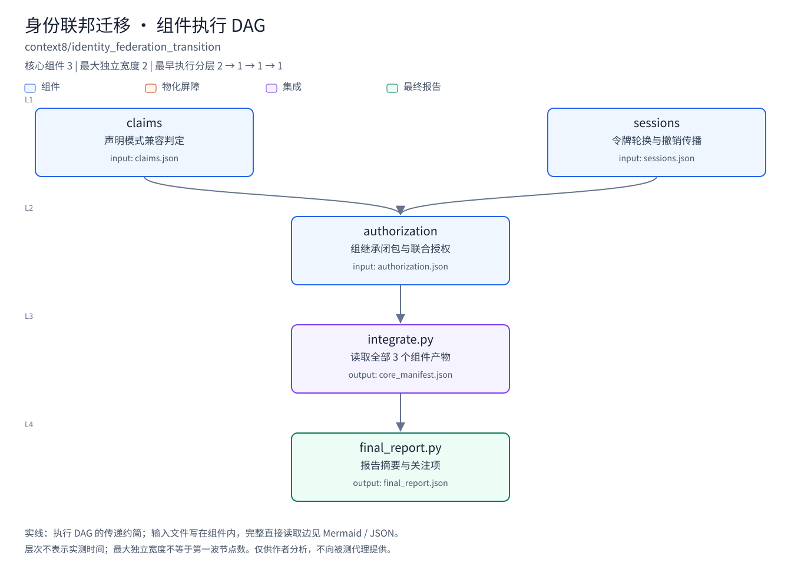


### 11. [流处理检查点恢复](streaming_checkpoint_recovery.md)

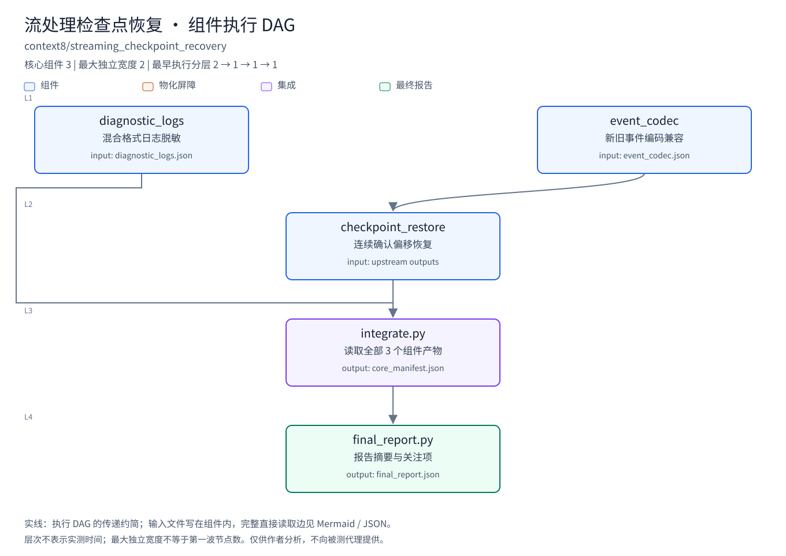


### 12. [搜索索引重建](search_index_rebuild.md)


### 13. [证书轮换准备](certificate_rotation_readiness.md)

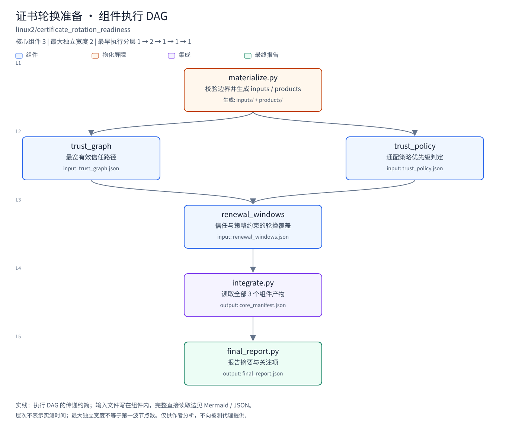


### 14. [备份恢复认证](backup_restore_certification.md)

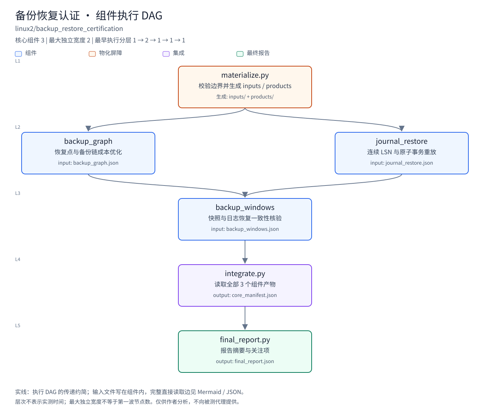


### 15. [可观测数据保留升级](observability_retention_upgrade.md)


### 16. [网络策略收敛](network_policy_convergence.md)

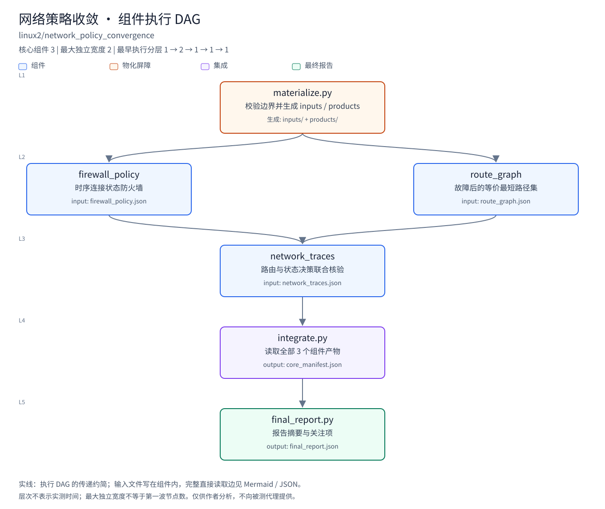
