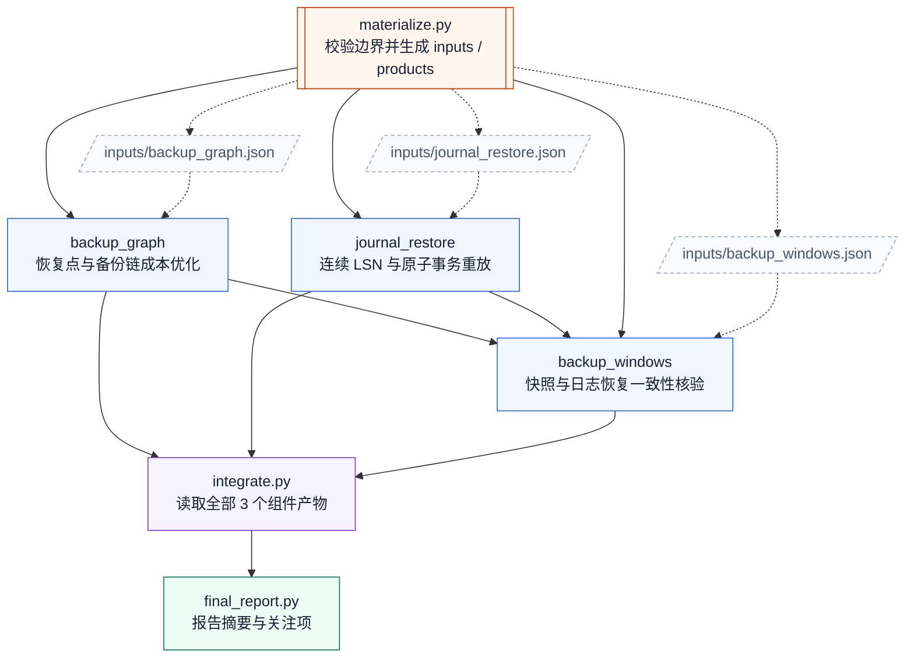

# 14. 备份恢复认证

任务：`linux2/backup_restore_certification`；[任务说明](../../tasks/linux2/backup_restore_certification/TASK.md) · [工作区说明](../../tasks/linux2/backup_restore_certification/workspace/README.md)。

核心组件 **3**；执行节点 **6**；最大独立宽度 **2**；最早分层 **1 → 2 → 1 → 1 → 1**。

[PNG](backup_restore_certification.png) · [SVG](backup_restore_certification.svg) · [Mermaid 源码](backup_restore_certification.mmd) · [完整边表与契约摘要](backup_restore_certification.json) · [图集目录](README.md)

## 完整依赖图（含输入文件）

虚线连接输入文件，实线为全部直接执行依赖；因此比上方传递约简图多出冗余但真实的读取边。

## 组件与输入接口

- `products/backup_graph`：恢复点与备份链成本优化；输入 `inputs/backup_graph.json`；输出 `outputs/backup_graph.json`。

- `products/journal_restore`：连续 LSN 与原子事务重放；输入 `inputs/journal_restore.json`；输出 `outputs/journal_restore.json`。

- `products/backup_windows`：快照与日志恢复一致性核验；输入 `inputs/backup_windows.json`、`outputs/backup_graph.json`、`outputs/journal_restore.json`；输出 `outputs/backup_windows.json`。

## 边的校验说明

完整执行边 9 条；传递约简后 6 条。两者传递闭包完全相同，所有执行节点都能到达最终报告。

本图只描述逻辑组件与文件接口，不要求代理按固定调度器运行；实际实现可以在满足依赖的前提下串行或并行。
