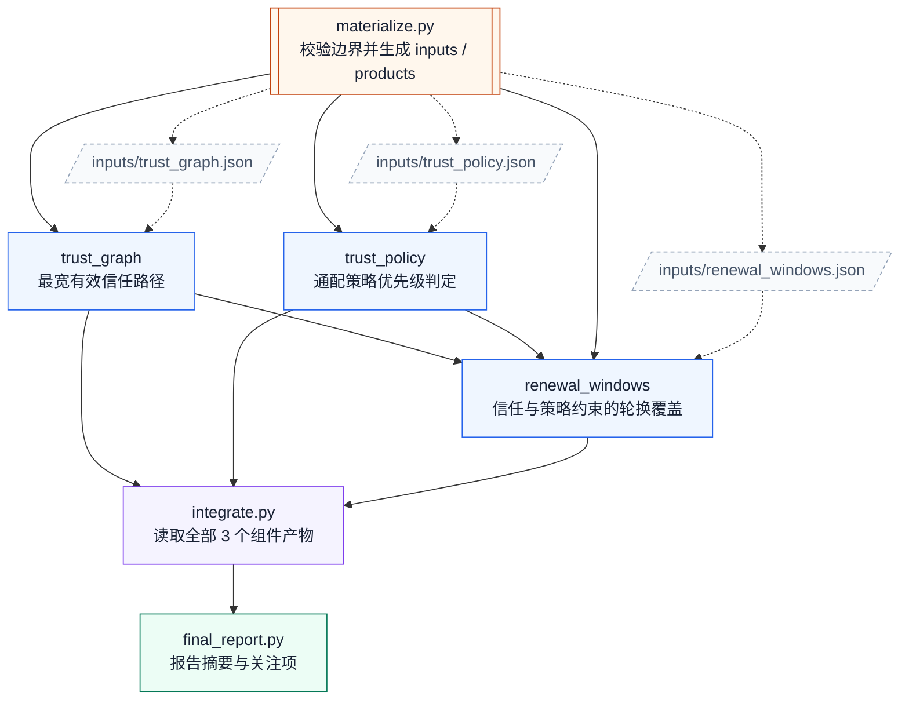

# 13. 证书轮换准备

任务：`linux2/certificate_rotation_readiness`；[任务说明](../../tasks/linux2/certificate_rotation_readiness/TASK.md) · [工作区说明](../../tasks/linux2/certificate_rotation_readiness/workspace/README.md)。

核心组件 **3**；执行节点 **6**；最大独立宽度 **2**；最早分层 **1 → 2 → 1 → 1 → 1**。

[PNG](certificate_rotation_readiness.png) · [SVG](certificate_rotation_readiness.svg) · [Mermaid 源码](certificate_rotation_readiness.mmd) · [完整边表与契约摘要](certificate_rotation_readiness.json) · [图集目录](README.md)

## 完整依赖图（含输入文件）

虚线连接输入文件，实线为全部直接执行依赖；因此比上方传递约简图多出冗余但真实的读取边。

## 组件与输入接口

- `products/trust_graph`：最宽有效信任路径；输入 `inputs/trust_graph.json`；输出 `outputs/trust_graph.json`。

- `products/trust_policy`：通配策略优先级判定；输入 `inputs/trust_policy.json`；输出 `outputs/trust_policy.json`。

- `products/renewal_windows`：信任与策略约束的轮换覆盖；输入 `inputs/renewal_windows.json`、`outputs/trust_graph.json`、`outputs/trust_policy.json`；输出 `outputs/renewal_windows.json`。

## 边的校验说明

完整执行边 9 条；传递约简后 6 条。两者传递闭包完全相同，所有执行节点都能到达最终报告。

本图只描述逻辑组件与文件接口，不要求代理按固定调度器运行；实际实现可以在满足依赖的前提下串行或并行。
