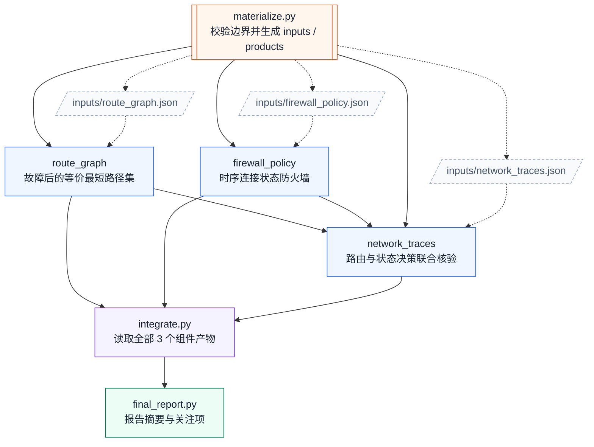

# 16. 网络策略收敛

任务：`linux2/network_policy_convergence`；[任务说明](../../tasks/linux2/network_policy_convergence/TASK.md) · [工作区说明](../../tasks/linux2/network_policy_convergence/workspace/README.md)。

核心组件 **3**；执行节点 **6**；最大独立宽度 **2**；最早分层 **1 → 2 → 1 → 1 → 1**。

[PNG](network_policy_convergence.png) · [SVG](network_policy_convergence.svg) · [Mermaid 源码](network_policy_convergence.mmd) · [完整边表与契约摘要](network_policy_convergence.json) · [图集目录](README.md)

## 完整依赖图（含输入文件）

虚线连接输入文件，实线为全部直接执行依赖；因此比上方传递约简图多出冗余但真实的读取边。

## 组件与输入接口

- `products/route_graph`：故障后的等价最短路径集；输入 `inputs/route_graph.json`；输出 `outputs/route_graph.json`。

- `products/firewall_policy`：时序连接状态防火墙；输入 `inputs/firewall_policy.json`；输出 `outputs/firewall_policy.json`。

- `products/network_traces`：路由与状态决策联合核验；输入 `inputs/network_traces.json`、`outputs/route_graph.json`、`outputs/firewall_policy.json`；输出 `outputs/network_traces.json`。

## 边的校验说明

完整执行边 9 条；传递约简后 6 条。两者传递闭包完全相同，所有执行节点都能到达最终报告。

本图只描述逻辑组件与文件接口，不要求代理按固定调度器运行；实际实现可以在满足依赖的前提下串行或并行。
