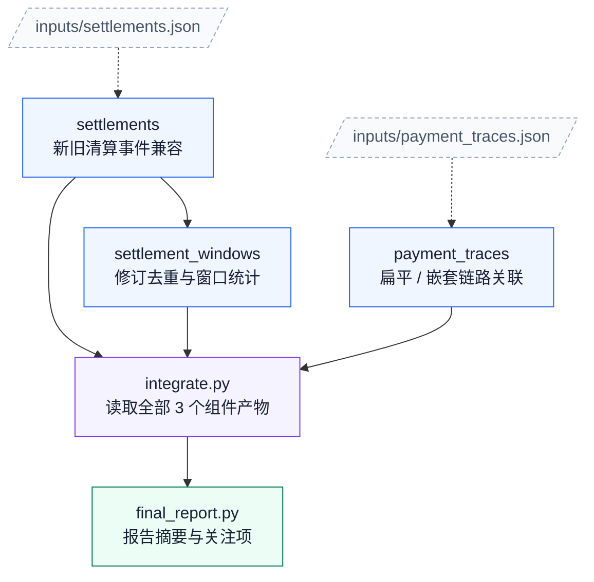

# 09. 支付清算对账

任务：`context8/payment_settlement_reconciliation`；[任务说明](../../tasks/context8/payment_settlement_reconciliation/TASK.md) · [工作区说明](../../tasks/context8/payment_settlement_reconciliation/workspace/README.md)。

核心组件 **3**；执行节点 **5**；最大独立宽度 **2**；最早分层 **2 → 1 → 1 → 1**。

[PNG](payment_settlement_reconciliation.png) · [SVG](payment_settlement_reconciliation.svg) · [Mermaid 源码](payment_settlement_reconciliation.mmd) · [完整边表与契约摘要](payment_settlement_reconciliation.json) · [图集目录](README.md)

## 完整依赖图（含输入文件）

虚线连接输入文件，实线为全部直接执行依赖；因此比上方传递约简图多出冗余但真实的读取边。

## 组件与输入接口

- `settlements`：新旧清算事件兼容；输入 `inputs/settlements.json`；输出 `outputs/settlements.json`。

- `settlement_windows`：修订去重与窗口统计；输入 `outputs/settlements.json`；输出 `outputs/settlement_windows.json`。

- `payment_traces`：扁平 / 嵌套链路关联；输入 `inputs/payment_traces.json`；输出 `outputs/payment_traces.json`。

## 边的校验说明

完整执行边 5 条；传递约简后 4 条。两者传递闭包完全相同，所有执行节点都能到达最终报告。

本图只描述逻辑组件与文件接口，不要求代理按固定调度器运行；实际实现可以在满足依赖的前提下串行或并行。
