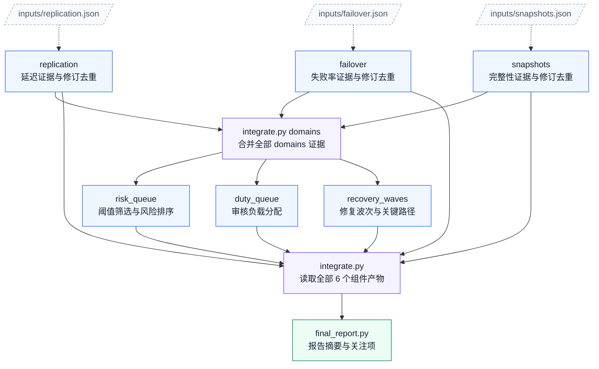

# 01. 跨区域故障切换

任务：`multistage4/regional_failover_readiness`；[任务说明](../../tasks/multistage4/regional_failover_readiness/TASK.md) · [工作区说明](../../tasks/multistage4/regional_failover_readiness/workspace/README.md)。

核心组件 **6**；执行节点 **9**；最大独立宽度 **3**；最早分层 **3 → 1 → 3 → 1 → 1**。

[PNG](regional_failover_readiness.png) · [SVG](regional_failover_readiness.svg) · [Mermaid 源码](regional_failover_readiness.mmd) · [完整边表与契约摘要](regional_failover_readiness.json) · [图集目录](README.md)

## 完整依赖图（含输入文件）

虚线连接输入文件，实线为全部直接执行依赖；因此比上方传递约简图多出冗余但真实的读取边。

## 组件与输入接口

- `domains/replication`：延迟证据与修订去重；输入 `inputs/replication.json`；输出 `outputs/replication.json`。

- `domains/failover`：失败率证据与修订去重；输入 `inputs/failover.json`；输出 `outputs/failover.json`。

- `domains/snapshots`：完整性证据与修订去重；输入 `inputs/snapshots.json`；输出 `outputs/snapshots.json`。

- `views/risk_queue`：阈值筛选与风险排序；输入 `outputs/domain_core.json`；输出 `outputs/risk_queue.json`。

- `views/duty_queue`：审核负载分配；输入 `outputs/domain_core.json`；输出 `outputs/duty_queue.json`。

- `views/recovery_waves`：修复波次与关键路径；输入 `outputs/domain_core.json`；输出 `outputs/recovery_waves.json`。

## 边的校验说明

完整执行边 13 条；传递约简后 10 条。两者传递闭包完全相同，所有执行节点都能到达最终报告。

本图只描述逻辑组件与文件接口，不要求代理按固定调度器运行；实际实现可以在满足依赖的前提下串行或并行。
