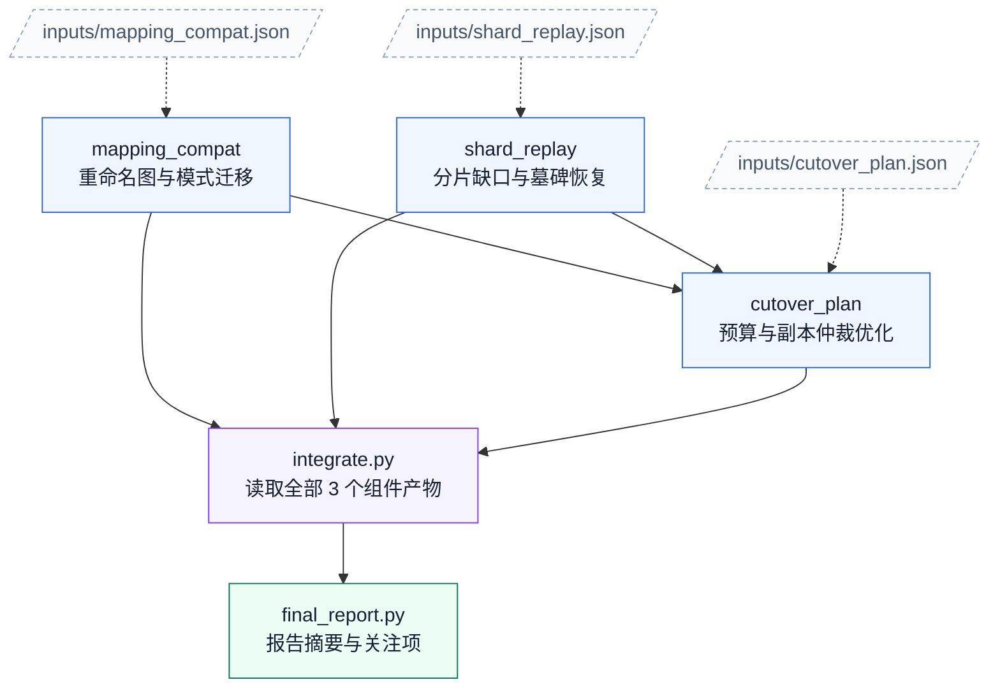

# 12. 搜索索引重建

任务：`context8/search_index_rebuild`；[任务说明](../../tasks/context8/search_index_rebuild/TASK.md) · [工作区说明](../../tasks/context8/search_index_rebuild/workspace/README.md)。

核心组件 **3**；执行节点 **5**；最大独立宽度 **2**；最早分层 **2 → 1 → 1 → 1**。

[PNG](search_index_rebuild.png) · [SVG](search_index_rebuild.svg) · [Mermaid 源码](search_index_rebuild.mmd) · [完整边表与契约摘要](search_index_rebuild.json) · [图集目录](README.md)

## 完整依赖图（含输入文件）

虚线连接输入文件，实线为全部直接执行依赖；因此比上方传递约简图多出冗余但真实的读取边。

## 组件与输入接口

- `mapping_compat`：重命名图与模式迁移；输入 `inputs/mapping_compat.json`；输出 `outputs/mapping_compat.json`。

- `shard_replay`：分片缺口与墓碑恢复；输入 `inputs/shard_replay.json`；输出 `outputs/shard_replay.json`。

- `cutover_plan`：预算与副本仲裁优化；输入 `inputs/cutover_plan.json`、`outputs/mapping_compat.json`、`outputs/shard_replay.json`；输出 `outputs/cutover_plan.json`。

## 边的校验说明

完整执行边 6 条；传递约简后 4 条。两者传递闭包完全相同，所有执行节点都能到达最终报告。

本图只描述逻辑组件与文件接口，不要求代理按固定调度器运行；实际实现可以在满足依赖的前提下串行或并行。
