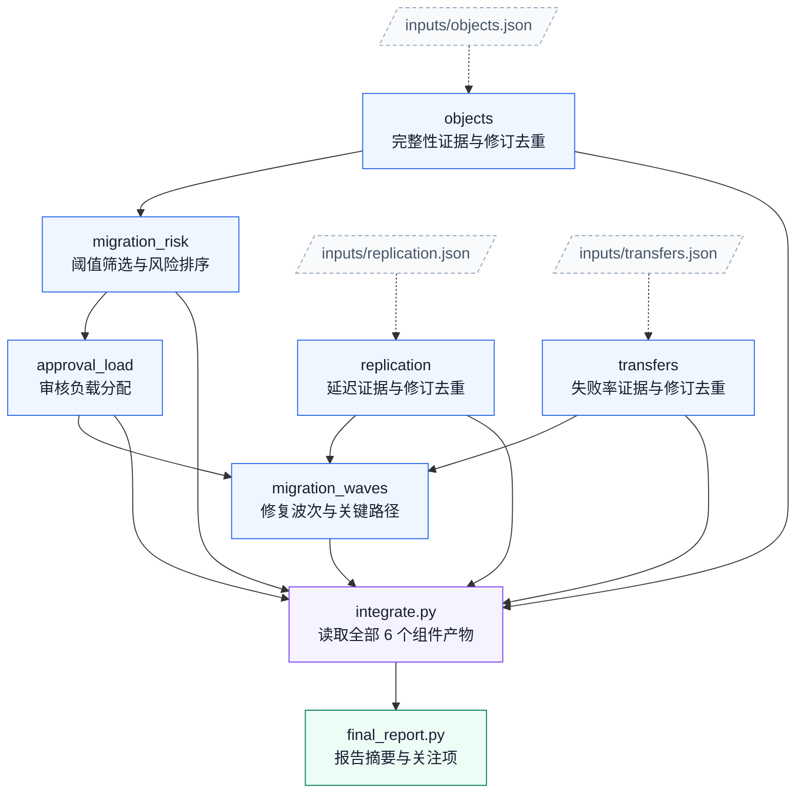

# 04. 存储分层迁移

任务：`multistage4/storage_tiering_migration`；[任务说明](../../tasks/multistage4/storage_tiering_migration/TASK.md) · [工作区说明](../../tasks/multistage4/storage_tiering_migration/workspace/README.md)。

核心组件 **6**；执行节点 **8**；最大独立宽度 **3**；最早分层 **3 → 1 → 1 → 1 → 1 → 1**。

[PNG](storage_tiering_migration.png) · [SVG](storage_tiering_migration.svg) · [Mermaid 源码](storage_tiering_migration.mmd) · [完整边表与契约摘要](storage_tiering_migration.json) · [图集目录](README.md)

## 完整依赖图（含输入文件）

虚线连接输入文件，实线为全部直接执行依赖；因此比上方传递约简图多出冗余但真实的读取边。

## 组件与输入接口

- `domains/objects`：完整性证据与修订去重；输入 `inputs/objects.json`；输出 `outputs/objects.json`。

- `domains/replication`：延迟证据与修订去重；输入 `inputs/replication.json`；输出 `outputs/replication.json`。

- `domains/transfers`：失败率证据与修订去重；输入 `inputs/transfers.json`；输出 `outputs/transfers.json`。

- `views/migration_risk`：阈值筛选与风险排序；输入 `outputs/objects.json`；输出 `outputs/migration_risk.json`。

- `views/approval_load`：审核负载分配；输入 `outputs/migration_risk.json`；输出 `outputs/approval_load.json`。

- `views/migration_waves`：修复波次与关键路径；输入 `outputs/replication.json`、`outputs/transfers.json`、`outputs/approval_load.json`；输出 `outputs/migration_waves.json`。

## 边的校验说明

完整执行边 12 条；传递约简后 7 条。两者传递闭包完全相同，所有执行节点都能到达最终报告。

本图只描述逻辑组件与文件接口，不要求代理按固定调度器运行；实际实现可以在满足依赖的前提下串行或并行。
