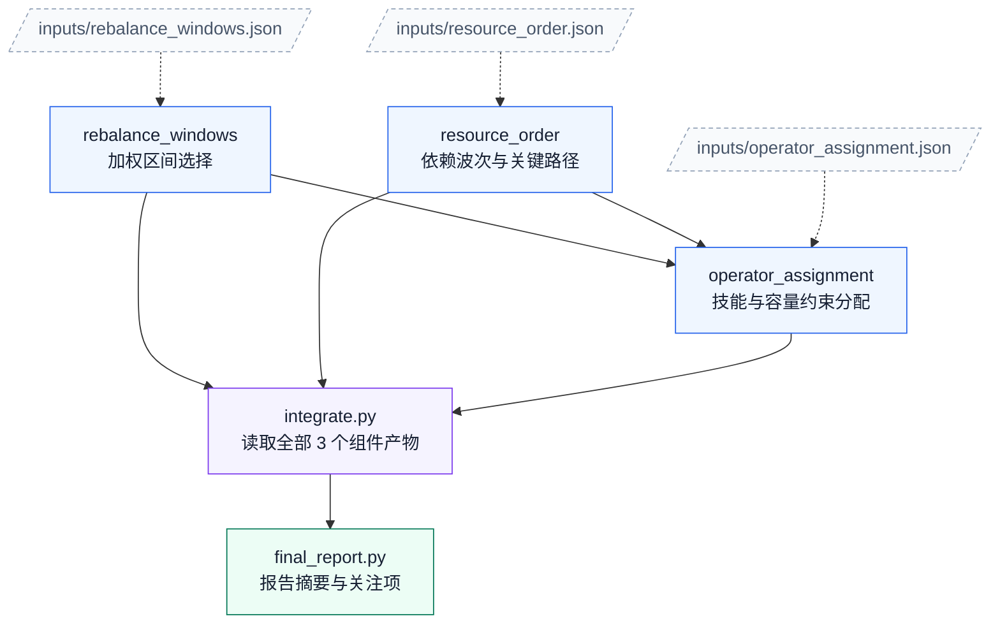

# 06. 租户配额再平衡

任务：`reasoning4/tenant_quota_rebalance`；[任务说明](../../tasks/reasoning4/tenant_quota_rebalance/TASK.md) · [工作区说明](../../tasks/reasoning4/tenant_quota_rebalance/workspace/README.md)。

核心组件 **3**；执行节点 **5**；最大独立宽度 **2**；最早分层 **2 → 1 → 1 → 1**。

[PNG](tenant_quota_rebalance.png) · [SVG](tenant_quota_rebalance.svg) · [Mermaid 源码](tenant_quota_rebalance.mmd) · [完整边表与契约摘要](tenant_quota_rebalance.json) · [图集目录](README.md)

## 完整依赖图（含输入文件）

虚线连接输入文件，实线为全部直接执行依赖；因此比上方传递约简图多出冗余但真实的读取边。

## 组件与输入接口

- `engines/rebalance_windows`：加权区间选择；输入 `inputs/rebalance_windows.json`；输出 `outputs/rebalance_windows.json`。

- `engines/resource_order`：依赖波次与关键路径；输入 `inputs/resource_order.json`；输出 `outputs/resource_order.json`。

- `engines/operator_assignment`：技能与容量约束分配；输入 `inputs/operator_assignment.json`、`outputs/rebalance_windows.json`、`outputs/resource_order.json`；输出 `outputs/operator_assignment.json`。

## 边的校验说明

完整执行边 6 条；传递约简后 4 条。两者传递闭包完全相同，所有执行节点都能到达最终报告。

本图只描述逻辑组件与文件接口，不要求代理按固定调度器运行；实际实现可以在满足依赖的前提下串行或并行。
