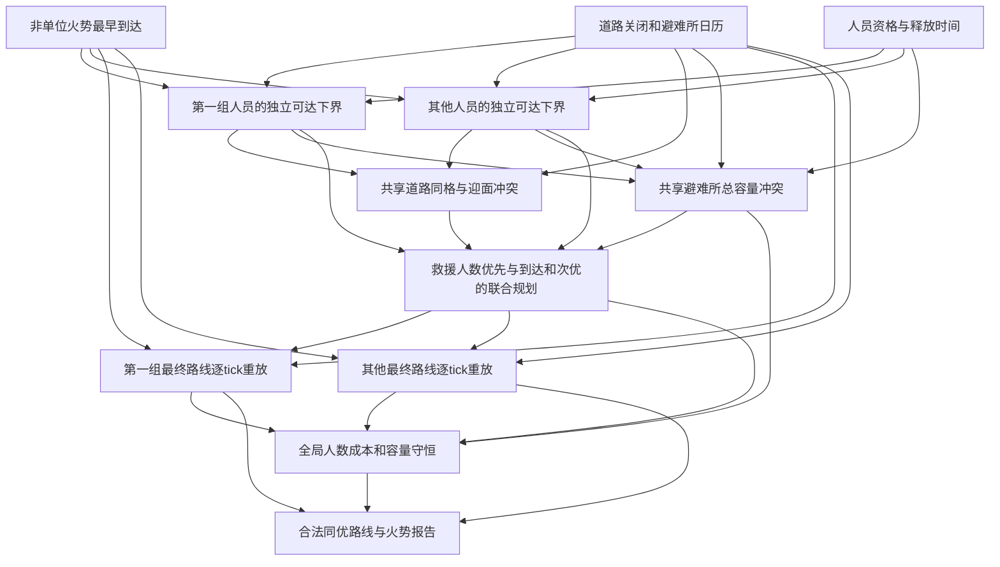

# E112　共享道路与有资格避难所的全局撤离

格式：context8；来源族：`dag300new112-wildfire-evacuation-grid`。

来源性质：DAG300本地原型启发/改编；原始模型难度未登记，不能把参考解Oracle通过当成源题易/中/难。
[来源原始声明与SHA](../../datasets/parallel-medium-calibrated-native-evacuation/author/E112/provenance.json) · [完整业务规格](../../datasets/parallel-medium-calibrated-native-evacuation/tasks/context8/joint-hazard-evacuation/workspace/packages/analysis/SPEC.md)

A/S/C/I：2/0/2/0，结构 **H**；固定基线五次实测 **M**，严格 **3/5**。
[测前评审原文](../../_authoring/history/medium-native-evacuation-20261112/测前设计与来源.md) · [测前评审元数据](../../_authoring/history/medium-native-evacuation-20261112/asci-review.json)

评审原文给出算法、状态、分支汇合和最小反例；早期四轴从原文提取，后期使用冻结元数据。结构档和实测档分别保存。

五次公开通过5/5，核心转换用例54/60，平均reward 1.475000/2。
严格通过要求该题全部冻结验收及完整性交付通过；核心转换用例通过率单独报告。

五次明细：r1 失败，reward=0.625；r2 通过，reward=2.0；r3 失败，reward=0.75；r4 通过，reward=2.0；r5 通过，reward=2.0。

[100次原始评分索引](../results/index.json) · [本题五次原始收据](../../datasets/parallel-medium-calibrated-native-evacuation/author/E112/five-runs.json)

核心失败接纳依据：Five fresh trials yield3/5 strict and5/5 public, with54/60 core cases. Both failed trials have evidenced core search-complexity failures within the fixed normal domain: r1 recursively enumerates joint full path histories; r3 enumerates independent routes and their Cartesian products. Their original formal timeouts are retained, never replayed. On the same9–12 inputs a trusted conflict-based reference solves in0.0002–0.0003 seconds at2CPU/3072MiB; the independent pretest multicommodity MILP agrees. The last instance has1,276,007,040 unpruned independent complete-route combinations for four people. No mathematical error is claimed for small cases; medium is conditional on the frozen algorithm-execution budget, not a universal hardness claim. No peripheral boundary, file-contract or import failure supports this label.

[作者侧SVG](../../docs/dags/E112.svg) · [Mermaid源码](../../docs/dags/E112.mmd)

DAG为作者的潜在业务/算法分解；未给Agent，不是唯一开发顺序，也不代表已实测多Agent加速。
