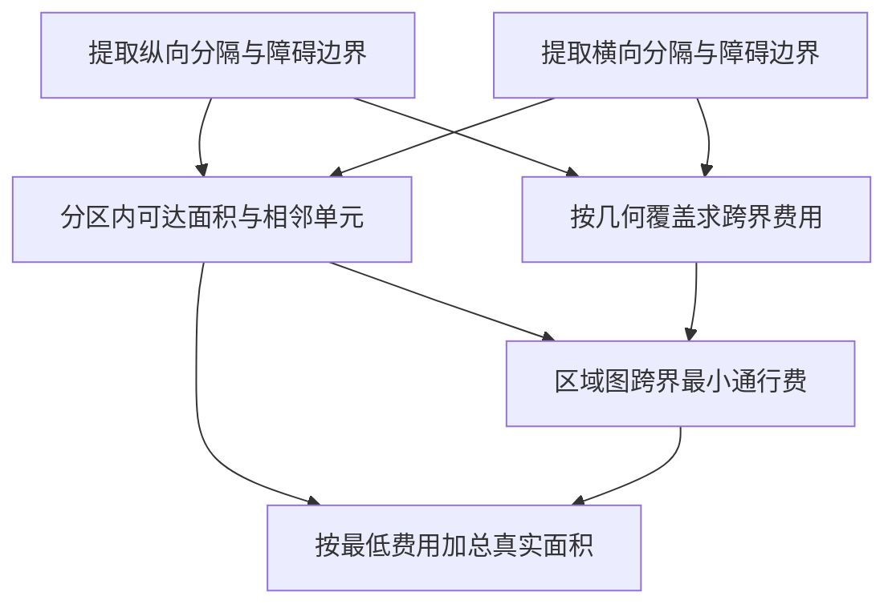

# F15　分隔平面的最低通行费面积

格式：reasoning4；来源族：`dag300new66-polygon-overlay`。

来源性质：DAG300本地原型启发/改编；原始模型难度未登记，不能把参考解Oracle通过当成源题易/中/难。
[来源原始声明与SHA](../../datasets/parallel-medium-calibrated-core-next/author/F15/provenance.json) · [完整业务规格](../../datasets/parallel-medium-calibrated-core-next/tasks/reasoning4/partition-access/workspace/engines/analysis/SPEC.md)

A/S/C/I：1/0/2/1，结构 **M**；固定基线五次实测 **M**，严格 **2/5**。
[测前评审原文](../../_authoring/history/medium-core-next-20261112/测前结构与预估.md) · [测前评审元数据](../../_authoring/history/medium-core-next-20261112/asci-review.json)

评审原文给出算法、状态、分支汇合和最小反例；早期四轴从原文提取，后期使用冻结元数据。结构档和实测档分别保存。

五次公开通过5/5，核心转换用例38/60，平均reward 1.025000/2。
严格通过要求该题全部冻结验收及完整性交付通过；核心转换用例通过率单独报告。

五次明细：r1 失败，reward=0.125；r2 失败，reward=0.6875；r3 失败，reward=0.3125；r4 通过，reward=2.0；r5 通过，reward=2.0。

[100次原始评分索引](../results/index.json) · [本题五次原始收据](../../datasets/parallel-medium-calibrated-core-next/author/F15/five-runs.json)

核心失败接纳依据：五次严格通过 2/5，后两次在相同预算下完整通过。第一份错解把四坐标障碍矩形当成单个点，3×2 普通地面本应计 5 格，却计成 6 格。第二次小坐标九例全部正确，但对实际单位格建立集合和距离表，三个等比例大坐标输入均以 process 失败；缩小坐标后的费用分区完全相同，面积按比例平方恢复，与冻结答案一致。第三次还把免费门当成关闭门，并在关闭门的 null 费用上报类型错误。这些都是正常通行、面积或求解规模的业务问题，未增加非核心边界检查。

[作者侧SVG](../../docs/dags/F15.svg) · [Mermaid源码](../../docs/dags/F15.mmd)

DAG为作者的潜在业务/算法分解；未给Agent，不是唯一开发顺序，也不代表已实测多Agent加速。
