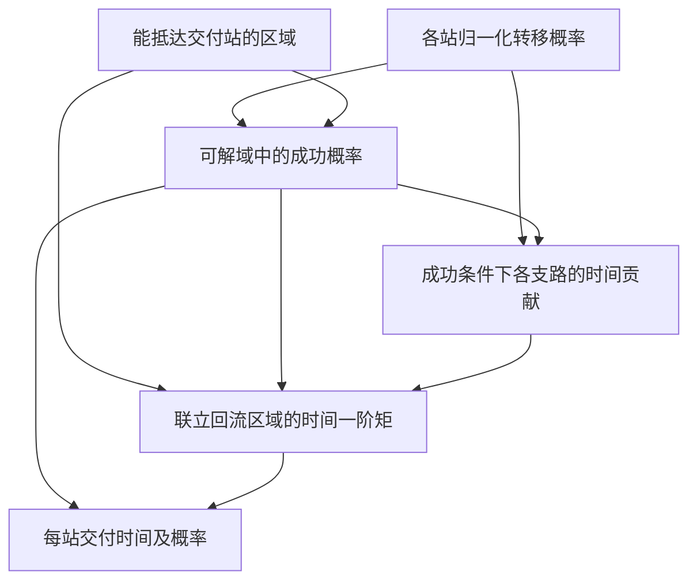

# F18　带回流与停滞分支的交付时间

格式：context8；来源族：`capstone-original-conditional-delivery`。

来源性质：项目自编；原始模型难度未登记，不能把参考解Oracle通过当成源题易/中/难。
[来源原始声明与SHA](../../datasets/parallel-medium-calibrated-core-next/author/F18/provenance.json) · [完整业务规格](../../datasets/parallel-medium-calibrated-core-next/tasks/context8/conditional-delivery/workspace/packages/analysis/SPEC.md)

A/S/C/I：1/0/2/1，结构 **M**；固定基线五次实测 **M**，严格 **3/5**。
[测前评审原文](../../_authoring/history/medium-core-next-20261112/测前结构与预估.md) · [测前评审元数据](../../_authoring/history/medium-core-next-20261112/asci-review.json)

评审原文给出算法、状态、分支汇合和最小反例；早期四轴从原文提取，后期使用冻结元数据。结构档和实测档分别保存。

五次公开通过5/5，核心转换用例38/60，平均reward 1.250000/2。
严格通过要求该题全部冻结验收及完整性交付通过；核心转换用例通过率单独报告。

五次明细：r1 通过，reward=2.0；r2 通过，reward=2.0；r3 失败，reward=0.125；r4 通过，reward=2.0；r5 失败，reward=0.125。

[100次原始评分索引](../results/index.json) · [本题五次原始收据](../../datasets/parallel-medium-calibrated-core-next/author/F18/five-runs.json)

核心失败接纳依据：五次严格通过 3/5，公开检查 5/5。第三、第五次在正常的闭环物流网络上均报奇异线性方程错误。只需两个站点，其中一个自循环且到不了成功收件点，即可复现两份提交的 ValueError；正确结果为该站成功概率零、成功条件下时长为空。任务明确包含永久回流分支。11 个正式输入的同类错误共享这一根因，未当作 11 种独立难点。两次均直接影响核心转换，未触发资源预算或基础设施排除。

[作者侧SVG](../../docs/dags/F18.svg) · [Mermaid源码](../../docs/dags/F18.mmd)

DAG为作者的潜在业务/算法分解；未给Agent，不是唯一开发顺序，也不代表已实测多Agent加速。
