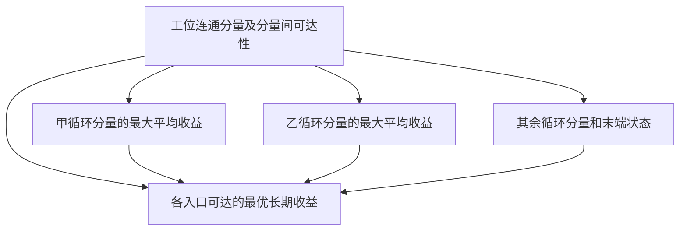

# F20　生产循环的可持续单位产出

格式：context8；来源族：`capstone-original-sustainable-yield`。

来源性质：项目自编；原始模型难度未登记，不能把参考解Oracle通过当成源题易/中/难。
[来源原始声明与SHA](../../datasets/parallel-medium-calibrated-core-next/author/F20/provenance.json) · [完整业务规格](../../datasets/parallel-medium-calibrated-core-next/tasks/context8/sustainable-yield/workspace/packages/analysis/SPEC.md)

A/S/C/I：1/0/2/0，结构 **M**；固定基线五次实测 **M**，严格 **2/5**。
[测前评审原文](../../_authoring/history/medium-core-next-20261112/测前结构与预估.md) · [测前评审元数据](../../_authoring/history/medium-core-next-20261112/asci-review.json)

评审原文给出算法、状态、分支汇合和最小反例；早期四轴从原文提取，后期使用冻结元数据。结构档和实测档分别保存。

五次公开通过4/5，核心转换用例26/60，平均reward 0.850000/2。
严格通过要求该题全部冻结验收及完整性交付通过；核心转换用例通过率单独报告。

五次明细：r1 失败，reward=0.125；r2 失败，reward=0.125；r3 失败，reward=0.0；r4 通过，reward=2.0；r5 通过，reward=2.0。

[100次原始评分索引](../results/index.json) · [本题五次原始收据](../../datasets/parallel-medium-calibrated-core-next/author/F20/five-runs.json)

核心失败接纳依据：五次严格通过 2/5。第一份失败把不同有限进路的收益混入循环平均值，在三状态例子中将真实零收益报成 3/2。第二份虽正确拆分强连通分量，仍把 Karp 公式中的内层下界算成最大值；只有两个状态、循环均值分别为 0、4、5 的普通图便会被报成 6 或 10。另一次触及原 200 万累计观测 token 预算，作为预算失败单列，保留零分。两份正常结束的业务错解足以说明核心问题，预算截止既未排除也未重试。

[作者侧SVG](../../docs/dags/F20.svg) · [Mermaid源码](../../docs/dags/F20.mmd)

DAG为作者的潜在业务/算法分解；未给Agent，不是唯一开发顺序，也不代表已实测多Agent加速。
