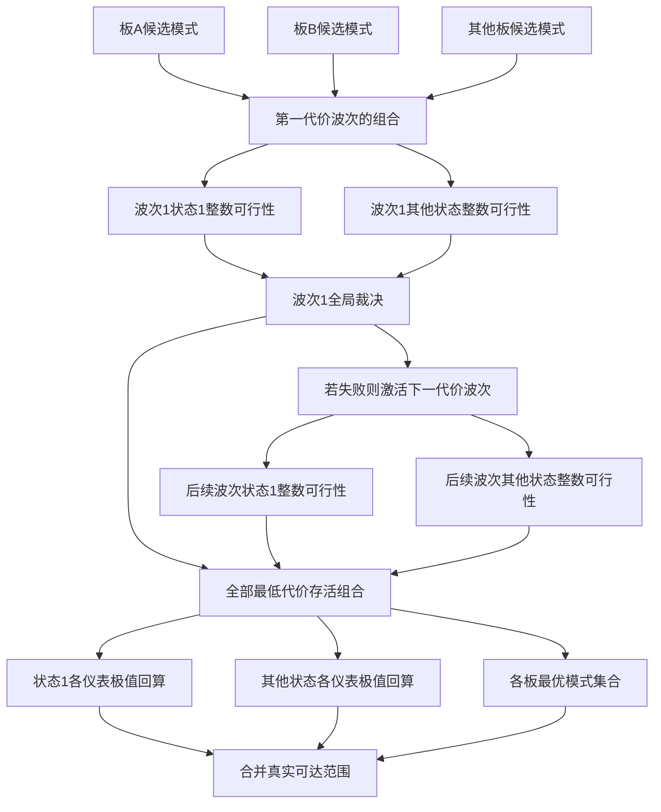

# I06　共享校准与整数装配的中等规模对照

格式：context8；来源族：`dag300new140-cad-tolerance-stackup`。

来源性质：DAG300本地原型启发/改编；原始模型难度未登记，不能把参考解Oracle通过当成源题易/中/难。
[来源原始声明与SHA](../../datasets/parallel-medium-calibrated-native-lattice-scale/author/I06/provenance.json) · [完整业务规格](../../datasets/parallel-medium-calibrated-native-lattice-scale/tasks/context8/shared-integer-calibration-scale/workspace/packages/analysis/SPEC.md)

A/S/C/I：2/0/2/1，结构 **H**；固定基线五次实测 **M**，严格 **3/5**。
[测前评审原文](../../_authoring/history/medium-native-lattice-scale-20261112/测前设计与来源.md) · [测前评审元数据](../../_authoring/history/medium-native-lattice-scale-20261112/asci-review.json)

评审原文给出算法、状态、分支汇合和最小反例；早期四轴从原文提取，后期使用冻结元数据。结构档和实测档分别保存。

五次公开通过5/5，核心转换用例58/60，平均reward 1.550000/2。
严格通过要求该题全部冻结验收及完整性交付通过；核心转换用例通过率单独报告。

五次明细：r1 通过，reward=2.0；r2 通过，reward=2.0；r3 失败，reward=0.8125；r4 通过，reward=2.0；r5 失败，reward=0.9375。

[100次原始评分索引](../results/index.json) · [本题五次原始收据](../../datasets/parallel-medium-calibrated-native-lattice-scale/author/I06/five-runs.json)

核心失败接纳依据：Five fresh trials yield3/5 strict,5/5 public and58/60 core cases. r3 loses attainable extrema: an ordinary two-datum example with x,y in[0,1] and gauge x+y should return[0,2], but the original read-only artifact returns[2,2] because its range accumulator remains locally None and is repeatedly overwritten. r5 exceeds the frozen90-second API budget on the normal1,679,616-state maximum case; original180-second integration already passes. A trusted exact reference solves that same case in0.00529 seconds at2CPU/3072MiB. The formal timeout was not rerun and is not claimed to be a wrong mathematical answer. The first11 samples remain byte-equivalent at the vector level; all algorithms/topology are retained. This is disclosed development scale calibration, not a paired causal experiment or a rewrite of I05 H1/5. One source140 family is admitted once.

[作者侧SVG](../../docs/dags/I06.svg) · [Mermaid源码](../../docs/dags/I06.mmd)

DAG为作者的潜在业务/算法分解；未给Agent，不是唯一开发顺序，也不代表已实测多Agent加速。
